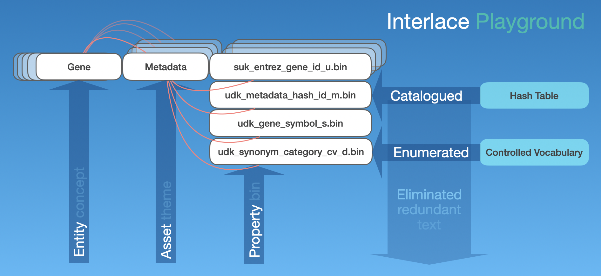

###### October 26, 2026: interlace-do readme v4

# interlace-do

Welcome to **interlace-do**! Interlace Go toolset and usage with the **interlace-ex** Gene data playground.



## Contents

1) [Introduction](#1-introduction)
2) [Download and Install Go](#2-download-and-install-go)
3) [Declare Your Interlace Codebase Path](#3-declare-your-interlace-codebase-path)
4) [Create Your Interlace Codebase Directory](#4-create-your-interlace-codebase-directory)
5) [Clone the interlace-do Repository](#5-clone-the-interlace-do-repository)
6) [Check the Makefile](#6-check-the-makefile)
7) [Build the Toolchain](#7-build-the-toolchain)
8) [Make Install](#8-make-install)
9) [Cleanup](#9-cleanup)
10) [License & Legal Notice](#10-license--legal-notice)
11) [Support and Commercial SLAs](#11-support-and-commercial-slas)

### 1. Introduction

Both the **interlace-ex** [Gene data stack](https://github.com/sas-quantome/interlace-ex) and the **interlace-do** [toolset](cmd) use the **interlace-go** [library](https://github.com/sas-quantome/interlace-go) to build their CLI applications.

Once you build the [Gene data stack](https://github.com/sas-quantome/interlace-ex) with **interlace-ex**, you can use the **interlace-do** application [a32004](cmd/a32004) to learn how to search for and retrieve data from any **Interlace Asset**. This application offers a tutorial with more than 40 command-line examples to help you understand how data is organized and accessed. You will also find other applications in the [cmd](cmd) folder, such as tools to create **Interlace Assets** from tab-delimited or DNA sequence FASTA files.

### 2. Download and Install Go

Download and install Go from [https://go.dev/doc/install](https://go.dev/doc/install). It takes less than 5 minutes to complete!

### 3. Declare Your Interlace Codebase Path

Declare a place where to clone the GitHub repositories the standard way somewhere in your computer. Include the `sas-quantome` directory to store multiple Interlace repositories:
```bash
REPO_PATH="${HOME}/github.com/sas-quantome"
```

### 4. Create Your Interlace Codebase Directory
Create the directory:
```bash
mkdir -p "${REPO_PATH}"
```

### 5. Clone the interlace-do Repository
Clone the repository in the `sas-quantome` folder:
```bash
cd "${REPO_PATH}"
git clone https://github.com/sas-quantome/interlace-do.git
```

### 6. Check the Makefile
Review the Makefile and then run the following commands:
```bash
cd "${REPO_PATH}/interlace-do"
make help
```

### 7. Build the Toolchain
If all is well in your installation, you will find the compiled products in the `bin` folder:
```bash
cd "${REPO_PATH}/interlace-do"
make build
```

### 8. Make Install
Compile the software and install the binaries, you will find them in your `$GOPATH/bin`:
```bash
cd "${REPO_PATH}/interlace-do"
make install
```

### 9. Cleanup
Remove the `bin` folder:
```bash
cd "${REPO_PATH}/interlace-do"
make clean
```

### 10. License & Legal Notice

This project is licensed under the **Apache License 2.0**.

* **Permissive Reuse:** You are free to modify, distribute, and use this software in your own commercial or private applications.
* **No Lock-In:** Your downstream solutions remain entirely your own.
* **As-Is Basis:** Per Sections 7 and 8 of the Apache 2.0 License, this software is provided strictly on an "AS IS" BASIS, WITHOUT WARRANTIES OR CONDITIONS OF ANY KIND.

For full details, please review the [LICENSE](LICENSE) and [NOTICE](NOTICE) files in the root of this repository.

### 11. Support and Commercial SLAs

This repository is an **open-source transparency initiative** and does not come with a dedicated maintenance or support SLA.

Bug reports and feature suggestions can be submitted via GitHub Issues.

If your organization requires guaranteed technical support, custom feature development, or integration assistance, please contact your account manager or reach out via [www.sas-quantome.com](https://www.sas-quantome.com).

***
*&copy; 2026, Société par Actions Simplifiée Quantome, Paris 75014, France. All rights reserved.*
