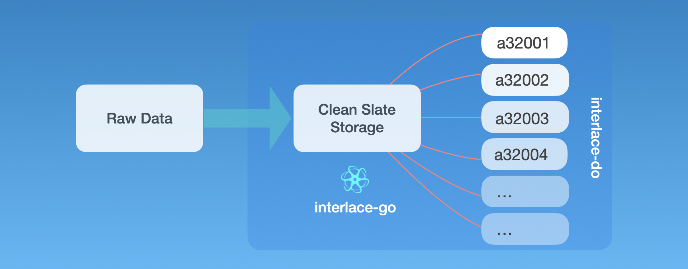

###### September 14, 2026: interlace-do cmd readme v2

# CMD

## Contents

| AppID    | Dependencies | Application Aim                                                             |
|----------|--------------|-----------------------------------------------------------------------------|
| [a32001] |              | `Creates` a **Metadata & Synonym** assets from a TSV file.                  |
| [a32002] |              | `Inserts` a data property relation from another asset.                      |
| [a32003] |              | `Creates` a **DNA** asset from a nucleic acid FASTA file.                   |
| [a32004] |              | `Fetches` data from an asset.                                               |

[a32001]: ./a32001/README.md
[a32002]: ./a32002/README.md
[a32003]: ./a32003/README.md
[a32004]: ./a32004/README.md
