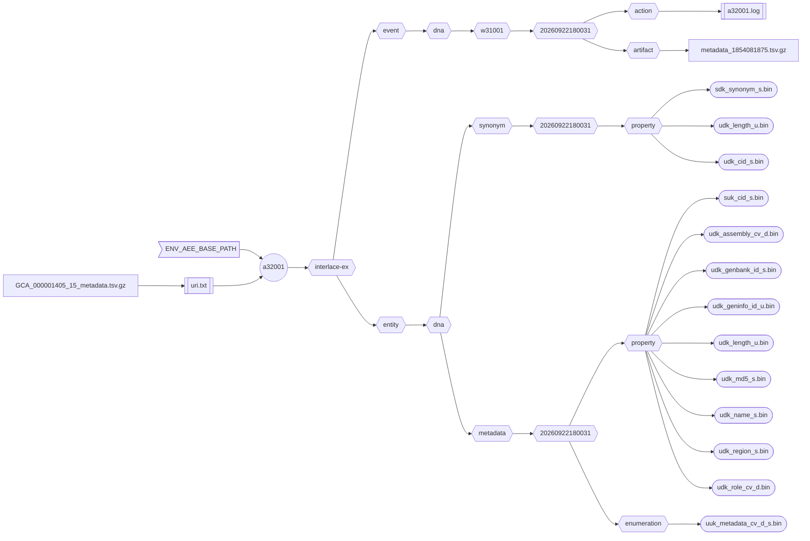

###### September 21, 2026: interlace-do cmd a32001 readme v2

# [a32001]

Creates a *Metadata Asset* with an optional *Synonym Asset* from a single TSV file.



##### Diagram Legend

- ⬡ **Hexagons:** Interlace folder hierarchy
- ◯ **Circles:** Interlace Go applications
- 𓉴 **Flags:** Environment variables
- 𓋰 **Ovals:** Interlace binary files
- 𓈙 **Rectangles:** | Raw data files | or || configuration/log files ||

An **interlace-go** *Metadata Asset* (e.g., a table) describes *Interlace Entity* data samples, separate from its content, to help identify uniqueness. For example, entity concepts such as a gene or a disease have a name, synonyms, a description, and a unique identifier as a bare minimum. To handle different naming conventions, the *Metadata Asset* is normally linked with a *Synonym Asset*. 

This README file describes how to build the **Metadata** and **Synonym** assets using the human genome reference sequence metadata. The tab-delimited data below is an input example.

```tsv
suk_cid_s	udk_length_u	udk_name_s/syn	udk_genbank_id_s/syn	udk_geninfo_id_u/syn	udk_region_s	udk_role_cv_d	udk_md5_s	udk_assembly_cv_d
	248956422	chr1	CM000663.2	568336023	chr1	Chromosome	6aef897c3d6ff0c78aff06ac189178dd	GRCh38
	242193529	chr2	CM000664.2	568336022	chr2	Chromosome	f98db672eb0993dcfdabafe2a882905c	GRCh38
	198295559	chr3	CM000665.2	568336021	chr3	Chromosome	76635a41ea913a405ded820447d067b0	GRCh38
	190214555	chr4	CM000666.2	568336020	chr4	Chromosome	3210fecf1eb92d5489da4346b3fddc6e	GRCh38
	181538259	chr5	CM000667.2	568336019	chr5	Chromosome	a811b3dc9fe66af729dc0dddf7fa4f13	GRCh38
	170805979	chr6	CM000668.2	568336018	chr6	Chromosome	5691468a67c7e7a7b5f2a3a683792c29	GRCh38
	159345973	chr7	CM000669.2	568336017	chr7	Chromosome	cc044cc2256a1141212660fb07b6171e	GRCh38
	145138636	chr8	CM000670.2	568336016	chr8	Chromosome	c67955b5f7815a9a1edfaa15893d3616	GRCh38
	138394717	chr9	CM000671.2	568336015	chr9	Chromosome	6c198acf68b5af7b9d676dfdd531b5de	GRCh38
	133797422	chr10	CM000672.2	568336014	chr10	Chromosome	c0eeee7acfdaf31b770a509bdaa6e51a	GRCh38
```

- The column names become the name of the **interlace-go** binary file with the specified data type.
- The first column is reserved for the unique ID and must appear a single time.
- When assigning a unique CID automatically, the first column is left empty and named: `suk_cid_s`.
- The `/syn` instructs the program to index the selected feature in the *Synonym Asset*.
- If synonym features are not selected, the *Synonym Asset* is not created.

## Contents

1) [Help Page](#1-help-page)
2) [URI Input File](#2-uri-input-file)
3) [Requirements](#3-requirements)
4) [Environment Variables](#4-environment-variables)
5) [Command Line Example](#5-command-line-example)
6) [Log Example](#6-log-example)
7) [Output Example](#7-output-example)

### 1. Help Page

The help page is available with the `-help` option or when no arguments are provided.

```text
Project: interlace-do
AppName: a32001
Version: beta_2026_09_12_2
Purpose: creates Metadata and Synonym assets from a TSV file.

Sources:

  1) METADATA_TSV

Options:

  -base-concept string
    	Base concept ontology term to name the entity folder
  -base-path string
    	Agent, event, and entity base path (default "/Users/foglio/interlace-ex")
  -config string
    	Config file (optional)
  -data-path string
    	Data path where to read and download files (default "/Users/foglio/interlace-ex/data")
  -event-time-tag string
    	Event time tag (required) (default "20260921123901")
  -help
    	Displays this help page
  -log string
    	Logfile path to write stderr & stdout regardless of the -silent flag (default no log file)
  -loud
    	Writes additional information if available
  -no-commit
    	Disables committing the work
  -no-delete
    	Disables deleting the artifact files
  -no-download
    	Disables downloading data when necessary
  -silent
    	Suppresses all standard output messages
  -uri-inp-file string
    	URI list of URL, mailto, telnet, absolute-file-path#key (unique key as URI fragment), etc.
  -workflow-id string
    	Workflow ID (default "w32001")
```

### 2. URI Input File

- Example:

```text
file:///Users/foglio/interlace-ex/data/GCA_000001405_15_metadata.tsv.gz#METADATA_TSV
```

- The provided data is created from the FASTA file: GCA_000001405.15_GRCh38_full_plus_hs38d1_analysis_set.fna.gz
- Update the URI input file to include your local path.

### 3. Requirements

- Base path from the `-base-path` option or the environmental-variable `ENV_AEE_BASE_PATH`
- URI list containing URLs and full-path file sources.

### 4. Environment Variables

```shell
ENV_AEE_BASE_PATH="${HOME}/interlace-ex"
```

### 5. Command Line Example

```shell
a32001 -log a32001.log -uri-inp-file uri.txt
```

## 6. Log Example

```text
Inf: 2026/09/22 18:00:31.084658 application name: a32001
Inf: 2026/09/22 18:00:31.084700 application version: beta_2026_09_12_3
Inf: 2026/09/22 18:00:31.084720 application module: interlace-do
Inf: 2026/09/22 18:00:31.084746 application aim: creates Metadata and Synonym assets from a TSV file.
Inf: 2026/09/22 18:00:31.084757 application start time tag: 20260922180031
Inf: 2026/09/22 18:00:31.084765 listing configuration variables ...
Inf: 2026/09/22 18:00:31.084774 APP_REVISION: 3
Inf: 2026/09/22 18:00:31.084782 BASE_CONCEPT: dna
Inf: 2026/09/22 18:00:31.084790 BASE_PATH: /Users/foglio/interlace-ex
Inf: 2026/09/22 18:00:31.084797 DATA_PATH: /Users/foglio/interlace-ex/data
Inf: 2026/09/22 18:00:31.084804 ENV_AEE_BASE_PATH: /Users/foglio/interlace-ex
Inf: 2026/09/22 18:00:31.084812 ENV_ALT_DATA_PATH: /Users/foglio/interlace-ex/data
Inf: 2026/09/22 18:00:31.084822 EVENT_TIME_TAG: 20260922180031
Inf: 2026/09/22 18:00:31.084829 HOME: /Users/foglio
Inf: 2026/09/22 18:00:31.084836 LOG_OUTPUT_FILE: a32001.log
Inf: 2026/09/22 18:00:31.084843 URI_INP_FILE: uri.txt
Inf: 2026/09/22 18:00:31.084850 USER_LOGIN_NAME: foglio
Inf: 2026/09/22 18:00:31.084858 USER_NAME: Mario Foglio
Inf: 2026/09/22 18:00:31.084865 WORKFLOW_ID: w32001
Inf: 2026/09/22 18:00:31.084872 setting up the Metadata refiner ...
Inf: 2026/09/22 18:00:31.085818 configured file[METADATA_TSV]=/Users/foglio/interlace-ex/data/GCA_000001405_15_metadata.tsv.gz
Inf: 2026/09/22 18:00:31.085832 creating the metadata asset ...
Inf: 2026/09/22 18:00:31.097991 total metadata lines read: 2842
Inf: 2026/09/22 18:00:31.098004 total metadata table rows examined: 2841
Inf: 2026/09/22 18:00:31.098012 total metadata tuples created: 2841
Inf: 2026/09/22 18:00:31.098741 /Users/foglio/interlace-ex/event/dna/w32001/20260922180031/artifact/metadata_2129841620.tsv.gz size: 292239
Inf: 2026/09/22 18:00:31.143315 setting up the Synonym refiner ...
Inf: 2026/09/22 18:00:31.143725 configured file[METADATA_TSV]=/Users/foglio/interlace-ex/data/GCA_000001405_15_metadata.tsv.gz
Inf: 2026/09/22 18:00:31.143737 creating the metadata synonym asset ...
Inf: 2026/09/22 18:00:31.143744 total metadata synonym identifiers collected: 11364
Inf: 2026/09/22 18:00:31.206234 total metadata synonym tuples created: 11364
Inf: 2026/09/22 18:00:31.206259 number of warnings caught: 0
Inf: 2026/09/22 18:00:31.206267 elapsed time just before closing: 122.176917ms
Inf: 2026/09/22 18:00:31.206273 end of process: complete
```

## 7. Output Example

```text
interlace-ex/entity/dna
├── metadata
│   └── 20260922180031
│       ├── catalog
│       ├── enumeration
│       │   └── uuk_metadata_cv_d_s.bin
│       └── property
│           ├── suk_cid_s.bin
│           ├── udk_assembly_cv_d.bin
│           ├── udk_genbank_id_s.bin
│           ├── udk_geninfo_id_u.bin
│           ├── udk_length_u.bin
│           ├── udk_md5_s.bin
│           ├── udk_name_s.bin
│           ├── udk_region_s.bin
│           └── udk_role_cv_d.bin
└── synonym
    └── 20260922180031
        ├── catalog
        ├── enumeration
        └── property
            ├── sdk_synonym_s.bin
            ├── udk_cid_s.bin
            └── udk_length_u.bin
            
interlace-ex/event/dna
└── w32001
    └── 20260922180031
        ├── action
        │   └── 20260922180031_a32001.log
        ├── artifact
        └── function
```

[a32001]: ../../internal/app/a32001
