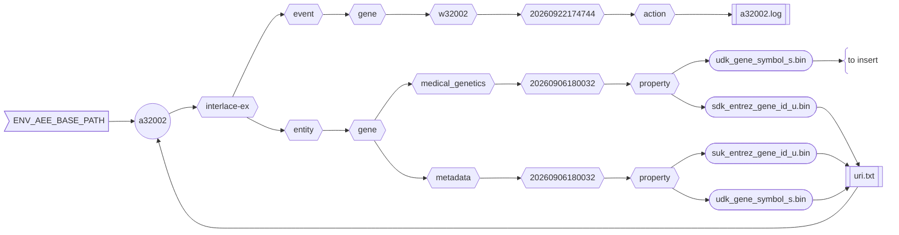

###### September 22, 2026: interlace-do cmd a32002 readme v1

# [a32002]

Inserts data from one asset to another.



##### Diagram Legend

- ⬡ **Hexagons:** Interlace folder hierarchy
- ◯ **Circles:** Interlace Go applications
- 𓉴 **Flags:** Environment variables
- 𓋰 **Ovals:** Interlace binary files
- 𓈙 **Rectangles:** | Raw data files | or || configuration/log files ||

## Contents

1) [Help Page](#1-help-page)
2) [URI Input File](#2-uri-input-file)
3) [Requirements](#3-requirements)
4) [Environment Variables](#4-environment-variables)
5) [Command Line Example](#5-command-line-example)
6) [Log Example](#6-log-example)
7) [Output Example](#7-output-example)

### 1. Help Page

The help page is available with the `-help` option or when no arguments are provided.

```text
Project: interlace-do
AppName: a32002
Version: beta_2026_09_12_2
Purpose: inserts data from one asset to another.

Sources:

  1) QRY_INP_FILE
  2) KEY_INP_FILE
  3) VAL_INP_FILE

Options:

  -asset-name string
    	lowercased asset name comma-delimited if more than one
  -base-concept string
    	Base concept ontology term to name the entity folder
  -base-path string
    	Agent, event, and entity base path (default "/Users/foglio/interlace-ex")
  -config string
    	Config file (optional)
  -data-path string
    	Data path where to read and download files (default "/Users/foglio/interlace-ex/data")
  -event-time-tag string
    	Event time tag (required) (default "20260922171922")
  -help
    	Displays this help page
  -log string
    	Logfile path to write stderr & stdout regardless of the -silent flag (default no log file)
  -loud
    	Writes additional information if available
  -no-commit
    	Disables committing the work
  -no-delete
    	Disables deleting the artifact files
  -no-download
    	Disables downloading data when necessary
  -silent
    	Suppresses all standard output messages
  -uri-inp-file string
    	URI list of URL, mailto, telnet, absolute-file-path#key (unique key as URI fragment), etc.
  -workflow-id string
    	Workflow ID (default "w32002")
```

### 2. URI Input File

- Example:

```text
file:///Users/foglio/interlace-ex/entity/gene/metadata/20260906180032/property/suk_entrez_gene_id_u.bin#KEY_INP_FILE
file:///Users/foglio/interlace-ex/entity/gene/metadata/20260906180032/property/udk_gene_symbol_s.bin#VAL_INP_FILE
file:///Users/foglio/interlace-ex/entity/gene/medical_genetics/20260906180032/property/sdk_entrez_gene_id_u.bin#QRY_INP_FILE
```

- For every `sdk_entrez_gene_id_u` in `suk_entrez_gene_id_u`, the `udk_gene_symbol_s` is inserted into the Medical Genetics asset.
- If not found, the associated entry is assigned the lowest integer: 0 for unsigned integers, else the lowest negative integer.
- Except for floats, missing values are assigned the maximum positive integer.
- Update the URI input file to include your local path.

### 3. Requirements

- Base path from the `-base-path` option or the environmental-variable `ENV_AEE_BASE_PATH`
- URI list containing URLs and full-path file sources.

### 4. Environment Variables

```shell
ENV_AEE_BASE_PATH="${HOME}/interlace-ex"
```

### 5. Command Line Example

```shell
a32002 -log a32002.log -uri-inp-file uri.txt -base-concept gene -asset-name medical_genetics
```

- Base concept is the entity name (e.g., gene) where the destiny asset is located.
- The asset name (e.g., medical_genetics) is the name of the asset where the new binary file will be written.
- The entity and asset names must be part of the `QRY_INP_FILE` path in the URI fle.

## 6. Log Example

```text
Inf: 2026/09/22 17:47:44.512832 application name: a32002
Inf: 2026/09/22 17:47:44.512967 application version: beta_2026_09_12_2
Inf: 2026/09/22 17:47:44.512991 application module: interlace-do
Inf: 2026/09/22 17:47:44.513163 application aim: inserts data from one asset to another.
Inf: 2026/09/22 17:47:44.513190 application start time tag: 20260922174744
Inf: 2026/09/22 17:47:44.513202 listing configuration variables ...
Inf: 2026/09/22 17:47:44.513215 APP_REVISION: 2
Inf: 2026/09/22 17:47:44.513225 ASSET_NAMES: medical_genetics
Inf: 2026/09/22 17:47:44.513236 BASE_CONCEPT: gene
Inf: 2026/09/22 17:47:44.513245 BASE_PATH: /Users/foglio/interlace-ex
Inf: 2026/09/22 17:47:44.513254 DATA_PATH: /Users/foglio/interlace-ex/data
Inf: 2026/09/22 17:47:44.513262 ENV_AEE_BASE_PATH: /Users/foglio/interlace-ex
Inf: 2026/09/22 17:47:44.513271 ENV_ALT_DATA_PATH: /Users/foglio/interlace-ex/data
Inf: 2026/09/22 17:47:44.513280 EVENT_TIME_TAG: 20260922174744
Inf: 2026/09/22 17:47:44.513289 HOME: /Users/foglio
Inf: 2026/09/22 17:47:44.513297 LOG_OUTPUT_FILE: a32002.log
Inf: 2026/09/22 17:47:44.513306 URI_INP_FILE: uri.txt
Inf: 2026/09/22 17:47:44.513315 USER_LOGIN_NAME: foglio
Inf: 2026/09/22 17:47:44.513324 USER_NAME: Mario Foglio
Inf: 2026/09/22 17:47:44.513333 WORKFLOW_ID: w32002
Inf: 2026/09/22 17:47:44.513341 setting up the refiner ...
Inf: 2026/09/22 17:47:44.514469 configured file[QRY_INP_FILE]=/Users/foglio/interlace-ex/entity/gene/medical_genetics/20260906180032/property/sdk_entrez_gene_id_u.bin
Inf: 2026/09/22 17:47:44.514498 configured file[KEY_INP_FILE]=/Users/foglio/interlace-ex/entity/gene/metadata/20260906180032/property/suk_entrez_gene_id_u.bin
Inf: 2026/09/22 17:47:44.514511 configured file[VAL_INP_FILE]=/Users/foglio/interlace-ex/entity/gene/metadata/20260906180032/property/udk_gene_symbol_s.bin
Inf: 2026/09/22 17:47:44.921965 total source asset items searched in suk_entrez_gene_id_u.bin: 193812
Inf: 2026/09/22 17:47:44.921986 total source asset items searched in udk_gene_symbol_s.bin: 193812
Inf: 2026/09/22 17:47:44.921993 total target asset items searched in sdk_entrez_gene_id_u.bin: 25426
Inf: 2026/09/22 17:47:44.922000 total target asset items inserted in udk_gene_symbol_s.bin: 25426
Inf: 2026/09/22 17:47:44.922006 total target asset items inserted in udk_gene_symbol_s.bin for search not found: 9
Inf: 2026/09/22 17:47:44.922055 number of warnings caught: 0
Inf: 2026/09/22 17:47:44.922064 elapsed time just before closing: 411.334208ms
Inf: 2026/09/22 17:47:44.922071 end of process: complete
```

## 7. Output Example

```text
interlace-ex/entity/gene/medical_genetics
└── 20260906180032
    ├── catalog
    ├── enumeration
    │   └── uuk_bit_flags_cv_s.bin
    └── property
        ├── sdk_entrez_gene_id_u.bin
        ├── udk_bit_flags_u.bin
        ├── udk_gene_symbol_s.bin <<<====== inserted
        ├── udk_medgen_cui_s.bin
        └── udk_omim_id_u.bin
```

[a32002]: ../../internal/app/a32002
