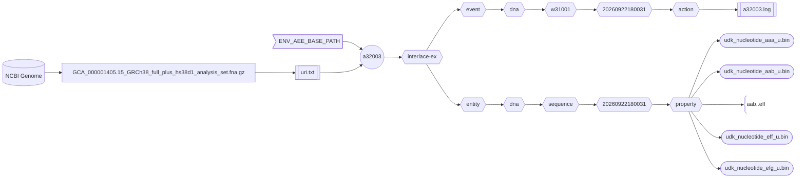

###### September 23, 2026: interlace-do cmd a32003 readme v2

# [a32003]

Creates the *DNA Sequence Asset* from the NCBI's reference genome.



##### Diagram Legend

- ⬡ **Hexagons:** Interlace folder hierarchy
- ⛁ **Cylinders:** External data providers
- ◯ **Circles:** Interlace Go applications
- 𓉴 **Flags:** Environment variables
- 𓋰 **Ovals:** Interlace binary files
- 𓈙 **Rectangles:** | Raw data files | or || configuration/log files ||

## Contents

1) [Help Page](#1-help-page)
2) [URI Input File](#2-uri-input-file)
3) [Requirements](#3-requirements)
4) [Environment Variables](#4-environment-variables)
5) [Command Line Example](#5-command-line-example)
6) [Log Example](#6-log-example)
7) [Output Example](#7-output-example)

### 1. Help Page

The help page is available with the `-help` option or when no arguments are provided.

```text
Project: interlace-do
AppName: a32003
Version: beta_2026_09_12_6
Purpose: creates the DNA entity Sequence asset from the NCBI's reference genome.

Sources:

  1) ASSEMBLY_SEQUENCE

Options:

  -base-concept string
    	Base concept ontology term to name the entity folder (default "dna")
  -base-path string
    	Agent, event, and entity base path (default "/Users/foglio/interlace-ex")
  -config string
    	Config file (optional)
  -data-path string
    	Data path where to read and download files (default "/Users/foglio/interlace-ex/data")
  -event-time-tag string
    	Event time tag (required) (default "20260922184106")
  -help
    	Displays this help page
  -log string
    	Logfile path to write stderr & stdout regardless of the -silent flag (default no log file)
  -loud
    	Writes additional information if available
  -no-commit
    	Disables committing the work
  -no-delete
    	Disables deleting the artifact files
  -no-download
    	Disables downloading data when necessary
  -silent
    	Suppresses all standard output messages
  -uri-inp-file string
    	URI list of URL, mailto, telnet, absolute-file-path#key (unique key as URI fragment), etc.
  -workflow-id string
    	Workflow ID (default "w32001")
```

### 2. URI Input File

```text
# https://ftp.ncbi.nlm.nih.gov/genomes/all/GCF/000/001/405/GCF_000001405.26_GRCh38/GRCh38_major_release_seqs_for_alignment_pipelines/GCA_000001405.15_GRCh38_full_plus_hs38d1_analysis_set.fna.gz
file:///Users/foglio/interlace-ex/data/GCA_000001405.15_GRCh38_full_plus_hs38d1_analysis_set.fna.gz#ASSEMBLY_SEQUENCE
```

- Update the URI input file to include your local path.

### 3. Requirements
- Base path from the `-base-path` option or the environmental-variable `ENV_AEE_BASE_PATH`
- URI list containing URLs and full-path file sources.

### 4. Environment Variables

```shell
ENV_AEE_BASE_PATH="${HOME}/interlace-ex"
```

### 5. Command Line Example

```shell
a32003 -log a32003.log -event-time-tag 20260922180031 -uri-inp-file uri.txt
```

- We keep the event time tag as the *DNA Metadata Asset*
- The same FASTA file is used to create the *DNA Metadata, Synonym, and Sequence Assets*.
- The FASTA data is not modified.

## 6. Log Example

```text
Inf: 2026/09/22 19:18:12.090975 application name: a32003
Inf: 2026/09/22 19:18:12.091024 application version: beta_2026_09_12_6
Inf: 2026/09/22 19:18:12.091036 application module: interlace-do
Inf: 2026/09/22 19:18:12.091059 application aim: creates the DNA entity Sequence asset from the NCBI's reference genome.
Inf: 2026/09/22 19:18:12.091088 application start time tag: 20260922191812
Inf: 2026/09/22 19:18:12.091098 listing configuration variables ...
Inf: 2026/09/22 19:18:12.091110 APP_REVISION: 6
Inf: 2026/09/22 19:18:12.091119 BASE_CONCEPT: dna
Inf: 2026/09/22 19:18:12.091128 BASE_PATH: /Users/foglio/interlace-ex
Inf: 2026/09/22 19:18:12.091137 DATA_PATH: /Users/foglio/interlace-ex/data
Inf: 2026/09/22 19:18:12.091146 ENV_AEE_BASE_PATH: /Users/foglio/interlace-ex
Inf: 2026/09/22 19:18:12.091155 ENV_ALT_DATA_PATH: /Users/foglio/interlace-ex/data
Inf: 2026/09/22 19:18:12.091163 EVENT_TIME_TAG: 20260922180031
Inf: 2026/09/22 19:18:12.091172 HOME: /Users/foglio
Inf: 2026/09/22 19:18:12.091181 LOG_OUTPUT_FILE: a32003.log
Inf: 2026/09/22 19:18:12.091189 URI_INP_FILE: uri.txt
Inf: 2026/09/22 19:18:12.091198 USER_LOGIN_NAME: foglio
Inf: 2026/09/22 19:18:12.091207 USER_NAME: Mario Foglio
Inf: 2026/09/22 19:18:12.091216 WORKFLOW_ID: w32001
Inf: 2026/09/22 19:18:12.091225 setting up the Metadata refiner ...
Inf: 2026/09/22 19:18:12.092128 configured file[ASSEMBLY_SEQUENCE]=/Users/foglio/interlace-ex/data/GCA_000001405.15_GRCh38_full_plus_hs38d1_analysis_set.fna.gz
Inf: 2026/09/22 19:18:12.092149 creating the DNA Sequence asset ...
Inf: 2026/09/22 19:18:12.139661 encoding cid=[AAA] from sequence: CM000663.2
Inf: 2026/09/22 19:18:21.876588 saved AAA, sequence length=[248956422], uint32 array length=[20633382], byte reduction: 3X
Inf: 2026/09/22 19:18:21.947177 encoding cid=[AAB] from sequence: CM000664.2
Inf: 2026/09/22 19:18:31.877766 saved AAB, sequence length=[242193529], uint32 array length=[21466173], byte reduction: 2X
Inf: 2026/09/22 19:18:31.961664 encoding cid=[AAC] from sequence: CM000665.2
Inf: 2026/09/22 19:18:40.120174 saved AAC, sequence length=[198295559], uint32 array length=[17663308], byte reduction: 2X
Inf: 2026/09/22 19:18:40.186332 encoding cid=[AAD] from sequence: CM000666.2
Inf: 2026/09/22 19:18:48.009691 saved AAD, sequence length=[190214555], uint32 array length=[16858756], byte reduction: 2X
Inf: 2026/09/22 19:18:48.069968 encoding cid=[AAE] from sequence: CM000667.2
Inf: 2026/09/22 19:18:55.492221 saved AAE, sequence length=[181538259], uint32 array length=[15944565], byte reduction: 2X
Inf: 2026/09/22 19:18:55.554440 encoding cid=[AAF] from sequence: CM000668.2
Inf: 2026/09/22 19:19:02.574271 saved AAF, sequence length=[170805979], uint32 array length=[15157524], byte reduction: 2X
Inf: 2026/09/22 19:19:02.626330 encoding cid=[AAG] from sequence: CM000669.2
Inf: 2026/09/22 19:19:09.248137 saved AAG, sequence length=[159345973], uint32 array length=[14190325], byte reduction: 2X
Inf: 2026/09/22 19:19:09.298515 encoding cid=[AAH] from sequence: CM000670.2
Inf: 2026/09/22 19:19:15.282029 saved AAH, sequence length=[145138636], uint32 array length=[12900002], byte reduction: 2X
Inf: 2026/09/22 19:19:15.328030 encoding cid=[AAI] from sequence: CM000671.2
Inf: 2026/09/22 19:19:20.497673 saved AAI, sequence length=[138394717], uint32 array length=[10887369], byte reduction: 3X
Inf: 2026/09/22 19:19:20.538597 encoding cid=[AAJ] from sequence: CM000672.2
Inf: 2026/09/22 19:19:26.163869 saved AAJ, sequence length=[133797422], uint32 array length=[11913695], byte reduction: 2X
Inf: 2026/09/22 19:19:26.206668 encoding cid=[AAK] from sequence: CM000673.2
Inf: 2026/09/22 19:19:31.836709 saved AAK, sequence length=[135086622], uint32 array length=[12026762], byte reduction: 2X
Inf: 2026/09/22 19:19:31.879946 encoding cid=[AAL] from sequence: CM000674.2
Inf: 2026/09/22 19:19:37.475556 saved AAL, sequence length=[133275309], uint32 array length=[11890654], byte reduction: 2X
Inf: 2026/09/22 19:19:37.516938 encoding cid=[AAM] from sequence: CM000675.2
Inf: 2026/09/22 19:19:41.686393 saved AAM, sequence length=[114364328], uint32 array length=[8703109], byte reduction: 3X
Inf: 2026/09/22 19:19:41.716822 encoding cid=[AAN] from sequence: CM000676.2
Inf: 2026/09/22 19:19:45.542093 saved AAN, sequence length=[107043718], uint32 array length=[7915587], byte reduction: 3X
Inf: 2026/09/22 19:19:45.573092 encoding cid=[AAO] from sequence: CM000677.2
Inf: 2026/09/22 19:19:49.265585 saved AAO, sequence length=[101991189], uint32 array length=[7580356], byte reduction: 3X
Inf: 2026/09/22 19:19:49.292390 encoding cid=[AAP] from sequence: CM000678.2
Inf: 2026/09/22 19:19:52.782777 saved AAP, sequence length=[90338345], uint32 array length=[7348093], byte reduction: 3X
Inf: 2026/09/22 19:19:52.807716 encoding cid=[AAQ] from sequence: CM000679.2
Inf: 2026/09/22 19:19:56.297781 saved AAQ, sequence length=[83257441], uint32 array length=[7474815], byte reduction: 2X
Inf: 2026/09/22 19:19:56.324127 encoding cid=[AAR] from sequence: CM000680.2
Inf: 2026/09/22 19:19:59.659864 saved AAR, sequence length=[80373285], uint32 array length=[7125391], byte reduction: 2X
Inf: 2026/09/22 19:19:59.685409 encoding cid=[AAS] from sequence: CM000681.2
Inf: 2026/09/22 19:20:02.102578 saved AAS, sequence length=[58617616], uint32 array length=[5061174], byte reduction: 2X
Inf: 2026/09/22 19:20:02.121159 encoding cid=[AAT] from sequence: CM000682.2
Inf: 2026/09/22 19:20:04.773564 saved AAT, sequence length=[64444167], uint32 array length=[5738528], byte reduction: 2X
Inf: 2026/09/22 19:20:04.794096 encoding cid=[AAU] from sequence: CM000683.2
Inf: 2026/09/22 19:20:06.411562 saved AAU, sequence length=[46709983], uint32 array length=[3394830], byte reduction: 3X
Inf: 2026/09/22 19:20:06.424639 encoding cid=[AAV] from sequence: CM000684.2
Inf: 2026/09/22 19:20:08.059378 saved AAV, sequence length=[50818468], uint32 array length=[3355854], byte reduction: 3X
Inf: 2026/09/22 19:20:08.073316 encoding cid=[AAW] from sequence: CM000685.2
Inf: 2026/09/22 19:20:14.539946 saved AAW, sequence length=[156040895], uint32 array length=[13774523], byte reduction: 2X
Inf: 2026/09/22 19:20:14.588650 encoding cid=[AAX] from sequence: CM000686.2
Inf: 2026/09/22 19:20:15.735989 saved AAX, sequence length=[57227415], uint32 array length=[2094906], byte reduction: 6X
Inf: 2026/09/22 19:20:15.743296 encoding cid=[AAY] from sequence: J01415.2
Inf: 2026/09/22 19:20:15.743979 saved AAY, sequence length=[16569], uint32 array length=[1481], byte reduction: 2X
...
... cut for brevity
...
Inf: 2026/09/22 19:20:21.107287 saved EFC, sequence length=[2016], uint32 array length=[166], byte reduction: 3X
Inf: 2026/09/22 19:20:21.107376 encoding cid=[EFD] from sequence: JTFH01001995.1
Inf: 2026/09/22 19:20:21.107484 saved EFD, sequence length=[2011], uint32 array length=[177], byte reduction: 2X
Inf: 2026/09/22 19:20:21.107659 encoding cid=[EFE] from sequence: JTFH01001996.1
Inf: 2026/09/22 19:20:21.107741 saved EFE, sequence length=[2009], uint32 array length=[170], byte reduction: 2X
Inf: 2026/09/22 19:20:21.107835 encoding cid=[EFF] from sequence: JTFH01001997.1
Inf: 2026/09/22 19:20:21.107917 saved EFF, sequence length=[2003], uint32 array length=[171], byte reduction: 2X
Inf: 2026/09/22 19:20:21.108002 encoding cid=[EFG] from sequence: JTFH01001998.1
Inf: 2026/09/22 19:20:21.108078 saved EFG, sequence length=[2001], uint32 array length=[168], byte reduction: 2X
Inf: 2026/09/22 19:20:21.108192 number of warnings caught: 0
Inf: 2026/09/22 19:20:21.108203 elapsed time just before closing: 2m9.018743041s
Inf: 2026/09/22 19:20:21.108209 end of process: complete
```

## 7. Output Example

```text
interlace-ex/entity/dna
├── sequence
│   └── 20260922180031
│       ├── catalog
│       ├── enumeration
│       └── property
│           ├── udk_nucleotide_aaa_u.bin
│           ├── udk_nucleotide_aab_u.bin
│           ├── udk_nucleotide_aac_u.bin
│           ├── udk_nucleotide_aad_u.bin
│           ├── udk_nucleotide_aae_u.bin
│           ├── udk_nucleotide_aaf_u.bin
│           ├── udk_nucleotide_aag_u.bin
│           ├── udk_nucleotide_aah_u.bin
│           ├── udk_nucleotide_aai_u.bin
│           ├── udk_nucleotide_aaj_u.bin
│           ├── udk_nucleotide_aak_u.bin
│           ├── udk_nucleotide_aal_u.bin
│           ├── udk_nucleotide_aam_u.bin
│           ├── udk_nucleotide_aan_u.bin
│           ├── udk_nucleotide_aao_u.bin
│           ├── udk_nucleotide_aap_u.bin
│           ├── udk_nucleotide_aaq_u.bin
│           ├── udk_nucleotide_aar_u.bin
│           ├── udk_nucleotide_aas_u.bin
│           ├── udk_nucleotide_aat_u.bin
│           ├── udk_nucleotide_aau_u.bin
│           ├── udk_nucleotide_aav_u.bin
│           ├── udk_nucleotide_aaw_u.bin
│           ├── udk_nucleotide_aax_u.bin
│           ├── udk_nucleotide_aay_u.bin
│           ├── udk_nucleotide_aaz_u.bin
│           ├── udk_nucleotide_aba_u.bin
│           ├── udk_nucleotide_abb_u.bin
│           ├── udk_nucleotide_abc_u.bin
...
... cut for brevity
...
│           ├── udk_nucleotide_eey_u.bin
│           ├── udk_nucleotide_eez_u.bin
│           ├── udk_nucleotide_efa_u.bin
│           ├── udk_nucleotide_efb_u.bin
│           ├── udk_nucleotide_efc_u.bin
│           ├── udk_nucleotide_efd_u.bin
│           ├── udk_nucleotide_efe_u.bin
│           ├── udk_nucleotide_eff_u.bin
│           └── udk_nucleotide_efg_u.bin

interlace-ex/event/dna
└── w32001
    └── 20260922180031
        ├── action
        │   ├── 20260922180031_a32001.log
        │   └── 20260922192021_a32003.log
        ├── artifact
        └── function
```

[a32003]: ../../internal/app/a32003
