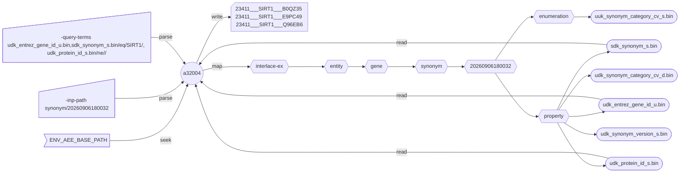

###### September 23, 2026: interlace-do cmd a32004 readme v2

# [a32004]

This application retrieves data from an *Interlace Asset*. 



##### Diagram Legend

- ⬡ **Hexagons:** Interlace folder hierarchy
- ◯ **Circles:** Interlace Go applications
- 𓉴 **Flags:** Environment variables
- 𓋰 **Ovals:** Interlace binary files
- 𓈙 **Rectangles:** Query command and results

The diagram illustrates the blueprint of a simple query requesting the Gene ID of SIRT1 with a valid protein ID from the *Gene Synonym Asset*. 

With the correct Gene ID, the SIRT1 function, products, interactions, DNA sources, genetic variants, and medical information can be retrieved.

## Contents

1) [Help Page](#1-help-page)
2) [Requirements](#2-requirements)
3) [Environment Variables](#3-environment-variables)
4) [Usage](#4-usage)

### 1. Help Page

The help page is available with the `-help` option or when no arguments are provided.

```text
Project: interlace-do
AppName: a32004
Version: beta_2026_09_12_17
Purpose: data retrieval tool for Interlace Assets.

         The -query-terms argument order is significant and has the following syntax format: 

         'bin-file-name-1/operator-1/value-1,bin-file-name-2/operator-2/value-2, ...' 

         The output field order will match the order of the query term string. If the query term string is empty, all 
         the bin files in the Interlace Property path are scanned in sorted order where the index always leads. 

          Examples for -query-terms:

         'sdk_entrez_gene_id_u.bin,udk_pubmed_id_u.bin,udk_rif_hash_id_m.bin/eq/14990363623126830805' return genes with cited function
         'sdk_synonym_s.bin/eq/CPX-1123,udk_entrez_gene_id_u.bin,udk_protein_id_s.bin,udk_synonym_category_cv_d.bin' return synonyms
         'sdk_entrez_gene_id_u.bin/eq/2309,udk_synonym_s.bin,udk_synonym_category_cv_d.bin,udk_protein_id_s.bin' returns gene products

         'udk_nucleotide_ack_u.bin/eq/3' returns ACK nucleotide at genomic position 3
         'udk_nucleotide_ack_u.bin/eq/3+10+99' returns ACK nucleotide at genomic positions 3, 10, and 99
         'udk_nucleotide_ack_u.bin/lt/10' returns all bases before nucleotide at position 10
         'udk_nucleotide_ack_u.bin/ni/3-10' returns ACK nucleotides before 3 and after 10
         'udk_nucleotide_ack_u.bin/in/3-10' returns ACK nucleotides from position 3 to 10 inclusive
         'udk_nucleotide_ack_u.bin/in/3-10+100-200+1000-1570' returns ACK nucleotides for the three ranges

         Possible operators are:
         
         - eq: equal to
         - gt: greater than
         - lt: less than
         - ge: greater than or equal to
         - le: less than or equal to
         - ne: not equal to
         - in: query value is a substring of the field value
         - ni: is the opposite of 'in'

         When there is no value to query, the '/' delimiters are omitted, for example: 

         'sdk_score_f.bin,sdk_color_d.bin'

         To expand 'set_s' properties with multiple elements, append '/=' at the end of the bin file name: 

         'udk_name_synonyms_set_s.bin/='

         Expansion can create very large files. Only the first '/=' expansion in the query term is considered. 

         To scape the delimiter, use '\/' whenever the query value contains a '/' character.

Options:

  -bit
    	Unmasks the bit flags and writes the 0s and 1s using one column per flag
  -cat
    	Inserts the text catalog next to the corresponding hash ID
  -enum
    	Inserts the CV term next to the corresponding enum code
  -help
    	Displays this help page
  -index int
    	Index start position in the output data, 0 means the first row (default)
  -inp-path string
    	For example 'metadata/20260906180032' or use the default when reading a single bin file (default "./")
  -log string
    	Logfile path to write stderr & stdout regardless of the -silent flag (default no log file)
  -loud
    	Writes additional information if available
  -max-rows int
    	Maximum number of rows to write to the output, 0 means no limit (default)
  -ncn
    	No column names in the output
  -or
    	OR comparison instead of AND
  -out-file string
    	Output file name or the output is written to stdout
  -query-terms string
    	Query term is one or more 'bin-name/operator/value' comma separated (default "all the property bin files")
  -silent
    	Suppresses all standard output messages
```

### 2. Requirements

- Base path from the `-base-path` option or the environmental-variable `ENV_AEE_BASE_PATH`
- The *Interlace Gene* data assets: [interlace-ex](https://github.com/sas-quantome/interlace-ex#5-build-the-gene-datastack)

### 3. Environment Variables

```shell
ENV_AEE_BASE_PATH="${HOME}/interlace-ex"
```

### 4. Usage

A) Brief introduction to the *Interlace Asset* structural concepts and organization:

- [Directory Architecture: Entities and Events](https://github.com/sas-quantome/interlace-go/tree/main/pkg/#9-directory-architecture-entities-and-events)
- [Binary File Nomenclature](https://github.com/sas-quantome/interlace-go/tree/main/pkg/#10-binary-file-nomenclature)

B) The *Interlace Gene* data assets are required for this exercise:

- [interlace-ex](https://github.com/sas-quantome/interlace-ex#5-build-the-gene-datastack)

C) Go through the following examples to learn how to use [a32004] in the given order.

1) [Show The interlace-ex Gene Asset Names](#1-show-the-interlace-ex-gene-asset-names)
2) [Show The Gene Metadata Bin Files](#2-show-the-gene-metadata-bin-files)
3) [Show The Metadata Enumeration Bin Files](#3-show-the-metadata-enumeration-bin-files)
4) [Decode One Bin File](#4-decode-one-bin-file)
5) [Take Advantage of Powerful UNIX-Like System's Commands](#5-take-advantage-of-powerful-unix-like-systems-commands)
6) [Decode Multiple Bin Files](#6-decode-multiple-bin-files)
7) [Unmask Bit Fields](#7-unmask-bit-fields)
8) [Discover Catalogued Text For The Most Important Gene In The Human Genome](#8-discover-catalogued-text-for-the-most-important-gene-in-the-human-genome)
9) [Scan Catalogued Text For Chromosome X Genes Regarding Aging](#9-scan-catalogued-text-for-chromosome-x-genes-regarding-aging)
10) [Find Catalogued Text Discussing Alzheimer's Disease in Chromosome 21 Genes](#10-find-catalogued-text-discussing-alzheimers-disease-in-chromosome-21-genes)
11) [Print All Synonyms For The Sirtuin Genes](#11-print-all-synonyms-for-the-sirtuin-genes)
12) [Split Delimited Data And Join Into Unique Rows](#12-split-delimited-data-and-join-into-unique-rows)
13) [Show The Gene Function Bin Files](#13-show-the-gene-function-bin-files)
14) [Search Longevity Genes From Curated Peer-Reviewed PubMed Articles](#14-search-longevity-genes-from-curated-peer-reviewed-pubmed-articles)
15) [Extract dbSNP IDs From FOXO3 Gene Function Catalogued Text](#15-extract-dbsnp-ids-from-foxo3-gene-function-catalogued-text)
16) [Show The Gene Genetic Variation Bin Files](#16-show-the-gene-genetic-variation-bin-files)
17) [Show The Genetic Variation Bit Masked Terms](#17-show-the-genetic-variation-bit-masked-terms)
18) [Inquire FOXO3 Genetic Variant Pathogenicity](#18-inquire-foxo3-genetic-variant-pathogenicity)
19) [Show The Gene Genomic Variation Bin Files](#19-show-the-gene-genomic-variation-bin-files)
20) [Show The Genomic Variation Bit Masked Terms](#20-show-the-genomic-variation-bit-masked-terms)
21) [Join FOXO3 GWAS Ancestry Variants With Human Body Traits](#21-join-foxo3-gwas-ancestry-variants-with-human-body-traits)
22) [Show The Gene Medical Genetics Bin Files](#22-show-the-gene-medical-genetics-bin-files)
23) [Point Out Gene Conditions, Phenotypes, and Findings Related to Medical Genetics](#23-point-out-gene-conditions-phenotypes-and-findings-related-to-medical-genetics)
24) [Show The Gene Molecular Interaction Bin Files](#24-show-the-gene-molecular-interaction-bin-files)
25) [Do FOXO3 & SIRT1 Interact? Find Out](#25-do-foxo3--sirt1-interact-find-out)
26) [Show The Gene Protein Interaction Bin Files](#26-show-the-gene-protein-interaction-bin-files)
27) [FOXO3/SIRT1 Protein Interaction Confidence Is Actually High](#27-foxo3sirt1-protein-interaction-confidence-is-actually-high)
28) [Show The Gene Ortholog Bin Files](#28-show-the-gene-ortholog-bin-files)
29) [Find FOXO3 Mouse Ortholog Gene](#29-find-foxo3-mouse-ortholog-gene)
30) [Show The Gene Chemical Reaction Bin Files](#30-show-the-gene-chemical-reaction-bin-files)
31) [Show The Chemical Reaction Enum Terms](#31-show-the-chemical-reaction-enum-terms)
32) [Display Cited Chemical Reactions For FOXO3](#32-display-cited-chemical-reactions-for-foxo3)
33) [Show The Gene Pathway Bin Files](#33-show-the-gene-pathway-bin-files)
34) [Display FOXO3 Biological Pathways](#34-display-foxo3-biological-pathways)
35) [Show The Gene Product Bin Files](#35-show-the-gene-product-bin-files)
36) [Apprise Dozens Of Database Sources Where To Find Gene Information](#36-apprise-dozens-of-database-sources-where-to-find-gene-information)
37) [Obtain Precise Access To FOXO3 Genomics, Transciptomics, and Proteomics](#37-obtain-precise-access-to-foxo3-genomics-transciptomics-and-proteomics)
38) [Show The Gene Synonym Bin Files](#38-show-the-gene-synonym-bin-files)
39) [Identify CPX-1123](#39-identify-cpx-1123)
40) [Show The Gene PubMed Reference Bin Files](#40-show-the-gene-pubmed-reference-bin-files)
41) [Count Number Of Publications Where FOXO3 Is Discussed](#41-count-number-of-publications-where-foxo3-is-discussed)
42) [Show The Gene Ontology Bin Files](#42-show-the-gene-ontology-bin-files)
43) [Decode The Gene Ontology Controlled Vocabulary Enum Terms](#43-decode-the-gene-ontology-controlled-vocabulary-enum-terms)
44) [Make A FOXO3 Ontology Table With Evidence, Relationship, and PubMed Reference](#44-make-a-foxo3-ontology-table-with-evidence-relationship-and-pubmed-reference)

#### 1) Show The interlace-ex Gene Asset Names

```bash
cd ~/interlace-ex/entity/gene; ls -l
```

```text
drwxr-xr-x  3 foglio  staff   96 Sep  6 18:08 chemical_reaction
drwxr-xr-x  3 foglio  staff   96 Sep  6 18:04 function
drwxr-xr-x  3 foglio  staff   96 Sep  6 18:06 genetic_variation
drwxr-xr-x  3 foglio  staff   96 Sep  6 18:07 genomic_variation
drwxr-xr-x  5 foglio  staff  160 Sep 22 17:47 medical_genetics
drwxr-xr-x  3 foglio  staff   96 Sep  6 18:04 metadata
drwxr-xr-x  3 foglio  staff   96 Sep  6 18:06 molecular_interaction
drwxr-xr-x  3 foglio  staff   96 Sep  6 18:05 ontology
drwxr-xr-x  3 foglio  staff   96 Sep  6 18:05 ortholog
drwxr-xr-x  3 foglio  staff   96 Sep  6 18:08 pathway
drwxr-xr-x  3 foglio  staff   96 Sep  6 18:00 product
drwxr-xr-x  3 foglio  staff   96 Sep  6 18:08 protein_interaction
drwxr-xr-x  3 foglio  staff   96 Sep  6 18:04 pubmed_reference
drwxr-xr-x  3 foglio  staff   96 Sep  6 18:03 synonym
```

#### 2) Show The Gene Metadata Bin Files

```bash
cd ~/interlace-ex/entity/gene; tree metadata 
```

```text
metadata
└── 20260906180032
    ├── catalog
    │   ├── suk_metadata_hash_id_m.bin
    │   └── uuk_metadata_text_s.bin
    ├── enumeration
    │   └── uuk_bit_flags_cv_s.bin
    └── property
        ├── suk_entrez_gene_id_u.bin
        ├── udk_bit_flags_u.bin
        ├── udk_chromosome_s.bin
        ├── udk_gene_name_s.bin
        ├── udk_gene_symbol_s.bin
        ├── udk_metadata_hash_id_m.bin
        ├── udk_name_synonyms_set_s.bin
        ├── udk_symbol_synonyms_set_s.bin
        ├── udk_taxonomy_id_u.bin
        └── udk_xdb_id_set_s.bin

5 directories, 13 files
```

#### 3) Show The Metadata Enumeration Bin Files

```bash
cd ~/interlace-ex/entity/gene/metadata/20260906180032/enumeration; ls -l
```

```text
-rw-r--r--  1 foglio  staff  150 Sep  6 18:04 uuk_bit_flags_cv_s.bin
```

#### 4) Decode One Bin File


```bash
cd ~/interlace-ex/entity/gene; a32004 -inp-path metadata/20260906180032/enumeration -query-terms uuk_bit_flags_cv_s.bin
```

- The output includes the column name followed by the enumerated controlled vocabulary terms.
- The enumeration is used to decode the bit flags in the Gene Metadata.
- The enumeration order helps decoders find the correct bit masks, e.g., 2^0, 2^1, 2^2 ... 2^10 for this case.
- In one byte bit mask, eight enumerations are possible; in four bytes bit mask, 32 enumerations are possible, and so on.

```text
Inf: 2026/09/24 18:47:29.424638 inpPath:metadata/20260906180032/enumeration
Inf: 2026/09/24 18:47:29.424881 application name: a32004
Inf: 2026/09/24 18:47:29.424884 application version: beta_2026_09_12_17
Inf: 2026/09/24 18:47:29.424887 application module: interlace-do
Inf: 2026/09/24 18:47:29.424894 application aim: data retrieval tool for Interlace Assets.
Inf: 2026/09/24 18:47:29.424899 application start time tag: 20260924184729
Inf: 2026/09/24 18:47:29.424902 listing configuration variables ...
Inf: 2026/09/24 18:47:29.424911 APP_REVISION: 17
Inf: 2026/09/24 18:47:29.424913 BASE_PATH: /Users/foglio/interlace-ex
Inf: 2026/09/24 18:47:29.424915 DATA_PATH: /Users/foglio/interlace-ex/data
Inf: 2026/09/24 18:47:29.424916 ENV_AEE_BASE_PATH: /Users/foglio/interlace-ex
Inf: 2026/09/24 18:47:29.424918 ENV_ALT_DATA_PATH: /Users/foglio/interlace-ex/data
Inf: 2026/09/24 18:47:29.424920 HOME: /Users/foglio
Inf: 2026/09/24 18:47:29.424922 INP_PATH: metadata/20260906180032/enumeration
Inf: 2026/09/24 18:47:29.424924 QUERY_TERMS: uuk_bit_flags_cv_s.bin
Inf: 2026/09/24 18:47:29.424975 USER_LOGIN_NAME: foglio
Inf: 2026/09/24 18:47:29.424979 USER_NAME: Mario Foglio
Inf: 2026/09/24 18:47:29.425157 reading bin file: metadata/20260906180032/enumeration/uuk_bit_flags_cv_s.bin
Inf: 2026/09/24 18:47:29.425308 number of query terms: 0
uuk_bit_flags_cv_s
biological-region
miscRNA
ncRNA
other-RNA
protein-coding
pseudogene
rRNA
scRNA
snRNA
snoRNA
tRNA
Inf: 2026/09/24 18:47:29.425323 total records written: 11
Inf: 2026/09/24 18:47:29.425325 closing bin file: uuk_bit_flags_cv_s.bin
Inf: 2026/09/24 18:47:29.425335 number of warnings caught: 0
Inf: 2026/09/24 18:47:29.425338 elapsed time just before closing: 2.542292ms
Inf: 2026/09/24 18:47:29.425342 end of process: complete
```

⏱️ 2.5 ms

#### 5) Take Advantage of Powerful UNIX-Like System's Commands

- Use `-silent` to suppress the standard output messages.
- Use the `\in\RNA` query syntax to output only the RNA enumeration terms.
- Reformat the output into a coma-delimited row in reverse-sorted order.

```bash
cd ~/interlace-ex/entity/gene; printf "`a32004 -silent -ncn -query-terms uuk_bit_flags_cv_s.bin/in/RNA -inp-path metadata/20260906180032/enumeration | sort -r | tr '\n' ','`\n"
```

- The `printf` command is used to print the output to the standard output.
- The `tr` command is used to replace the newline character with a coma.
- The `in` operator is used to query the enumeration containing the string "RNA".
- The `-ncn` flag is used to suppress the column names in the output.

```text
tRNA,snoRNA,snRNA,scRNA,rRNA,other-RNA,ncRNA,miscRNA,
```

⏱️ 2.6 ms

#### 6) Decode Multiple Bin Files

```bash
cd ~/interlace-ex/entity/gene; a32004 -silent \
-inp-path "metadata/20260906180032" \
-query-terms "suk_entrez_gene_id_u.bin,udk_chromosome_s.bin,udk_gene_symbol_s.bin,udk_bit_flags_u.bin" \
-index 31001 \
-max-rows 10
```

- The `-index` and `-max-rows` options serve for paging and limit the number of records to display.
- Since the `-bit` flag is not used, the 1024 unsigned integers are not decoded into the boolean values.

```text
suk_entrez_gene_id_u	udk_chromosome_s	udk_gene_symbol_s	udk_bit_flags_u
100189225	6	TRS-GCT4-1	1024
100189226	16	TRM-CAT6-1	1024
100189227	6	TRV-CAC1-6	1024
100189228	1	TRV-CAC1-7	1024
100189229	15	TRS-GCT4-2	1024
100189230	1	TRG-GCC1-3	1024
100189231	2	TRG-CCC2-1	1024
100189232	12	TRA-TGC3-2	1024
100189233	1	TRN-GTT15-1	1024
100189234	6	TRK-TTT3-3	1024
```

⏱️ 12.7 ms

#### 7) Unmask Bit Fields

```bash
cd ~/interlace-ex/entity/gene; a32004 -silent \
-inp-path "metadata/20260906180032" \
-query-terms "suk_entrez_gene_id_u.bin,udk_chromosome_s.bin,udk_gene_symbol_s.bin,udk_bit_flags_u.bin" \
-index 31001 \
-max-rows 10 \
-bit
```

```text
suk_entrez_gene_id_u	udk_chromosome_s	udk_gene_symbol_s	udk_bit_flags_u	biological-region	miscRNA	ncRNA	other-RNA	protein-coding	pseudogene	rRNA	scRNA	snRNA	snoRNA	tRNA
100189225	6	TRS-GCT4-1	1024	0	0	0	0	0	0	0	0	0	0	1
100189226	16	TRM-CAT6-1	1024	0	0	0	0	0	0	0	0	0	0	1
100189227	6	TRV-CAC1-6	1024	0	0	0	0	0	0	0	0	0	0	1
100189228	1	TRV-CAC1-7	1024	0	0	0	0	0	0	0	0	0	0	1
100189229	15	TRS-GCT4-2	1024	0	0	0	0	0	0	0	0	0	0	1
100189230	1	TRG-GCC1-3	1024	0	0	0	0	0	0	0	0	0	0	1
100189231	2	TRG-CCC2-1	1024	0	0	0	0	0	0	0	0	0	0	1
100189232	12	TRA-TGC3-2	1024	0	0	0	0	0	0	0	0	0	0	1
100189233	1	TRN-GTT15-1	1024	0	0	0	0	0	0	0	0	0	0	1
100189234	6	TRK-TTT3-3	1024	0	0	0	0	0	0	0	0	0	0	1
```

⏱️ 13.6 ms

#### 8) Discover Catalogued Text For The Most Important Gene In The Human Genome

```bash
cd ~/interlace-ex/entity/gene; a32004 -silent \
-inp-path "metadata/20260906180032" \
-query-terms "udk_gene_symbol_s.bin/eq/TP53,udk_gene_name_s.bin,udk_metadata_hash_id_m.bin" \
-cat \
-ncn | tr '\t' '\n' | tr '.' '\n'
```

```text
TP53
tumor protein p53
5016799052191644430
This gene encodes a tumor suppressor protein containing transcriptional activation, DNA binding, and oligomerization domains
 The encoded protein responds to diverse cellular stresses to regulate expression of target genes, thereby inducing cell cycle arrest, apoptosis, senescence, DNA repair, or changes in metabolism
 Mutations in this gene are associated with a variety of human cancers, including hereditary cancers such as Li-Fraumeni syndrome
 Alternative splicing of this gene and the use of alternate promoters result in multiple transcript variants and isoforms
 Additional isoforms have also been shown to result from the use of alternate translation initiation codons from identical transcript variants (PMIDs: 12032546, 20937277)
 [provided by RefSeq, Dec 2016]
```

⏱️ 19.9 ms

#### 9) Scan Catalogued Text For Chromosome X Genes Regarding Aging

```bash
cd ~/interlace-ex/entity/gene; a32004 \
-inp-path "metadata/20260906180032" \
-query-terms "suk_entrez_gene_id_u.bin,udk_gene_symbol_s.bin,udk_chromosome_s.bin/eq/X,udk_metadata_hash_id_m.bin/ne/0" \
-cat \
-ncn | grep -iw aging
```

```text
9104	RGN	X	8102364367807151611	The protein encoded by this gene is a highly conserved, calcium-binding protein, that is preferentially expressed in the liver and kidney. It may have an important role in calcium homeostasis. Studies in rat indicate that this protein may also play a role in aging, as it shows age-associated down-regulation. This gene is part of a gene cluster on chromosome Xp11.3-Xp11.23. Alternative splicing results in multiple transcript variants. [provided by RefSeq, Sep 2013]
115201	ATG4A	X	15099671238220962518	Autophagy is the process by which endogenous proteins and damaged organelles are destroyed intracellularly. Autophagy is postulated to be essential for cell homeostasis and cell remodeling during differentiation, metamorphosis, non-apoptotic cell death, and aging. Reduced levels of autophagy have been described in some malignant tumors, and a role for autophagy in controlling the unregulated cell growth linked to cancer has been proposed. This gene encodes a member of the autophagin protein family. The encoded protein is also designated as a member of the C-54 family of cysteine proteases. [provided by RefSeq, Mar 2016]
```

⏱️ 237 ms

#### 10) Find Catalogued Text Discussing Alzheimer's Disease in Chromosome 21 Genes

```bash
cd ~/interlace-ex/entity/gene; a32004 \
-inp-path "metadata/20260906180032" \
-query-terms "suk_entrez_gene_id_u.bin,udk_gene_symbol_s.bin,udk_chromosome_s.bin/eq/21,udk_metadata_hash_id_m.bin/ne/0" \
-cat \
-ncn | grep Alzheimer
```

```text
351	APP	21	8905702872562443907	This gene encodes a cell surface receptor and transmembrane precursor protein that is cleaved by secretases to form a number of peptides. Some of these peptides are secreted and can bind to the acetyltransferase complex APBB1/TIP60 to promote transcriptional activation, while others form the protein basis of the amyloid plaques found in the brains of patients with Alzheimer disease. In addition, two of the peptides are antimicrobial peptides, having been shown to have bacteriocidal and antifungal activities. Mutations in this gene have been implicated in autosomal dominant Alzheimer disease and cerebroarterial amyloidosis (cerebral amyloid angiopathy). Multiple transcript variants encoding several different isoforms have been found for this gene. [provided by RefSeq, Aug 2014]
1827	RCAN1	21	4319654907535454987	The protein encoded by this gene interacts with calcineurin A and inhibits calcineurin-dependent signaling pathways, possibly affecting central nervous system development. This gene is located in the minimal candidate region for the Down syndrome phenotype, and is overexpressed in the brain of Down syndrome fetuses. Chronic overexpression of this gene may lead to neurofibrillary tangles such as those associated with Alzheimer disease. Alternative splicing results in multiple transcript variants. [provided by RefSeq, Nov 2013]
6285	S100B	21	13683481660812137817	The protein encoded by this gene is a member of the S100 family of proteins containing 2 EF-hand calcium-binding motifs. S100 proteins are localized in the cytoplasm and/or nucleus of a wide range of cells, and involved in the regulation of a number of cellular processes such as cell cycle progression and differentiation. S100 genes include at least 13 members which are located as a cluster on chromosome 1q21; however, this gene is located at 21q22.3. This protein may function in Neurite extension, proliferation of melanoma cells, stimulation of Ca2+ fluxes, inhibition of PKC-mediated phosphorylation, astrocytosis and axonal proliferation, and inhibition of microtubule assembly. Chromosomal rearrangements and altered expression of this gene have been implicated in several neurological, neoplastic, and other types of diseases, including Alzheimer's disease, Down's syndrome, epilepsy, amyotrophic lateral sclerosis, melanoma, and type I diabetes. [provided by RefSeq, Jul 2008]
25825	BACE2	21	12677390424806491353	This gene encodes an integral membrane glycoprotein that functions as an aspartic protease. The encoded protein cleaves amyloid precursor protein into amyloid beta peptide, which is a critical step in the etiology of Alzheimer's disease and Down syndrome. The protein precursor is further processed into an active mature peptide. Alternative splicing results in multiple transcript variants. [provided by RefSeq, Jul 2013]
```

⏱️ 132 ms

#### 11) Print All Synonyms For The Sirtuin Genes

```bash
cd ~/interlace-ex/entity/gene; a32004 \
-silent \
-inp-path "metadata/20260906180032" \
-query-terms "suk_entrez_gene_id_u.bin,udk_chromosome_s.bin,udk_gene_symbol_s.bin/in/SIRT,udk_symbol_synonyms_set_s.bin"
```

```text
suk_entrez_gene_id_u	udk_chromosome_s	udk_gene_symbol_s	udk_symbol_synonyms_set_s
22933	19	SIRT2	SIR2|SIR2L|SIR2L2
23408	6	SIRT5	SIR2L5
23409	12	SIRT4	SIR2L4
23410	11	SIRT3	SIR2L3
23411	10	SIRT1	SIR2|SIR2L1|SIR2alpha
51547	17	SIRT7	SIR2L7
51548	19	SIRT6	SIR2L6|hSIRT6
106633813	10	SIRT1-AS	
```

⏱️ 12.1 ms

#### 12) Split Delimited Data And Join Into Unique Rows

Property Bin file names that include `_set_s` as in the case of `udk_symbol_synonyms_set_s.bin` signals the possibility of multiple values delimited by a pipe character. Apply the `/=` operator to split them into multiple rows.

```bash
cd ~/interlace-ex/entity/gene; a32004 \
-silent \
-inp-path "metadata/20260906180032" \
-query-terms "suk_entrez_gene_id_u.bin,udk_chromosome_s.bin,udk_gene_symbol_s.bin/in/SIRT,udk_symbol_synonyms_set_s.bin/="
```

```text
suk_entrez_gene_id_u	udk_chromosome_s	udk_gene_symbol_s	udk_symbol_synonyms_set_s
22933	19	SIRT2	SIR2	
22933	19	SIRT2	SIR2L	
22933	19	SIRT2	SIR2L2	
23408	6	SIRT5	SIR2L5
23409	12	SIRT4	SIR2L4
23410	11	SIRT3	SIR2L3
23411	10	SIRT1	SIR2	
23411	10	SIRT1	SIR2L1	
23411	10	SIRT1	SIR2alpha	
51547	17	SIRT7	SIR2L7
51548	19	SIRT6	SIR2L6	
51548	19	SIRT6	hSIRT6	
106633813	10	SIRT1-AS	
```

⏱️ 12.5 ms

#### 13) Show The Gene Function Bin Files

```bash
cd ~/interlace-ex/entity/gene
tree function
```

```text
function
└── 20260906180032
    ├── catalog
    │   ├── suk_function_hash_id_m.bin
    │   └── uuk_function_text_s.bin
    ├── enumeration
    └── property
        ├── sdk_entrez_gene_id_u.bin
        ├── udk_pubmed_id_u.bin
        ├── udk_rif_hash_id_m.bin
        └── udk_taxonomy_id_u.bin
```

#### 14) Search Longevity Genes From Curated Peer-Reviewed PubMed Articles

```bash
cd ~/interlace-ex/entity/gene; a32004 \
-silent \
-inp-path "function/20260906180032" \
-query-terms "sdk_entrez_gene_id_u.bin,udk_pubmed_id_u.bin,udk_rif_hash_id_m.bin/ne/0" \
-cat | grep -i longevity | cut -f 1,2,4 | head -330 | tail -20
```

- The `cut` command is applied to exclude the `udk_rif_hash_id_m` column.
- The `grep` command funnels the *longevity* results, but it also filters out the column names.
- The `head` and `tail` commands are used to limit the results to 20 rows around some of the Sirtuin genes.

```text
23012	28556638	It was found that STK38L*I/D genotype had positive association with longevity in the ethnically homogeneous group of Tatars from the Republic of Bashkortostan, Russia.
23410	15676284	the underexpression of a human sirtuin gene seems to be detrimental for longevity as it occurs in model organisms.
23410	23839864	We found an increased level of SIRT3 in subjects homozygous for the (T) allele. We suggest that SIRT3 genetic variability might be relevant for the modulation of human longevity in the Italian population.
23411	21149730	Data show that inhibition of the deacetylase and longevity factor SIRT1 impairs global genome NER through suppressing the transcription of XPC in a SIRT1 deacetylase-dependent manner.
23411	21972126	Report SIRT1 impacts age-related decline in telomere length and is associated with longevity.
23411	23450480	There is an association between rs4746720 of SIRT1 gene and longevity in Yongfu region of Guangxi.
23411	23855981	The deacetylase activity of SIRT1 might play a role in protecting the brain against ischemic injury and in the longevity effects elicited by calorie restriction. (review)
23411	25785999	current study is the first to demonstrate age-related changes in SIRT1 levels in humans and it is important for a much better molecular understanding of the role of the longevity gene SIRT1 and its protein product in aging
23411	26831453	Although primarily a nuclear protein, Sirt1 deacetylation of PGC-1a has been extensively implicated in metabolic control and mitochondrial biogenesis, which was proposed to partially underlie Sirt1 role in caloric restriction and impacts on longevity. (Review)
23411	27089876	several common single nucleotide polymorphisms(rs12778366, rs3758391, rs3740051, rs33957861, rs7896005, rs12413112, rs11599176 and rs4746720) in the SIRT1 gene are not associated with human longevity
23411	27125385	Genetic variation in SIRT1 might therefore affect lung function and human longevity by modifying subclinical inflammation arising from abdominal adipose tissue.
23411	30443855	SIRT1/LKB1/AMPK pathway was involved in genistein accelerating autophagic flux and mitigating senescence in HUVECs. The present study illustrated that genistein was a promising therapeutic agent to delay aging process and extend longevity.
23411	30633320	The increased expression of cellular protective proteins SIRT1, HSP70 and SOD2 in NKT-like and T-lymphocytes of the oldest seniors seems to correspond to longevity and the observed correlations may suggest the involvement of these proteins in establishing cellular homeostasis specific for healthy ageing.
23411	31309340	Oldest individuals (age >/= 76.0 years) carrying AG genotypes for rs7895833 showed the highest SIRT1 level, suggesting a strong association between rs7895833 SNP and lifespan longevity.
23411	32460327	Longevity genes, cardiac ageing, and the pathogenesis of cardiomyopathy: implications for understanding the effects of current and future treatments for heart failure.
23411	33715628	Interaction of Sirtuin 1 (SIRT1) candidate longevity gene and particulate matter (PM2.5) on all-cause mortality: a longitudinal cohort study in China.
23411	34256387	Telomere Length, SIRT1, and Insulin in Male Master Athletes: The Path to Healthy Longevity?
23411	34769292	MicroRNA 132-3p Is Upregulated in Laron Syndrome Patients and Controls Longevity Gene Expression.
23411	34928346	Sex Difference and Interaction of SIRT1 and FOXO3 Candidate Longevity Genes on Life Expectancy: A 10-Year Prospective Longitudinal Cohort Study.
23411	36503597	Irisin enhances longevity by boosting SIRT1, AMPK, autophagy and telomerase.
```

⏱️ 844 ms

#### 15) Extract dbSNP IDs From FOXO3 Gene Function Catalogued Text

```bash
cd ~/interlace-ex/entity/gene; a32004 \
-silent \
-inp-path "function/20260906180032" \
-query-terms "sdk_entrez_gene_id_u.bin/eq/2309,udk_pubmed_id_u.bin,udk_rif_hash_id_m.bin/ne/0" \
-cat | grep -E "\brs[0-9]+\b" | cut -f 1,2,4
```

```text
2309	20881262	Our data indicate that the minor G-allele of FOXO3A rs2802292 is associated with enhanced peripheral and hepatic insulin sensitivity in our small twin cohort
2309	24035192	Study identifies a noncoding polymorphism in FOXO3A (rs12212067: T > G) at which the minor (G) allele, despite not being associated with disease susceptibility, is associated with a milder course of Crohn's disease and rheumatoid arthritis and with increased risk of severe malaria.
2309	24333267	rs4946936 of FOXO3A gene may associate susceptibility of vitiligo, especially active vitiligo.
2309	24589462	Significant association of five FOXO3A gene polymorphisms with longevity, with the effects of rs2802292 and rs2764264 being male-specific. Meta-analysis.
2309	24809632	association of rs7762395 allele with longevity varies among birth cohorts
2309	25365249	the NOD2 variant p.Leu1007fsX1008 (rs2066847), in particular in homozygous form, is a much stronger marker for a severe clinical phenotype than the FOXO3A rs12212067 SNP for a mild disease course on an individual patient level
2309	25913413	A significant association between the FOXO3 rs2802288*A and rs2802292*G gene variants in FOXO3 and human longevity.
2309	26223437	this study found that rs12212067 in FOXO3was associated with increased risk of active Tuberculosis. The minor G allele might be a protection factor which was found more common in latent Tuberculosis patients and healthy controls than active Tuberculosis patients.
2309	27125259	The result suggests that FOXO3 rs12212067 polymorphism does not play an important role in susceptibility to T. cruzi infection and/or chronic Chagas cardiomyopathy.
2309	27214848	rs12212067 (a single-nucleotide polymorphism that increases FOXO3 transcription) was associated with reduced inflammation, both biochemically and clinically, and with lower rheumatoid arthritis activity scores.
2309	27529982	FOXO1A gene polymorphic site rs4943794 is associated with an acquisition of old and senescent age and with women's longevity. FOXO3A gene polymorphic site rs3800231 is associated with longevity in both women and men.
2309	27621247	No statistically significant association was found between the rs2802292 polymorphism and exceptional longevity in either cohort (either examined in their entirety or in a sex-based analysis).
2309	27694344	Carriage of the longevity-associated G allele of FOXO3 snp rs2802292 was a protective factor against CAD mortality in all three populations. In Japanese and Whites, but not in Blacks, the protective effect of the G allele was little changed in models adjusted for other major risk factors. Population-attributable risk (PAR) models found that the nonprotective TT genotype contributed 15%, 9%, and 3% to CAD mortality risk in
2309	28977569	Using data from four longevity studies (total n = 8,266, age range 96-119 years for cases), we tested gene-wide association between 107 SNPs and survival to at least the oldest 1 percentile of survival for the 1900 birth cohort. An uncommon homozygote genotype of rs9384680 exhibited the strongest association with mortality risk (p = 2.68E-04) in only 11 females, a heretofore unreported association.
2309	29141605	first report of the association between rs13217795 and allergic rhinitis, and the first independent verification of the association between rs13217795 and asthma
2309	29688278	We found that telomere length for carriers of the longevity associated allele of FOXO3 single nucleotide polymorphism rs2802292 displayed no significant correlation with age. This is the first validated longevity gene variant identified to date showing an association with negligible loss of telomere length with age in humans.
2309	29733381	A 90-bp sequence around the intronic single nucleotide polymorphism rs2802292 has enhancer functions, and that the rs2802292 G-allele creates a novel HSE binding site for HSF1, which induces FOXO3 expression in response to diverse stress stimuli.
2309	31009445	None of the 4 FOXO3 variants, rs13217795, rs2764264, rs2802292, and rs13220810, were associated with the risk of type 2 diabetes compared to controls. rs13217795, rs2764264, and rs2802292 were associated with lower blood glucose levels. further subgroup analysis indicated that the longevity-associated alleles of FOXO3 SNP (rs13217795, rs2764264, and rs2802292) were associated with lower blood glucose levels in women.
2309	31241240	FOXO3 plays vital roles in the risk of immune-related infectious diseases such as Tuberculosis. rs3800229 and rs4946935 in FOXO3 were associated with a risk of TB in the Chinese population.
2309	31309340	The presence of 5 SNPs in FOXO3A gene has been strongly associated to Longevity and correlated with several phenotypes of healthy aging. rs2802292 and rs2764264 were found specific for male gender.
2309	32614786	CircFOXO3 rs12196996, a polymorphism at the gene flanking intron, is associated with circFOXO3 levels and the risk of coronary artery disease.
2309	33317466	Novel association between FOXO3 rs2232365 polymorphism and late-onset preeclampsia: a case-control candidate genetic study.
2309	35156517	Effect of circRNA_FOXO3 rs12196996 polymorphism and FOXO3 rs2232365 polymorphism on survival rate and severity of intensive care unit-acquired sepsis.
```

⏱️ 56.3 ms

#### 16) Show The Gene Genetic Variation Bin Files

```bash
cd ~/interlace-ex/entity/gene; tree genetic_variation 
```

```text
genetic_variation
└── 20260906180032
    ├── catalog
    │   ├── suk_genetic_variation_hash_id_m.bin
    │   └── uuk_genetic_variation_text_s.bin
    ├── enumeration
    │   └── uuk_bit_flags_cv_s.bin
    └── property
        ├── sdk_entrez_gene_id_u.bin
        ├── udk_bit_flags_m.bin
        ├── udk_conical_allele_id_u.bin
        ├── udk_omim_id_u.bin
        ├── udk_refsnp_id_u.bin
        ├── udk_variation_hash_id_m.bin
        └── udk_variation_id_u.bin
```

#### 17) Show The Genetic Variation Bit Masked Terms

```bash
cd ~/interlace-ex/entity/gene; a32004 -silent -ncn \
-query-terms "uuk_bit_flags_cv_s.bin" \
-inp-path "genetic_variation/20260906180032/enumeration" | less -N
```

Attention: that enumeration starts at 0, and `less -N` starts counting lines from 1.

```text
      1 Affects
      2 Benign
      3 Conflicting classifications of oncogenicity
      4 Conflicting classifications of pathogenicity
      5 Established risk allele
      6 Likely benign
      7 Likely oncogenic
      8 Likely pathogenic
      9 Likely pathogenic, low penetrance
     10 Likely risk allele
     11 Oncogenic
     12 Pathogenic
     13 Pathogenic, low penetrance
     14 Tier I - Strong
     15 Tier II - Potential
     16 Tier III - Unknown
     17 Tier IV - Benign
     18 Uncertain risk allele
     19 Uncertain significance
     20 VUS-high
     21 VUS-low
     22 VUS-mid
     23 association
     24 association not found
     25 biparental
     26 confers sensitivity
     27 conflicting data from submitters
     28 criteria provided, conflicting classifications
     29 criteria provided, multiple submitters, no conflicts
     30 criteria provided, single submitter
     31 de novo
     32 drug response
     33 germline
     34 inherited
     35 maternal
     36 no assertion criteria provided
     37 no classification for the single variant
     38 no classification provided
     39 no classifications from unflagged records
     40 not applicable
     41 not provided
     42 not-reported
     43 other
     44 paternal
     45 practice guideline
     46 protective
     47 reviewed by expert panel
     48 risk factor
     49 somatic
     50 uniparental
     51 unknown
```

⏱️ 5.25 ms

#### 18) Inquire FOXO3 Genetic Variant Pathogenicity


```bash
cd ~/interlace-ex/entity/gene; a32004 \
-silent \
-inp-path "genetic_variation/20260906180032" \
-query-terms "sdk_entrez_gene_id_u.bin/eq/2309,udk_variation_hash_id_m.bin,udk_refsnp_id_u.bin/ne/0,udk_bit_flags_m.bin" \
-bit -cat | cut -f 1,3,4,7,11,13,16,17 | sort -ru
```

- The above query filters out genetic variants with dbSNP ID=0.
- A *not specified* ClinVar annotation indicates that the genetic variant is generally benign.
- A *not provided* ClinVar annotation announces a genetic outcome or phenotyping submission without a variant classification.
- If the genetic variant has a dbSNP ID, the variant classification may be tracked from dbSNP.

```text
sdk_entrez_gene_id_u	udk_variation_text_s	udk_refsnp_id_u	Benign	Likely benign	Likely pathogenic	Oncogenic	Pathogenic
2309	not specified	944210246	0	0	0	0	0
2309	not specified	909124051	0	0	0	0	0
2309	not specified	779887975	0	0	0	0	0
2309	not specified	778623754	0	0	0	0	0
2309	not specified	771834327	0	0	0	0	0
2309	not specified	771700859	0	0	0	0	0
2309	not specified	771516569	0	0	0	0	0
2309	not specified	768572858	0	0	0	0	0
2309	not specified	767626656	0	0	0	0	0
2309	not specified	766475174	0	0	0	0	0
2309	not specified	761888480	0	0	0	0	0
2309	not specified	756842922	0	0	0	0	0
2309	not specified	755424488	0	0	0	0	0
2309	not specified	540196548	0	0	0	0	0
2309	not specified	2482287824	0	0	0	0	0
2309	not specified	1778991547	0	0	0	0	0
2309	not specified	1778981596	0	0	0	0	0
2309	not specified	1778954287	0	0	0	0	0
2309	not specified	1463974336	0	0	0	0	0
2309	not specified	1448374108	0	0	0	0	0
2309	not specified	1415832829	0	0	0	0	0
2309	not specified	1396187319	0	0	0	0	0
2309	not specified	1344931063	0	0	0	0	0
2309	not specified	1245687963	0	0	0	0	0
2309	not specified	1228590271	0	0	0	0	0
2309	not specified	1182679423	0	0	0	0	0
2309	not specified	1023544612	0	0	0	0	0
2309	not provided	749898404	0	1	0	0	0
2309	not provided	61756661	1	1	0	0	0
2309	not provided	4946936	1	0	0	0	0
2309	not provided	4946935	1	0	0	0	0
2309	not provided	374860833	1	1	0	0	0
2309	not provided	2802292	1	0	0	0	0
2309	not provided	201417491	0	1	0	0	0
2309	not provided	150320900	1	1	0	0	0
2309	not provided	145259784	1	0	0	0	0
2309	not provided	1321459699	0	1	0	0	0
2309	not provided	1191293561	0	1	0	0	0
2309	not provided	111556510	1	1	0	0	0
2309	Medulloblastoma	1554218944	0	0	0	0	0
2309	Choroid plexus carcinoma	1554209779	0	0	0	0	0
```

⏱️ 223 ms

#### 19) Show The Gene Genomic Variation Bin Files

```bash
cd ~/interlace-ex/entity/gene; tree genomic_variation 
```

```text
genomic_variation
└── 20260906180032
    ├── catalog
    │   ├── suk_genomic_variation_hash_id_m.bin
    │   └── uuk_genomic_variation_text_s.bin
    ├── enumeration
    │   └── uuk_bit_flags_cv_s.bin
    └── property
        ├── sdk_entrez_gene_id_u.bin
        ├── udk_bit_flags_u.bin
        ├── udk_gwas_hash_id_m.bin
        ├── udk_ontology_id_s.bin
        ├── udk_pubmed_id_u.bin
        └── udk_refsnp_id_u.bin
```

#### 20) Show The Genomic Variation Bit Masked Terms

```bash
cd ~/interlace-ex/entity/gene; a32004 -silent -ncn \
-query-terms "uuk_bit_flags_cv_s.bin" \
-inp-path "genomic_variation/20260906180032/enumeration" | less -N
```

Attention: enumeration starts at 0, and `less -N` starts counting lines from 1.

```text
      1 not_reported
      2 Aboriginal_Australian
      3 African_American_or_Afro-Caribbean
      4 African_unspecified
      5 Asian_unspecified
      6 Central_Asian
      7 East_Asian
      8 European
      9 Greater_Middle_Eastern
     10 Hispanic_or_Latin_American
     11 Greater_Middle_Eastern_Persian
     12 Native_American
     13 Oceanian
     14 other_ancestry
     15 other_admixed_ancestry
     16 South_Asian
     17 South_East_Asian
     18 Sub-Saharan_African
```

⏱️ 3.51 ms

#### 21) Join FOXO3 GWAS Ancestry Variants With Human Body Traits

```bash
cd ~/interlace-ex/entity/gene; a32004 -silent \
-inp-path "genomic_variation/20260906180032" \
-query-terms "sdk_entrez_gene_id_u.bin/eq/2309,udk_refsnp_id_u.bin,udk_gwas_hash_id_m.bin,udk_bit_flags_u.bin" \
-cat -bit | cut -f 1,2,4,7-23 | sort -u | grep -i body | sort -k 3
```

- Prints the GeneID (1), dbSNP ID (2), and the catalogued phenotype (4)
- Ends with the ancestry enumerated boolean flags starting from the *Aboriginal_Australian* (7) to *Sub-Saharan_African* (23)

```text
2309	2764261	body fat percentage	0	0	0	0	0	0	1	0	0	0	0	0	0	0	0	0	0
2309	2253310	body height	0	0	0	0	0	0	1	0	0	0	0	0	0	0	0	0	0
2309	3813498	body height	0	0	0	0	0	0	1	0	0	0	0	0	0	0	0	0	0
2309	72944305	body height	0	0	0	0	0	0	1	0	0	0	0	0	0	0	0	0	0
2309	2490272	body height	0	0	1	0	0	1	1	0	1	0	0	0	0	0	1	0	0
2309	3800230	body height	0	0	1	0	0	1	1	0	1	0	0	0	0	0	1	0	0
2309	3813498	body height	0	0	1	0	0	1	1	0	1	0	0	0	0	0	1	0	0
2309	9398172	body height	0	0	1	0	0	1	1	0	1	0	0	0	0	0	1	0	0
2309	3813498	body height	0	1	0	0	0	0	1	0	1	0	0	0	0	0	0	0	0
2309	3813498	body height	0	1	0	0	0	1	1	0	1	0	0	0	0	0	0	0	0
2309	12206094	body mass index	0	0	0	0	0	0	1	0	0	0	0	0	0	0	0	0	0
2309	147824753	body mass index	0	0	0	0	0	0	1	0	0	0	0	0	0	0	0	0	0
2309	2253310	body mass index	0	0	0	0	0	0	1	0	0	0	0	0	0	0	0	0	0
2309	2764261	body mass index	0	0	0	0	0	0	1	0	0	0	0	0	0	0	0	0	0
2309	2802295	body mass index	0	0	0	0	0	0	1	0	0	0	0	0	0	0	0	0	0
2309	3800229	body mass index	0	0	0	0	0	0	1	0	0	0	0	0	0	0	0	0	0
2309	3800230	body mass index	0	0	0	0	0	0	1	0	0	0	0	0	0	0	0	0	0
2309	4946935	body mass index	0	0	0	0	0	0	1	0	0	0	0	0	0	0	0	0	0
2309	9400239	body mass index	0	0	0	0	0	0	1	0	0	0	0	0	0	0	0	0	0
2309	2802295	body mass index	0	0	0	0	0	1	1	0	0	0	0	0	0	0	0	0	0
2309	35396874	body mass index	0	0	0	0	0	1	1	0	0	0	0	0	0	0	0	0	0
2309	3800229	body mass index	0	0	0	0	0	1	1	0	0	0	0	0	0	0	0	0	0
2309	4946935	body mass index	0	0	0	0	0	1	1	0	0	0	0	0	0	0	0	0	0
2309	9374040	body mass index	0	0	0	0	0	1	1	0	0	0	0	0	0	0	0	0	0
2309	3800229	body mass index	0	1	0	0	0	1	1	0	0	0	0	0	0	0	1	0	0
2309	9400239	body mass index	0	1	0	0	0	1	1	0	1	0	0	0	0	0	1	0	0
2309	9400239	body mass index	0	1	0	1	0	0	1	0	1	0	0	0	0	0	1	0	0
2309	9400239	body mass index	0	1	1	0	0	1	1	0	1	0	0	0	0	0	1	0	0
2309	2253310	body shape measurement	0	0	0	0	0	0	1	0	0	0	0	0	0	0	0	0	0
2309	3813498	body shape measurement	0	0	0	0	0	0	1	0	0	0	0	0	0	0	0	0	0
2309	9398171	body shape measurement	0	0	0	0	0	0	1	0	0	0	0	0	0	0	0	0	0
2309	3800227	body weight	0	0	0	0	0	0	1	0	0	0	0	0	0	0	0	0	0
2309	1935951	body weight	0	0	0	0	0	1	1	0	0	0	0	0	0	0	0	0	0
2309	9400241	body weight	0	0	0	0	0	1	1	0	0	0	0	0	0	0	0	0	0
2309	2802290	body weight	0	1	0	0	0	1	1	0	1	0	0	0	0	0	0	0	0
2309	4946936	lean body mass	0	0	0	0	0	0	1	0	0	0	0	0	0	0	0	0	0
2309	9398171	lean body mass	0	0	0	0	0	0	1	0	0	0	0	0	0	0	0	0	0
2309	4946936	whole body water mass	0	0	0	0	0	0	1	0	0	0	0	0	0	0	0	0	0
```

⏱️ 70.1 ms

#### 22) Show The Gene Medical Genetics Bin Files

```bash
cd ~/interlace-ex/entity/gene; tree medical_genetics 
```

```text
medical_genetics
├── 20260906180032
│   ├── catalog
│   ├── enumeration
│   │   └── uuk_bit_flags_cv_s.bin
│   └── property
│       ├── sdk_entrez_gene_id_u.bin
│       ├── udk_bit_flags_u.bin
│       ├── udk_gene_symbol_s.bin
│       ├── udk_medgen_cui_s.bin
│       └── udk_omim_id_u.bin
├── 20260921140600
│   ├── catalog
│   ├── enumeration
│   └── property
└── 20260922174744
    ├── catalog
    ├── enumeration
    └── property
```

#### 23) Point Out Gene Conditions, Phenotypes, and Findings Related to Medical Genetics

```bash
cd ~/interlace-ex/entity/gene; a32004 -silent \
-inp-path "medical_genetics/20260906180032" \
-query-terms "sdk_entrez_gene_id_u.bin,udk_medgen_cui_s.bin,udk_omim_id_u.bin/ne/0,udk_bit_flags_u.bin/eq/258" \
-bit -max-rows 50 -index 2960
```

```text
sdk_entrez_gene_id_u	udk_medgen_cui_s	udk_omim_id_u	udk_bit_flags_u	gene	phenotype	QTL1	QTL2	modifier	nondisease	question	somatic	susceptibility
2304	C4225293	616534	258	0	1	0	0	0	0	0	0	1
2312	C1853965	605803	258	0	1	0	0	0	0	0	0	1
2487	C3887876	165720	258	0	1	0	0	0	0	0	0	1
2524	C2674252	612542	258	0	1	0	0	0	0	0	0	1
2532	C1970028	611162	258	0	1	0	0	0	0	0	0	1
2539	C1970028	611162	258	0	1	0	0	0	0	0	0	1
2554	C4013473	611136	258	0	1	0	0	0	0	0	0	1
2555	C0001973	103780	258	0	1	0	0	0	0	0	0	1
2562	C2677087	612269	258	0	1	0	0	0	0	0	0	1
2563	C2751603	613060	258	0	1	0	0	0	0	0	0	1
2624	C0023467	601626	258	0	1	0	0	0	0	0	0	1
2624	C3463824	614286	258	0	1	0	0	0	0	0	0	1
2629	C0752347	127750	258	0	1	0	0	0	0	0	0	1
2629	C3160718	168600	258	0	1	0	0	0	0	0	0	1
2668	C3150974	613711	258	0	1	0	0	0	0	0	0	1
2690	C0745103	143890	258	0	1	0	0	0	0	0	0	1
2729	C1832662	608446	258	0	1	0	0	0	0	0	0	1
2730	C1832662	608446	258	0	1	0	0	0	0	0	0	1
2784	CN305331	145500	258	0	1	0	0	0	0	0	0	1
2811	C1847711	258660	258	0	1	0	0	0	0	0	0	1
2820	C0011860	125853	258	0	1	0	0	0	0	0	0	1
2956	C0476089	608089	258	0	1	0	0	0	0	0	0	1
2993	C1970028	611162	258	0	1	0	0	0	0	0	0	1
2994	C1970028	611162	258	0	1	0	0	0	0	0	0	1
2995	C1970028	611162	258	0	1	0	0	0	0	0	0	1
3026	C3160733	188050	258	0	1	0	0	0	0	0	0	1
3026	C4225292	616535	258	0	1	0	0	0	0	0	0	1
3043	C1970028	611162	258	0	1	0	0	0	0	0	0	1
3067	C0040517	137580	258	0	1	0	0	0	0	0	0	1
3075	C2749604	235400	258	0	1	0	0	0	0	0	0	1
3075	C1853147	610698	258	0	1	0	0	0	0	0	0	1
3078	C2749604	235400	258	0	1	0	0	0	0	0	0	1
3078	C1864205	603075	258	0	1	0	0	0	0	0	0	1
3105	C1840548	608579	258	0	1	0	0	0	0	0	0	1
3106	C1862852	106300	258	0	1	0	0	0	0	0	0	1
3106	C1840548	608579	258	0	1	0	0	0	0	0	0	1
3107	C1867449	177900	258	0	1	0	0	0	0	0	0	1
3107	C1836230	609423	258	0	1	0	0	0	0	0	0	1
3117	C1859310	212750	258	0	1	0	0	0	0	0	0	1
3119	C0751254	123400	258	0	1	0	0	0	0	0	0	1
3119	C1868685	126200	258	0	1	0	0	0	0	0	0	1
3119	C1859310	212750	258	0	1	0	0	0	0	0	0	1
3123	C1868685	126200	258	0	1	0	0	0	0	0	0	1
3123	C2697310	181000	258	0	1	0	0	0	0	0	0	1
3135	C1869116	600807	258	0	1	0	0	0	0	0	0	1
3159	C0011860	125853	258	0	1	0	0	0	0	0	0	1
3161	C0346153	114480	258	0	1	0	0	0	0	0	0	1
3162	C0024117	606963	258	0	1	0	0	0	0	0	0	1
3172	C0011860	125853	258	0	1	0	0	0	0	0	0	1
3176	C1869116	600807	258	0	1	0	0	0	0	0	0	1
```

⏱️ 6.94 ms

#### 24) Show The Gene Molecular Interaction Bin Files

```bash
cd ~/interlace-ex/entity/gene; tree molecular_interaction 
```

```text
molecular_interaction
└── 20260906180032
    ├── catalog
    ├── enumeration
    └── property
        ├── sdk_entrez_gene_id_u.bin
        ├── udk_interactant_entrez_gene_id_u.bin
        ├── udk_interactant_taxonomy_id_u.bin
        ├── udk_pubmed_id_set_s.bin
        └── udk_taxonomy_id_u.bin
```

#### 25) Do FOXO3 & SIRT1 Interact? Find Out!

```bash
cd ~/interlace-ex/entity/gene; a32004 -silent \
-inp-path "molecular_interaction/20260906180032" \
-query-terms "sdk_entrez_gene_id_u.bin/eq/2309,udk_taxonomy_id_u.bin,udk_interactant_entrez_gene_id_u.bin/eq/23411,udk_interactant_taxonomy_id_u.bin,udk_pubmed_id_set_s.bin/="
```

```text
sdk_entrez_gene_id_u	udk_taxonomy_id_u	udk_interactant_entrez_gene_id_u	udk_interactant_taxonomy_id_u	udk_pubmed_id_set_s
2309	9606	23411	9606	14976264
2309	9606	23411	9606	14976264	
2309	9606	23411	9606	15126506	
2309	9606	23411	9606	20733005	
2309	9606	23411	9606	21713995	
```

#### 26) Show The Gene Protein Interaction Bin Files

```bash
cd ~/interlace-ex/entity/gene; tree protein_interaction 
```

```text
protein_interaction
└── 20260906180032
    ├── catalog
    ├── enumeration
    └── property
        ├── sdk_entrez_gene_id_u.bin
        ├── udk_association_ensp_id_i.bin
        ├── udk_association_entrez_gene_id_u.bin
        ├── udk_ensp_id_i.bin
        └── udk_likelihood_score_n.bin
```

#### 27) FOXO3/SIRT1 Protein Interaction Confidence Is Actually High

```bash
cd ~/interlace-ex/entity/gene; a32004 -silent \
-inp-path "protein_interaction/20260906180032" \
-query-terms "sdk_entrez_gene_id_u.bin/eq/2309,udk_association_ensp_id_i.bin,udk_association_entrez_gene_id_u.bin/eq/23411,udk_ensp_id_i.bin,udk_likelihood_score_n.bin"
```

- Scores range from 0.150 to 0.999 in the STRING DB.
- A score closer to 1.0 indicates higher confidence.
- A score of 0.999 is an association that is probably real.
- The scores are stored as 4-byte integers, e.g., 150–999.
- Ensembl IDs are stored as integers too, e.g., 212015 → ENSP00000212015 and 339527 → ENSP00000339527
- Storing the Ensembl IDs as 8-byte integers rather than 15 bytes string reduces space almost by half.

```text
sdk_entrez_gene_id_u	udk_association_ensp_id_i	udk_association_entrez_gene_id_u	udk_ensp_id_i	udk_likelihood_score_n
2309	212015	23411	339527	999
```

⏱️ 399 ms

#### 28) Show The Gene Ortholog Bin Files

```bash
cd ~/interlace-ex/entity/gene; tree ortholog 
```

```text
ortholog
└── 20260906180032
    ├── catalog
    ├── enumeration
    └── property
        ├── sdk_entrez_gene_id_u.bin
        ├── udk_ortholog_entrez_gene_id_u.bin
        ├── udk_ortholog_taxonomy_id_u.bin
        └── udk_taxonomy_id_u.bin
```

#### 29) Find FOXO3 Mouse Ortholog Gene

```bash
cd ~/interlace-ex/entity/gene; a32004 -silent \
-inp-path "ortholog/20260906180032" \
-query-terms "sdk_entrez_gene_id_u.bin/eq/2309,udk_taxonomy_id_u.bin,udk_ortholog_entrez_gene_id_u.bin,udk_ortholog_taxonomy_id_u.bin/eq/10090"
```

```text
sdk_entrez_gene_id_u	udk_taxonomy_id_u	udk_ortholog_entrez_gene_id_u	udk_ortholog_taxonomy_id_u
2309	9606	56484	10090
```

⏱️ 248 ms

#### 30) Show The Gene Chemical Reaction Bin Files

```bash
cd ~/interlace-ex/entity/gene; tree chemical_reaction 
```

```text
chemical_reaction
└── 20260906180032
    ├── catalog
    │   ├── suk_chemical_reaction_hash_id_m.bin
    │   └── uuk_chemical_reaction_text_s.bin
    ├── enumeration
    │   └── uuk_reaction_entity_cv_s.bin
    └── property
        ├── sdk_entrez_gene_id_u.bin
        ├── udk_pubmed_id_u.bin
        ├── udk_reaction_entity_cv_d.bin
        ├── udk_reaction_hash_id_m.bin
        └── udk_reactome_hsa_id_u.bin
```

#### 31) Show The Chemical Reaction Enum Terms

```bash
cd ~/interlace-ex/entity/gene; a32004 -silent -ncn -inp-path "chemical_reaction/20260906180032/enumeration" \
-query-terms "uuk_reaction_entity_cv_s.bin" | less -N
```

Attention: enumeration starts at 0, and `less -N` starts counting lines from 1.

```text
      1 unknown
      2 COPII-coated ER to Golgi transport vesicle
      3 ER to Golgi transport vesicle membrane
      4 Golgi lumen
      5 Golgi membrane
      6 Golgi-associated vesicle lumen
      7 Golgi-associated vesicle membrane
      8 apical plasma membrane
      9 autophagosome membrane
     10 autophagosome
     11 axonemal microtubule
     12 azurophil granule lumen
     13 azurophil granule membrane
     14 bacterial outer membrane vesicle
     15 basolateral plasma membrane
     16 cell junction
     17 cell outer membrane
     18 chromosome, centromeric region
     19 chromosome
     20 ciliary base
     21 ciliary membrane
     22 ciliary tip
     23 cilium
     24 clathrin-coated endocytic vesicle membrane
     25 clathrin-coated endocytic vesicle
     26 clathrin-sculpted acetylcholine transport vesicle membrane
     27 clathrin-sculpted gamma-aminobutyric acid transport vesicle membrane
     28 clathrin-sculpted glutamate transport vesicle membrane
     29 clathrin-sculpted monoamine transport vesicle membrane
     30 cornified envelope
     31 cytolytic granule lumen
     32 cytoplasm
     33 cytoplasmic side of plasma membrane
     34 cytoplasmic vesicle lumen
     35 cytoplasmic vesicle membrane
     36 cytosol
     37 double membrane vesicle viral factory outer membrane
     38 early endosome lumen
     39 early endosome membrane
     40 early endosome
     41 endocytic vesicle lumen
     42 endocytic vesicle membrane
     43 endolysosome lumen
     44 endolysosome membrane
     45 endoplasmic reticulum lumen
     46 endoplasmic reticulum membrane
     47 endoplasmic reticulum quality control compartment
     48 endoplasmic reticulum-Golgi intermediate compartment membrane
     49 endoplasmic reticulum-Golgi intermediate compartment
     50 endosome lumen
     51 endosome membrane
     52 endosome
     53 exocytic vesicle
     54 external side of plasma membrane
     55 extracellular exosome
     56 extracellular matrix
     57 extracellular region
     58 ficolin-1-rich granule lumen
     59 ficolin-1-rich granule membrane
     60 granular component
     61 host cell viral assembly compartment
     62 lamellar body membrane
     63 lamellar body
     64 late endosome lumen
     65 late endosome membrane
     66 lipid droplet
     67 lumenal side of endoplasmic reticulum membrane
     68 lysosomal lumen
     69 lysosomal membrane
     70 macropinosome membrane
     71 melanosome membrane
     72 microtubule organizing center
     73 microvillus membrane
     74 microvillus
     75 mitochondrial inner membrane
     76 mitochondrial intermembrane space
     77 mitochondrial matrix
     78 mitochondrial outer membrane
     79 mitochondrion
     80 multivesicular body lumen
     81 nuclear envelope
     82 nucleolus
     83 nucleoplasm
     84 peptidoglycan-based cell wall
     85 periplasmic space
     86 peroxisomal matrix
     87 peroxisomal membrane
     88 phagocytic vesicle lumen
     89 phagocytic vesicle membrane
     90 phagocytic vesicle
     91 phagolysosome
     92 phagophore assembly site membrane
     93 photoreceptor disc membrane
     94 photoreceptor inner segment membrane
     95 photoreceptor outer segment membrane
     96 plasma membrane
     97 platelet alpha granule lumen
     98 platelet alpha granule membrane
     99 platelet dense granule lumen
    100 platelet dense granule membrane
    101 platelet dense tubular network membrane
    102 recycling endosome membrane
    103 recycling endosome
    104 sarcoplasmic reticulum lumen
    105 sarcoplasmic reticulum membrane
    106 secretory granule lumen
    107 secretory granule membrane
    108 smooth endoplasmic reticulum
    109 specific granule lumen
    110 specific granule membrane
    111 sperm plasma membrane
    112 spindle
    113 synaptic vesicle membrane
    114 tertiary granule lumen
    115 tertiary granule membrane
    116 trans-Golgi network membrane
    117 transport vesicle membrane
    118 transport vesicle
    119 viral capsid
    120 viral envelope
    121 viral tegument
    122 virion membrane
    123 zymogen granule
    124 cytoplasmic microtubule
    125 Gram-positive-bacterium-type cell wall
```

⏱️ 2.61 ms

#### 32) Display Cited Chemical Reactions For FOXO3

```bash
cd ~/interlace-ex/entity/gene; a32004 -silent \
-inp-path "chemical_reaction/20260906180032" \
-query-terms "sdk_entrez_gene_id_u.bin/eq/2309,udk_reactome_hsa_id_u.bin,udk_pubmed_id_u.bin/ne/0,udk_reaction_entity_cv_d.bin,udk_reaction_hash_id_m.bin" \
-cat -enum | cut -f 1-5,7 | sort -r -k 5
```

- The Reactome HSA (Homo sapiens) IDs are stored as 8-byte integers, e.g., 5687126 → R-HSA-5687126

```text
sdk_entrez_gene_id_u	udk_reactome_hsa_id_u	udk_pubmed_id_u	udk_reaction_entity_cv_d	uuk_reaction_entity_cv_s	udk_reaction_text_s
2309	9625378	22412893	82	nucleoplasm	STK11 gene transcription is stimulated by FOXO3,FOXO4
2309	9617833	24040102	82	nucleoplasm	SOD2 gene expression is stimulated by FOXO4, FOXO3 and FOXO1
2309	8870703	28157684	82	nucleoplasm	SOD2 (MnSOD) gene expression
2309	9620532	23665396	82	nucleoplasm	SIRT1,SIRT3 deacetylate FOXO3
2309	8952226	12637528	82	nucleoplasm	RUNX3 binds the BCL2L11 (BIM) gene
2309	8870628	28157684	82	nucleoplasm	Phosphorylated FOXO3 translocates to the nucleus
2309	1535903	21532621	82	nucleoplasm	Phospho R-SMAD(SMAD2/3):CO-SMAD(SMAD4):FOXO3 binds FoxO3a-binding elements
2309	9623280	10913147	82	nucleoplasm	PCK1 gene expression is stimulated by FOXO1:PPARGC1A
2309	5687126	22800433	82	nucleoplasm	p-S215 FOXO3 translocates to the nucleus
2309	5687095	21329882	82	nucleoplasm	p-S215 FOXO3 binds MIR34B and C gene
2309	9620515	14976264	82	nucleoplasm	KAT2B,EP300 acetylate FOXO3 under oxidative stress
2309	9623427	10217147	82	nucleoplasm	IGFBP1 gene expression is stimulated by FOXO1,FOXO3,FOXO4
2309	9623192	16840535	82	nucleoplasm	G6PC gene expression is stimulated by FOXO1,FOXO3,FOXO4,FOXO6
2309	9617852	11964479	82	nucleoplasm	FOXO3,FOXO4,(FOXO1) bind GADD45A gene promoter
2309	9622630	15509806	82	nucleoplasm	FOXO3,FOXO4,(FOXO1) bind BCL6 gene promoter
2309	9625375	22412893	82	nucleoplasm	FOXO3,FOXO4 bind STK11 gene promoter
2309	9622668	20978166	82	nucleoplasm	FOXO3,(FOXO1) bind BBC3 gene first intron
2309	9699575	28522571	82	nucleoplasm	FOXO3-dependent CDKN1B gene expression
2309	9699574	29309929	82	nucleoplasm	FOXO3-dependent BCL2L11 gene expression
2309	9841812	24324009	82	nucleoplasm	FOXO3 translocates from the mitochondrial matrix to the nucleus
2309	5687103	21329882	82	nucleoplasm	FOXO3 regulates MIR34B,C expression
2309	9617972	12239572	82	nucleoplasm	FOXO3 binds SOD2 gene promoter
2309	9856665	24324009	82	nucleoplasm	FOXO3 activates expression of SOD2
2309	9856663	24324009	82	nucleoplasm	FOXO3 activates expression of CAT
2309	9623281	10913147	82	nucleoplasm	FOXO1:PPARGC1A,FOXO4 binds PCK1 gene promoter
2309	9620788	11884591	82	nucleoplasm	FOXO1,FOXO3,FOXO4 binds RBL2 gene
2309	9617996	15084259	82	nucleoplasm	FOXO1,FOXO3,FOXO4 bind p-2S-SMAD2/3:SMAD4
2309	9623415	10217147	82	nucleoplasm	FOXO1,FOXO3,FOXO4 bind IGFBP1 gene promoter
2309	9617840	15084259	82	nucleoplasm	FOXO1,FOXO3,FOXO4 bind CDKN1A gene promoter
2309	9614662	14576824	82	nucleoplasm	FOXO1,FOXO3,(FOXO4) bind FASLG gene promoter
2309	9624976	24047697	82	nucleoplasm	FOXO1,FOXO3 binds CAV1 gene promoter
2309	9625091	24028821	82	nucleoplasm	FOXO1,FOXO3 bind ABCA6 gene promoter
2309	9623168	16840535	82	nucleoplasm	FOXO1,FOXO1:PPARGC1A,FOXO3,FOXO4,FOXO6 bind G6PC gene promoter
2309	9618004	15084259	82	nucleoplasm	FOXO:SMAD complex binds CDKN1A gene promoter
2309	9618021	15084259	82	nucleoplasm	FOXG1 binds FOXO:SMAD complexes
2309	9614669	26715362	82	nucleoplasm	FASLG gene expression is stimulated by FOXO1,FOXO3,(FOXO4)
2309	8870698	28157684	82	nucleoplasm	FASLG (FasL) gene expression
2309	6790036	16510571	82	nucleoplasm	Expression of STAT3-upregulated nuclear proteins
2309	9621242	27561725	82	nucleoplasm	CITED2 gene expression is stimulated by FOXO1,FOXO3
2309	9617838	15084259	82	nucleoplasm	CDKN1A gene transcription is stimulated by FOXO1,FOXO3,FOXO4
2309	9624985	24047697	82	nucleoplasm	CAV1 gene expression is stimulated by FOXO1,FOXO3
2309	9620915	25843800	82	nucleoplasm	BTG1 gene expression is stimulated by FOXO3
2309	9622627	15509806	82	nucleoplasm	BCL6 gene expression is stimulated by FOXO3,FOXO4,(FOXO1)
2309	8952232	12637528	82	nucleoplasm	BCL2L11 (BIM) gene transcription is stimulated by RUNX3
2309	8870686	28157684	82	nucleoplasm	BCL2L11 (BIM) gene expression
2309	9622667	20978166	82	nucleoplasm	BBC3 gene expression is stimulated by FOXO3,(FOXO1)
2309	8870710	28157684	82	nucleoplasm	APP gene expression
2309	2399992	17611497	82	nucleoplasm	AKT1 E17K mutant phosphorylates forkhead box transcription factors
2309	9699581	29309929	82	nucleoplasm	AKT-phosphorylated FOXO3 translocates to cytosol
2309	9624527	18391968	82	nucleoplasm	AKT-phosphorylated FOXO3 translocates to cytosol
2309	9614414	16114898	82	nucleoplasm	AKT-phosphorylated FOXO1,FOXO3,FOXO4 translocate to the cytosol
2309	9699579	29309929	82	nucleoplasm	AKT phosphorylates FOXO3 downstream of FLT3 
2309	9624526	18391968	82	nucleoplasm	AKT phosphorylates FOXO3 downstream of ESR1 and EGFR
2309	199299	10102273	82	nucleoplasm	AKT phosphorylates FOXO transcription factors
2309	9625092	24028821	82	nucleoplasm	ABCA6 gene expression is stimulated by FOXO1,FOXO3
2309	9841847	24324009	76	mitochondrial matrix	SIRT3 deacetylates Ac-K272,K290-FOXO3
2309	9841812	24324009	76	mitochondrial matrix	FOXO3 translocates from the mitochondrial matrix to the nucleus
2309	8870628	28157684	35	cytosol	Phosphorylated FOXO3 translocates to the nucleus
2309	5687101	22800433	35	cytosol	p-T182 MAPKAPK5 phosphorylates FOXO3
2309	5687126	22800433	35	cytosol	p-S215 FOXO3 translocates to the nucleus
2309	8870558	28157684	35	cytosol	CDK5:p25 phosphorylates FOXO3
2309	9699581	29309929	35	cytosol	AKT-phosphorylated FOXO3 translocates to cytosol
2309	9624527	18391968	35	cytosol	AKT-phosphorylated FOXO3 translocates to cytosol
2309	9614414	16114898	35	cytosol	AKT-phosphorylated FOXO1,FOXO3,FOXO4 translocate to the cytosol
2309	9614562	14701673	35	cytosol	14-3-3 proteins bind AKT-phosphorylated FOXO3
```

⏱️ 8.23 ms

#### 33) Show The Gene Pathway Bin Files

```bash
cd ~/interlace-ex/entity/gene; tree pathway 
```

```text
pathway
└── 20260906180032
    ├── catalog
    │   ├── suk_pathway_hash_id_m.bin
    │   └── uuk_pathway_text_s.bin
    ├── enumeration
    └── property
        ├── sdk_entrez_gene_id_u.bin
        ├── udk_pathway_hash_id_m.bin
        └── udk_reactome_hsa_id_u.bin
```

#### 34) Display FOXO3 Biological Pathways

```bash
cd ~/interlace-ex/entity/gene; a32004 -silent \
-inp-path "pathway/20260906180032" \
-query-terms "sdk_entrez_gene_id_u.bin/eq/2309,udk_reactome_hsa_id_u.bin,udk_pathway_hash_id_m.bin" \
-cat
```

```text
sdk_entrez_gene_id_u	udk_reactome_hsa_id_u	udk_pathway_hash_id_m	udk_pathway_text_s
2309	1181150	2382736386286996136	Signaling by NODAL
2309	1257604	15022240249935687565	PIP3 activates AKT signaling
2309	1266738	2157392081151331196	Developmental Biology
2309	1280215	223365492863297518	Cytokine Signaling in Immune system
2309	162582	8893693198813509575	Signal Transduction
2309	1643685	6209737826868658277	Disease
2309	168256	9145464811918663309	Immune System
2309	198693	7935811046979989273	AKT phosphorylates targets in the nucleus
2309	212436	2577001949975549356	Generic Transcription Pathway
2309	2219528	12636326725831958558	PI3K/AKT Signaling in Cancer
2309	2262752	8241524100559721080	Cellular responses to stress
2309	449147	10767073545621267591	Signaling by Interleukins
2309	5663202	14236724890423101954	Diseases of signal transduction by growth factor receptors and second messengers
2309	5674400	7682961766859262499	Constitutive Signaling by AKT1 E17K in Cancer
2309	5683057	8687591911933472013	MAPK family signaling cascades
2309	5687128	13604500106580084854	MAPK6/MAPK4 signaling
2309	6785807	6290505901088701318	Interleukin-4 and Interleukin-13 signaling
2309	73857	7224686517088692825	RNA Polymerase II Transcription
2309	74160	9915575372167779109	Gene expression (Transcription)
2309	8862803	15813544280323407938	Deregulated CDK5 triggers multiple neurodegenerative pathways in Alzheimer's disease models
2309	8863678	4783953396374364284	Neurodegenerative Diseases
2309	8878159	4934493480873619267	Transcriptional regulation by RUNX3
2309	8939211	4848085728573568257	ESR-mediated signaling
2309	8952158	3385767838903876071	RUNX3 regulates BCL2L11 (BIM) transcription
2309	8953897	357962469367362299	Cellular responses to stimuli
2309	9006925	16778195451839659962	Intracellular signaling by second messengers
2309	9006931	12892138691380824319	Signaling by Nuclear Receptors
2309	9009391	17957326721623110801	Extra-nuclear estrogen signaling
2309	9607240	13440323391347112526	FLT3 Signaling
2309	9614085	7448488038438035291	FOXO-mediated transcription
2309	9614399	6341645141544011730	Regulation of localization of FOXO transcription factors
2309	9614657	3411825575501155040	FOXO-mediated transcription of cell death genes
2309	9615017	9199956924229154660	FOXO-mediated transcription of oxidative stress, metabolic and neuronal genes
2309	9617629	15965564336614125174	Regulation of FOXO transcriptional activity by acetylation
2309	9617828	9535599101706083100	FOXO-mediated transcription of cell cycle genes
2309	9634638	7521758875465235318	Estrogen-dependent nuclear events downstream of ESR-membrane signaling
2309	9645723	13487135998659991047	Diseases of programmed cell death
2309	9734009	6992883999949346048	Defective Intrinsic Pathway for Apoptosis
2309	9841251	12300703364526915550	Mitochondrial unfolded protein response (UPRmt)
```

⏱️ 10.3 ms

#### 35) Show The Gene Product Bin Files

```bash
cd ~/interlace-ex/entity/gene; tree product 
```

```text
product
└── 20260906180032
    ├── catalog
    ├── enumeration
    │   └── uuk_synonym_category_cv_s.bin
    └── property
        ├── sdk_entrez_gene_id_u.bin
        ├── udk_protein_id_s.bin
        ├── udk_synonym_category_cv_d.bin
        └── udk_synonym_s.bin
```

#### 36) Apprise Dozens Of Database Sources Where To Find Gene Information

```bash
cd ~/interlace-ex/entity/gene; a32004 -silent -ncn -inp-path "product/20260906180032/enumeration" \
-query-terms "uuk_synonym_category_cv_s.bin" | less -N
```

Attention: enumeration starts at 0, and `less -N` starts counting lines from 1.

```text
      1 unknown
      2 Allergome
      3 BioCyc
      4 BioGRID
      5 BioMuta
      6 CCDS
      7 CPTAC
      8 CRC64
      9 ChEMBL
     10 ChiTaRS
     11 ComplexPortal
     12 DIP
     13 DMDM
     14 DNASU
     15 DisProt
     16 DrugBank
     17 EMBL
     18 EMBL-CDS
     19 EMDB
     20 ESTHER
     21 Ensembl
     22 Ensembl_PRO
     23 Ensembl_TRS
     24 GI
     25 GeneCards
     26 GeneID
     27 GeneReviews
     28 GeneTree
     29 GeneWiki
     30 Gene_Name
     31 Gene_ORFName
     32 Gene_Synonym
     33 GenomeRNAi
     34 GlyConnect
     35 GuidetoPHARMACOLOGY
     36 HGNC
     37 HOGENOM
     38 IDEAL
     39 IMGT
     40 KEGG
     41 MEROPS
     42 MIM
     43 MINT
     44 miRBase
     45 NCBI_TaxID
     46 OMA
     47 OpenTargets
     48 Orphanet
     49 OrthoDB
     50 PATRIC
     51 PDB
     52 PeroxiBase
     53 PharmGKB
     54 ProteomicsDB
     55 REBASE
     56 Reactome
     57 RefSeq
     58 RefSeq_PRO
     59 RefSeq_TRS
     60 RefSeq_NT
     61 STRING
     62 SwissLipids
     63 TCDB
     64 TreeFam
     65 UCSC
     66 UniParc
     67 UniPathway
     68 UniProtKB-ID
     69 UniRef100
     70 UniRef50
     71 UniRef90
     72 VEuPathDB
     73 eggNOG
     74 neXtProt
     75 ClinPGx
```

⏱️ 10.9 ms

#### 37) Obtain Precise Access To FOXO3 Genomics, Transciptomics, and Proteomics

```bash
cd ~/interlace-ex/entity/gene; a32004 -silent \
-inp-path "product/20260906180032" \
-query-terms "sdk_entrez_gene_id_u.bin/eq/2309,udk_synonym_s.bin,udk_synonym_category_cv_d.bin,udk_protein_id_s.bin" \
-enum | sort -r
```

```text
sdk_entrez_gene_id_u	udk_synonym_s	udk_synonym_category_cv_d	uuk_synonym_category_cv_s	udk_protein_id_s
2309	XP_054210781.1	57	RefSeq_PRO	XP_054210781.1
2309	XP_016866075.1	57	RefSeq_PRO	XP_016866075.1
2309	XP_016866075.1	56	RefSeq	O43524
2309	XP_016866075.1	56	RefSeq	A0A856PRE8
2309	XP_016866074.1	57	RefSeq_PRO	XP_016866074.1
2309	XM_054354806.1	58	RefSeq_TRS	XP_054210781.1
2309	XM_017010586.2	59	RefSeq_NT	O43524
2309	XM_017010586.2	58	RefSeq_TRS	XP_016866075.1
2309	XM_017010586.1	59	RefSeq_NT	A0A856PRE8
2309	XM_017010585.2	58	RefSeq_TRS	XP_016866074.1
2309	UPI000020E058	65	UniParc	O43524
2309	UPI000020E058	65	UniParc	A0A856PRE8
2309	UPI000012ADEA	65	UniParc	O43524
2309	UniRef90_O43524	70	UniRef90	O43524
2309	UniRef90_O43524	70	UniRef90	A0A856PRE8
2309	UniRef50_O43524	69	UniRef50	O43524
2309	UniRef50_O43524	69	UniRef50	A0A856PRE8
2309	UniRef100_O43524	68	UniRef100	O43524
2309	UniRef100_A0A856PRE8	68	UniRef100	A0A856PRE8
2309	uc003psk.3	64	UCSC	O43524
2309	TGGMMQR	45	OMA	O43524
2309	R-HSA-9841251	55	Reactome	O43524
2309	R-HSA-9634638	55	Reactome	O43524
2309	R-HSA-9617828	55	Reactome	O43524
2309	R-HSA-9617629	55	Reactome	O43524
2309	R-HSA-9615017	55	Reactome	O43524
2309	R-HSA-9614657	55	Reactome	O43524
2309	R-HSA-9614399	55	Reactome	O43524
2309	R-HSA-9607240	55	Reactome	O43524
2309	R-HSA-8952158	55	Reactome	O43524
2309	R-HSA-8862803	55	Reactome	O43524
2309	R-HSA-6785807	55	Reactome	O43524
2309	R-HSA-5687128	55	Reactome	O43524
2309	R-HSA-5674400	55	Reactome	O43524
2309	R-HSA-198693	55	Reactome	O43524
2309	R-HSA-1181150	55	Reactome	O43524
2309	QEE82967.1	57	RefSeq_PRO	QEE82967.1
2309	QEE82967.1	17	EMBL-CDS	A0A856PRE8
2309	QEE82966.1	57	RefSeq_PRO	QEE82966.1
2309	QEE82966.1	17	EMBL-CDS	A0A856PRE8
2309	PA28239	74	ClinPGx	O43524
2309	O43524.1	57	RefSeq_PRO	O43524.1
2309	O43524	42	MINT	O43524
2309	O43524	33	GlyConnect	O43524
2309	NP_963853.1	57	RefSeq_PRO	NP_963853.1
2309	NP_963853.1	56	RefSeq	O43524
2309	NP_001446.1	57	RefSeq_PRO	NP_001446.1
2309	NP_001446.1	56	RefSeq	O43524
2309	NP_001402079.1	57	RefSeq_PRO	NP_001402079.1
2309	NP_001402078.1	57	RefSeq_PRO	NP_001402078.1
2309	NP_001402078.1	56	RefSeq	O43524
2309	NP_001402077.1	57	RefSeq_PRO	NP_001402077.1
2309	NP_001402077.1	56	RefSeq	O43524
2309	NP_001402076.1	57	RefSeq_PRO	NP_001402076.1
2309	NP_001402076.1	56	RefSeq	O43524
2309	NP_001402075.1	57	RefSeq_PRO	NP_001402075.1
2309	NP_001402075.1	56	RefSeq	O43524
2309	NP_001402074.1	57	RefSeq_PRO	NP_001402074.1
2309	NP_001402074.1	56	RefSeq	O43524
2309	NP_001402073.1	57	RefSeq_PRO	NP_001402073.1
2309	NP_001402073.1	56	RefSeq	O43524
2309	NP_001402071.1	57	RefSeq_PRO	NP_001402071.1
2309	NP_001402070.1	57	RefSeq_PRO	NP_001402070.1
2309	NP_001402069.1	57	RefSeq_PRO	NP_001402069.1
2309	NP_001402068.1	57	RefSeq_PRO	NP_001402068.1
2309	non-CPTAC-5740	6	CPTAC	O43524
2309	non-CPTAC-5739	6	CPTAC	O43524
2309	non-CPTAC-5394	6	CPTAC	O43524
2309	non-CPTAC-5392	6	CPTAC	O43524
2309	NM_201559.3	59	RefSeq_NT	O43524
2309	NM_201559.3	58	RefSeq_TRS	NP_963853.1
2309	NM_001455.4	59	RefSeq_NT	O43524
2309	NM_001455.4	58	RefSeq_TRS	NP_001446.1
2309	NM_001415150.1	58	RefSeq_TRS	NP_001402079.1
2309	NM_001415149.1	59	RefSeq_NT	O43524
2309	NM_001415149.1	58	RefSeq_TRS	NP_001402078.1
2309	NM_001415148.1	59	RefSeq_NT	O43524
2309	NM_001415148.1	58	RefSeq_TRS	NP_001402077.1
2309	NM_001415147.1	59	RefSeq_NT	O43524
2309	NM_001415147.1	58	RefSeq_TRS	NP_001402076.1
2309	NM_001415146.1	59	RefSeq_NT	O43524
2309	NM_001415146.1	58	RefSeq_TRS	NP_001402075.1
2309	NM_001415145.1	59	RefSeq_NT	O43524
2309	NM_001415145.1	58	RefSeq_TRS	NP_001402074.1
2309	NM_001415144.1	59	RefSeq_NT	O43524
2309	NM_001415144.1	58	RefSeq_TRS	NP_001402073.1
2309	NM_001415142.1	58	RefSeq_TRS	NP_001402071.1
2309	NM_001415141.1	58	RefSeq_TRS	NP_001402070.1
2309	NM_001415140.1	58	RefSeq_TRS	NP_001402069.1
2309	NM_001415139.1	58	RefSeq_TRS	NP_001402068.1
2309	NC_060930.1	59	RefSeq_NT	XP_054210781.1
2309	NC_060930.1	59	RefSeq_NT	NP_963853.1
2309	NC_060930.1	59	RefSeq_NT	NP_001446.1
2309	NC_060930.1	59	RefSeq_NT	NP_001402079.1
2309	NC_060930.1	59	RefSeq_NT	NP_001402078.1
2309	NC_060930.1	59	RefSeq_NT	NP_001402077.1
2309	NC_060930.1	59	RefSeq_NT	NP_001402076.1
2309	NC_060930.1	59	RefSeq_NT	NP_001402075.1
2309	NC_060930.1	59	RefSeq_NT	NP_001402074.1
2309	NC_060930.1	59	RefSeq_NT	NP_001402073.1
2309	NC_060930.1	59	RefSeq_NT	NP_001402071.1
2309	NC_060930.1	59	RefSeq_NT	NP_001402070.1
2309	NC_060930.1	59	RefSeq_NT	NP_001402069.1
2309	NC_060930.1	59	RefSeq_NT	NP_001402068.1
2309	NC_000006.12	59	RefSeq_NT	XP_016866075.1
2309	NC_000006.12	59	RefSeq_NT	XP_016866074.1
2309	NC_000006.12	59	RefSeq_NT	NP_963853.1
2309	NC_000006.12	59	RefSeq_NT	NP_001446.1
2309	NC_000006.12	59	RefSeq_NT	NP_001402079.1
2309	NC_000006.12	59	RefSeq_NT	NP_001402078.1
2309	NC_000006.12	59	RefSeq_NT	NP_001402077.1
2309	NC_000006.12	59	RefSeq_NT	NP_001402076.1
2309	NC_000006.12	59	RefSeq_NT	NP_001402075.1
2309	NC_000006.12	59	RefSeq_NT	NP_001402074.1
2309	NC_000006.12	59	RefSeq_NT	NP_001402073.1
2309	NC_000006.12	59	RefSeq_NT	NP_001402071.1
2309	NC_000006.12	59	RefSeq_NT	NP_001402070.1
2309	NC_000006.12	59	RefSeq_NT	NP_001402069.1
2309	NC_000006.12	59	RefSeq_NT	NP_001402068.1
2309	MK390615.1	58	RefSeq_TRS	QEE82967.1
2309	MK390615	16	EMBL	A0A856PRE8
2309	MK390614.1	58	RefSeq_TRS	QEE82966.1
2309	MK390614	16	EMBL	A0A856PRE8
2309	KOG2294	72	eggNOG	O43524
2309	IID00433	37	IDEAL	O43524
2309	hsa:2309	39	KEGG	O43524
2309	HostDB:ENSG00000118689	71	VEuPathDB	O43524
2309	HGNC:3821	35	HGNC	O43524
2309	FOXO3A	31	Gene_Synonym	O43524
2309	FOXO3A	31	Gene_Synonym	
2309	FOXO3A	29	Gene_Name	A0A856PRE8
2309	FOXO3_HUMAN	67	UniProtKB-ID	O43524
2309	FOXO3	9	ChiTaRS	O43524
2309	FOXO3	4	BioMuta	O43524
2309	FOXO3	31	Gene_Synonym	
2309	FOXO3	29	Gene_Name	O43524
2309	FOXO3	28	GeneWiki	O43524
2309	FOXO3	24	GeneCards	O43524
2309	FOXO2	31	Gene_Synonym	
2309	FKHRL1P2	31	Gene_Synonym	
2309	FKHRL1	31	Gene_Synonym	O43524
2309	FKHRL1	31	Gene_Synonym	
2309	ENST00001121428.1	22	Ensembl_TRS	ENSP00000791233.1
2309	ENST00000963985.1	22	Ensembl_TRS	O43524
2309	ENST00000963984.1	22	Ensembl_TRS	O43524
2309	ENST00000918253.1	22	Ensembl_TRS	O43524
2309	ENST00000898150.1	22	Ensembl_TRS	O43524
2309	ENST00000898149.1	22	Ensembl_TRS	O43524
2309	ENST00000898147.1	22	Ensembl_TRS	O43524
2309	ENST00000540898.1	22	Ensembl_TRS	O43524
2309	ENST00000540898.1	22	Ensembl_TRS	ENSP00000446316.1
2309	ENST00000406360.2	22	Ensembl_TRS	O43524
2309	ENST00000406360.2	22	Ensembl_TRS	ENSP00000385824.1
2309	ENST00000343882.11	22	Ensembl_TRS	ENSP00000339527.6
2309	ENST00000343882.10	22	Ensembl_TRS	O43524
2309	ENSP00000791233.1	21	Ensembl_PRO	ENSP00000791233.1
2309	ENSP00000634044.1	21	Ensembl_PRO	O43524
2309	ENSP00000634043.1	21	Ensembl_PRO	O43524
2309	ENSP00000588312.1	21	Ensembl_PRO	O43524
2309	ENSP00000568209.1	21	Ensembl_PRO	O43524
2309	ENSP00000568208.1	21	Ensembl_PRO	O43524
2309	ENSP00000568206.1	21	Ensembl_PRO	O43524
2309	ENSP00000446316.1	21	Ensembl_PRO	O43524
2309	ENSP00000446316.1	21	Ensembl_PRO	ENSP00000446316.1
2309	ENSP00000385824.1	21	Ensembl_PRO	O43524
2309	ENSP00000385824.1	21	Ensembl_PRO	ENSP00000385824.1
2309	ENSP00000339527.6	21	Ensembl_PRO	O43524
2309	ENSP00000339527.6	21	Ensembl_PRO	ENSP00000339527.6
2309	ENSGT00940000159826	27	GeneTree	O43524
2309	ENSG00000118689.16	20	Ensembl	O43524
2309	ENSG00000118689	46	OpenTargets	O43524
2309	ENSG00000118689	20	Ensembl	ENSP00000791233.1
2309	ENSG00000118689	20	Ensembl	ENSP00000446316.1
2309	ENSG00000118689	20	Ensembl	ENSP00000385824.1
2309	ENSG00000118689	20	Ensembl	ENSP00000339527.6
2309	EAW48374.1	57	RefSeq_PRO	EAW48374.1
2309	EAW48374.1	17	EMBL-CDS	O43524
2309	EAW48373.1	57	RefSeq_PRO	EAW48373.1
2309	EAW48373.1	17	EMBL-CDS	O43524
2309	E5B4E830665A9982	7	CRC64	O43524
2309	E093364532E78AE1	7	CRC64	A0A856PRE8
2309	DIP-29723N	11	DIP	O43524
2309	CR749261.1	58	RefSeq_TRS	CAH18117.1
2309	CPX-1147	10	ComplexPortal	O43524
2309	CPX-1123	10	ComplexPortal	O43524
2309	CPTAC-5836	6	CPTAC	O43524
2309	CP068272.2	59	RefSeq_NT	
2309	CLU_023456_1_0_1	36	HOGENOM	O43524
2309	CHEMBL5778	8	ChEMBL	O43524
2309	CH471051.2	59	RefSeq_NT	EAW48374.1
2309	CH471051.2	59	RefSeq_NT	EAW48373.1
2309	CH471051	16	EMBL	O43524
2309	CD101760.1	58	RefSeq_TRS	
2309	CCDS5068.1	5	CCDS	O43524
2309	CAH18117.1	57	RefSeq_PRO	CAH18117.1
2309	CAA04861.1	57	RefSeq_PRO	CAA04861.1
2309	CAA04861.1	17	EMBL-CDS	O43524
2309	CAA04860.1	57	RefSeq_PRO	CAA04860.1
2309	CAA04860.1	17	EMBL-CDS	O43524
2309	CA389775.1	58	RefSeq_TRS	
2309	BC068552.1	58	RefSeq_TRS	AAH68552.1
2309	BC068552	16	EMBL	O43524
2309	BC045800.1	58	RefSeq_TRS	
2309	BC021224.2	58	RefSeq_TRS	AAH21224.1
2309	BC021224	16	EMBL	O43524
2309	BC020227.1	58	RefSeq_TRS	AAH20227.1
2309	BC020227	16	EMBL	O43524
2309	BAG64861.1	57	RefSeq_PRO	BAG64861.1
2309	BAG62858.1	57	RefSeq_PRO	BAG62858.1
2309	BAG62858.1	17	EMBL-CDS	O43524
2309	AL391646.12	59	RefSeq_NT	
2309	AL391646	16	EMBL	O43524
2309	AL365509.8	59	RefSeq_NT	
2309	AL365509	16	EMBL	O43524
2309	AL096818.9	59	RefSeq_NT	
2309	AL096818	16	EMBL	O43524
2309	AK311587.1	58	RefSeq_TRS	
2309	AK303933.1	58	RefSeq_TRS	BAG64861.1
2309	AK301304.1	58	RefSeq_TRS	BAG62858.1
2309	AK301304	16	EMBL	O43524
2309	AK122861.1	58	RefSeq_TRS	
2309	AK092357.1	58	RefSeq_TRS	
2309	AK024103.1	58	RefSeq_TRS	
2309	AJ001590.1	59	RefSeq_NT	CAA04861.1
2309	AJ001590	16	EMBL	O43524
2309	AJ001589.1	58	RefSeq_TRS	CAA04860.1
2309	AJ001589	16	EMBL	O43524
2309	AI554317.1	58	RefSeq_TRS	
2309	AF6q21	31	Gene_Synonym	
2309	AF032886.1	58	RefSeq_TRS	AAC39592.1
2309	AF032886	16	EMBL	O43524
2309	AB072905.1	58	RefSeq_TRS	
2309	AAH68552.1	57	RefSeq_PRO	AAH68552.1
2309	AAH68552.1	17	EMBL-CDS	O43524
2309	AAH21224.1	57	RefSeq_PRO	AAH21224.1
2309	AAH21224.1	17	EMBL-CDS	O43524
2309	AAH20227.1	57	RefSeq_PRO	AAH20227.1
2309	AAH20227.1	17	EMBL-CDS	O43524
2309	AAC39592.1	57	RefSeq_PRO	AAC39592.1
2309	AAC39592.1	17	EMBL-CDS	O43524
2309	A0A856PRE8_HUMAN	67	UniProtKB-ID	A0A856PRE8
2309	9QNG	50	PDB	O43524
2309	9606.ENSP00000339527	60	STRING	O43524
2309	9606	44	NCBI_TaxID	O43524
2309	9606	44	NCBI_TaxID	A0A856PRE8
2309	7V9B	50	PDB	O43524
2309	6MNL	50	PDB	O43524
2309	602681	41	MIM	O43524
2309	602681	41	MIM	
2309	5954824at2759	48	OrthoDB	O43524
2309	5954824at2759	48	OrthoDB	A0A856PRE8
2309	5304	53	ProteomicsDB	O43524
2309	49029	53	ProteomicsDB	O43524
2309	3821	35	HGNC	
2309	2UZK	50	PDB	O43524
2309	2LQI	50	PDB	O43524
2309	2LQH	50	PDB	O43524
2309	2K86	50	PDB	O43524
2309	2309	32	GenomeRNAi	O43524
2309	2309	13	DNASU	O43524
2309	13171	59	RefSeq_NT	
2309	109737166	59	RefSeq_NT	XP_054210781.1
2309	109737166	59	RefSeq_NT	NP_963853.1
2309	109737166	59	RefSeq_NT	NP_001446.1
2309	109737166	59	RefSeq_NT	NP_001402079.1
2309	109737166	59	RefSeq_NT	NP_001402078.1
2309	109737166	59	RefSeq_NT	NP_001402077.1
2309	109737166	59	RefSeq_NT	NP_001402076.1
2309	109737166	59	RefSeq_NT	NP_001402075.1
2309	109737166	59	RefSeq_NT	NP_001402074.1
2309	109737166	59	RefSeq_NT	NP_001402073.1
2309	109737166	59	RefSeq_NT	NP_001402071.1
2309	109737166	59	RefSeq_NT	NP_001402070.1
2309	109737166	59	RefSeq_NT	NP_001402069.1
2309	109737166	59	RefSeq_NT	NP_001402068.1
2309	109737166	59	RefSeq_NT	
2309	108598	3	BioGRID	O43524
2309	108559824	59	RefSeq_NT	XP_016866075.1
2309	108559824	59	RefSeq_NT	XP_016866074.1
2309	108559824	59	RefSeq_NT	NP_963853.1
2309	108559824	59	RefSeq_NT	NP_001446.1
2309	108559824	59	RefSeq_NT	NP_001402079.1
2309	108559824	59	RefSeq_NT	NP_001402078.1
2309	108559824	59	RefSeq_NT	NP_001402077.1
2309	108559824	59	RefSeq_NT	NP_001402076.1
2309	108559824	59	RefSeq_NT	NP_001402075.1
2309	108559824	59	RefSeq_NT	NP_001402074.1
2309	108559824	59	RefSeq_NT	NP_001402073.1
2309	108559824	59	RefSeq_NT	NP_001402071.1
2309	108559824	59	RefSeq_NT	NP_001402070.1
2309	108559824	59	RefSeq_NT	NP_001402069.1
2309	108559824	59	RefSeq_NT	NP_001402068.1
2309	10140	59	RefSeq_NT	
2309	100	59	RefSeq_NT
```

⏱️ 104 ms

#### 38) Show The Gene Synonym Bin Files

```bash
cd ~/interlace-ex/entity/gene; tree synonym 
```

```text
synonym
└── 20260906180032
    ├── catalog
    ├── enumeration
    │   └── uuk_synonym_category_cv_s.bin
    └── property
        ├── sdk_synonym_s.bin
        ├── udk_entrez_gene_id_u.bin
        ├── udk_protein_id_s.bin
        ├── udk_synonym_category_cv_d.bin
        └── udk_synonym_version_s.bin
```

#### 39) Identify CPX-1123

```bash
cd ~/interlace-ex/entity/gene; a32004 -enum -silent \
-inp-path "synonym/20260906180032" \
-query-terms "sdk_synonym_s.bin/eq/CPX-1123,udk_entrez_gene_id_u.bin,udk_protein_id_s.bin,udk_synonym_category_cv_d.bin"
```

- CPX-1123 resource is [ComplexPortal](https://www.ebi.ac.uk/complexportal/complex/CPX-1123)

```text
sdk_synonym_s	udk_entrez_gene_id_u	udk_protein_id_s	udk_synonym_category_cv_d	uuk_synonym_category_cv_s
CPX-1123	2309	O43524	10	ComplexPortal
CPX-1123	4609	P01106	10	ComplexPortal
```

⏱️ 89.2 ms

#### 40) Show The Gene PubMed Reference Bin Files

```bash
cd ~/interlace-ex/entity/gene; tree pubmed_reference 
```

```text
pubmed_reference
└── 20260906180032
    ├── catalog
    ├── enumeration
    └── property
        ├── sdk_entrez_gene_id_u.bin
        └── udk_pubmed_id_u.bin
```

#### 41) Count Number Of Publications Where FOXO3 Is Discussed

```bash
cd ~/interlace-ex/entity/gene; a32004 -silent -ncn \
-inp-path "pubmed_reference/20260906180032" \
-query-terms "sdk_entrez_gene_id_u.bin/eq/2309" | wc -l
```

```text
    1755
```

⏱️ 16.8 ms

#### 42) Show The Gene Ontology Bin Files

```bash
cd ~/interlace-ex/entity/gene; tree ontology  
```

```text
ontology
└── 20260906180032
    ├── catalog
    │   ├── suk_ontology_hash_id_m.bin
    │   └── uuk_ontology_text_s.bin
    ├── enumeration
    │   └── uuk_bit_flags_cv_s.bin
    └── property
        ├── sdk_entrez_gene_id_u.bin
        ├── udk_bit_flags_m.bin
        ├── udk_go_hash_id_m.bin
        ├── udk_go_id_u.bin
        └── udk_pubmed_id_u.bin
```

#### 43) Decode The Gene Ontology Controlled Vocabulary Enum Terms

```bash
cd ~/interlace-ex/entity/gene; a32004 -silent -ncn \
-inp-path "ontology/20260906180032/enumeration" \
-query-terms "uuk_bit_flags_cv_s.bin" | less -N
```

Attention: enumeration starts at 0, and `less -N` starts counting lines from 1.

```text
      1 component
      2 function
      3 process
      4 EXP
      5 HDA
      6 HEP
      7 HGI
      8 GHMP
      9 HTP
     10 IBA
     11 IC
     12 IDA
     13 IEA
     14 IEP
     15 IGC
     16 IGI
     17 IKR
     18 IMP
     19 IPI
     20 ISA
     21 ISM
     22 ISO
     23 ISS
     24 NAS
     25 ND
     26 RCA
     27 TAS
     28 not_acts_upstream_of
     29 not_acts_upstream_of_or_within
     30 not_acts_upstream_of_or_within_negative_effect
     31 not_colocalizes_with
     32 not_contributes_to
     33 not_enables
     34 not_involved_in
     35 not_is_active_in
     36 not_located_in
     37 not_part_of
     38 acts_upstream_of
     39 acts_upstream_of_negative_effect
     40 acts_upstream_of_or_within
     41 acts_upstream_of_or_within_negative_effect
     42 acts_upstream_of_or_within_positive_effect
     43 acts_upstream_of_positive_effect
     44 colocalizes_with
     45 contributes_to
     46 enables
     47 involved_in
     48 is_active_in
     49 located_in
     50 part_of
```

⏱️ 4.70 ms

#### 44) Make A FOXO3 Ontology Table With Evidence, Relationship, and PubMed Reference

```bash
cd ~/interlace-ex/entity/gene; a32004 -silent \
-inp-path "ontology/20260906180032" \
-query-terms "sdk_entrez_gene_id_u.bin/eq/2309,udk_pubmed_id_u.bin,udk_go_hash_id_m.bin,udk_bit_flags_m.bin" \
-cat -bit | cut -f 1,2,4,6-56 | sort -r -k 3
```

```text
sdk_entrez_gene_id_u	udk_pubmed_id_u	udk_go_text_s	component	function	process	EXP	HDA	HEP	HGI	GHMP	HTP	IBA	IC	IDA	IEA	IEP	IGC	IGI	IKR	IMP	IPI	ISA	ISM	ISO	ISS	NAS	ND	RCA	TAS	not_acts_upstream_of	not_acts_upstream_of_or_within	not_acts_upstream_of_or_within_negative_effect	not_colocalizes_with	not_contributes_to	not_enables	not_involved_in	not_is_active_in	not_located_in	not_part_of	acts_upstream_of	acts_upstream_of_negative_effect	acts_upstream_of_or_within	acts_upstream_of_or_within_negative_effect	acts_upstream_of_or_within_positive_effect	acts_upstream_of_positive_effect	colocalizes_with	contributes_to	enables	involved_in	is_active_in	located_in	part_of
2309	15084260	tumor necrosis factor-mediated signaling pathway	0	0	1	0	0	0	0	0	0	0	0	0	0	0	0	0	0	0
2309	28473536	sequence-specific double-stranded DNA binding	0	1	0	0	0	0	0	0	0	0	0	1	0	0	0	0	0	0	0
2309	10102273	sequence-specific DNA binding	0	1	0	0	0	0	0	0	0	0	0	1	0	0	0	0	0	0	0	0	0
2309	18393360	RNA polymerase II transcription repressor complex	1	0	0	0	0	0	0	0	0	0	0	0	0	0	0	0	0	1
2309	21329882	regulation of translation	0	0	1	0	0	0	0	0	0	0	0	1	0	0	0	0	0	0	0	0	0
2309	29445193	protein-containing complex	1	0	0	0	0	0	0	0	0	0	0	1	0	0	0	0	0	0	0	0	1
2309	23283301	protein-containing complex	1	0	0	0	0	0	0	0	0	0	0	1	0	0	0	0	0	0	0	0	1
2309	21329882	protein kinase binding	0	1	0	0	0	0	0	0	0	0	0	0	0	0	0	0	0	0	1	0	0	0
2309	16751106	protein kinase binding	0	1	0	0	0	0	0	0	0	0	0	0	0	0	0	0	0	0	1	0	0	0
2309	36931259	protein binding	0	1	0	0	0	0	0	0	0	0	0	0	0	0	0	0	0	0	1	0	0	0	0
2309	35512704	protein binding	0	1	0	0	0	0	0	0	0	0	0	0	0	0	0	0	0	0	1	0	0	0	0
2309	35271311	protein binding	0	1	0	0	0	0	0	0	0	0	0	0	0	0	0	0	0	0	1	0	0	0	0
2309	33961781	protein binding	0	1	0	0	0	0	0	0	0	0	0	0	0	0	0	0	0	0	1	0	0	0	0
2309	29445193	protein binding	0	1	0	0	0	0	0	0	0	0	0	0	0	0	0	0	0	0	1	0	0	0	0
2309	28851713	protein binding	0	1	0	0	0	0	0	0	0	0	0	0	0	0	0	0	0	0	1	0	0	0	0
2309	28514442	protein binding	0	1	0	0	0	0	0	0	0	0	0	0	0	0	0	0	0	0	1	0	0	0	0
2309	25609649	protein binding	0	1	0	0	0	0	0	0	0	0	0	0	0	0	0	0	0	0	1	0	0	0	0
2309	25241761	protein binding	0	1	0	0	0	0	0	0	0	0	0	0	0	0	0	0	0	0	1	0	0	0	0
2309	23283301	protein binding	0	1	0	0	0	0	0	0	0	0	0	0	0	0	0	0	0	0	1	0	0	0	0
2309	22761832	protein binding	0	1	0	0	0	0	0	0	0	0	0	0	0	0	0	0	0	0	1	0	0	0	0
2309	21909281	protein binding	0	1	0	0	0	0	0	0	0	0	0	0	0	0	0	0	0	0	1	0	0	0	0
2309	21621563	protein binding	0	1	0	0	0	0	0	0	0	0	0	0	0	0	0	0	0	0	1	0	0	0	0
2309	21532621	protein binding	0	1	0	0	0	0	0	0	0	0	0	0	0	0	0	0	0	0	1	0	0	0	0
2309	20562859	protein binding	0	1	0	0	0	0	0	0	0	0	0	0	0	0	0	0	0	0	1	0	0	0	0
2309	20181828	protein binding	0	1	0	0	0	0	0	0	0	0	0	0	0	0	0	0	0	0	1	0	0	0	0
2309	18593906	protein binding	0	1	0	0	0	0	0	0	0	0	0	0	0	0	0	0	0	0	1	0	0	0	0
2309	18393360	protein binding	0	1	0	0	0	0	0	0	0	0	0	0	0	0	0	0	0	0	1	0	0	0	0
2309	18312651	protein binding	0	1	0	0	0	0	0	0	0	0	0	0	0	0	0	0	0	0	1	0	0	0	0
2309	16809346	protein binding	0	1	0	0	0	0	0	0	0	0	0	0	0	0	0	0	0	0	1	0	0	0	0
2309	15126506	protein binding	0	1	0	0	0	0	0	0	0	0	0	0	0	0	0	0	0	0	1	0	0	0	0
2309	15084260	protein binding	0	1	0	0	0	0	0	0	0	0	0	0	0	0	0	0	0	0	1	0	0	0	0
2309	15084259	protein binding	0	1	0	0	0	0	0	0	0	0	0	0	0	0	0	0	0	0	1	0	0	0	0
2309	14976264	protein binding	0	1	0	0	0	0	0	0	0	0	0	0	0	0	0	0	0	0	1	0	0	0	0
2309	11864996	protein binding	0	1	0	0	0	0	0	0	0	0	0	0	0	0	0	0	0	0	1	0	0	0	0
2309	10102273	protein binding	0	1	0	0	0	0	0	0	0	0	0	0	0	0	0	0	0	0	1	0	0	0	0
2309	14734530	positive regulation of transcription by RNA polymerase II	0	0	1	0	0	0	0	0	0	0	0	1	0	0	0	0	0
2309	10102273	positive regulation of transcription by RNA polymerase II	0	0	1	0	0	0	0	0	0	0	0	1	0	0	0	0	0
2309	30513302	positive regulation of regulatory T cell differentiation	0	0	1	0	0	0	0	0	0	0	0	1	0	0	0	0	0
2309	10102273	positive regulation of neuron apoptotic process	0	0	1	0	0	0	0	0	0	0	0	0	0	0	0	0	0	1	0
2309	14734530	positive regulation of erythrocyte differentiation	0	0	1	0	0	0	0	0	0	0	0	1	0	0	0	0	0	0
2309	15084260	positive regulation of DNA-templated transcription	0	0	1	0	0	0	0	0	0	0	0	1	0	0	0	0	0	0
2309	10102273	positive regulation of DNA-templated transcription	0	0	1	0	0	0	0	0	0	0	0	1	0	0	0	0	0	0
2309	20371612	positive regulation of apoptotic process	0	0	1	0	0	0	0	0	0	0	0	1	0	0	0	0	0	0	0
2309	22313691	nucleus	1	0	0	1	0	0	0	0	0	0	0	0	0	0	0	0	0	0	0	0	0	0	0	0
2309	17711846	nucleus	1	0	0	1	0	0	0	0	0	0	0	0	0	0	0	0	0	0	0	0	0	0	0	0
2309	28851713	nucleus	1	0	0	0	0	0	0	0	0	0	0	1	0	0	0	0	0	0	0	0	0	0	0	0
2309	25327288	nucleus	1	0	0	0	0	0	0	0	0	0	0	1	0	0	0	0	0	0	0	0	0	0	0	0
2309	23640897	nucleus	1	0	0	0	0	0	0	0	0	0	0	1	0	0	0	0	0	0	0	0	0	0	0	0
2309	23283301	nucleus	1	0	0	0	0	0	0	0	0	0	0	1	0	0	0	0	0	0	0	0	0	0	0	0
2309	22761832	nucleus	1	0	0	0	0	0	0	0	0	0	0	1	0	0	0	0	0	0	0	0	0	0	0	0
2309	21329882	nucleus	1	0	0	0	0	0	0	0	0	0	0	1	0	0	0	0	0	0	0	0	0	0	0	0
2309	18393360	nucleus	1	0	0	0	0	0	0	0	0	0	0	1	0	0	0	0	0	0	0	0	0	0	0	0
2309	16751106	nucleus	1	0	0	0	0	0	0	0	0	0	0	1	0	0	0	0	0	0	0	0	0	0	0	0
2309	15084260	nucleus	1	0	0	0	0	0	0	0	0	0	0	1	0	0	0	0	0	0	0	0	0	0	0	0
2309	10102273	nucleus	1	0	0	0	0	0	0	0	0	0	0	1	0	0	0	0	0	0	0	0	0	0	0	0
2309	29445193	nucleus	1	0	0	0	0	0	0	0	0	0	0	0	0	0	0	0	0	1	0	0	0	0	0	0
2309	21621563	negative regulation of transcription by RNA polymerase II	0	0	1	0	0	0	0	0	0	0	0	1	0	0	0	0	0
2309	20371612	negative regulation of transcription by RNA polymerase II	0	0	1	0	0	0	0	0	0	0	0	1	0	0	0	0	0
2309	18393360	negative regulation of transcription by RNA polymerase II	0	0	1	0	0	0	0	0	0	0	0	1	0	0	0	0	0
2309	18787191	negative regulation of transcription by RNA polymerase II	0	0	1	0	0	0	0	0	0	0	0	0	0	0	0	0	0
2309	19188590	negative regulation of cell migration	0	0	1	0	0	0	0	0	0	0	0	0	0	0	0	0	0	1	0	0
2309	23283301	mitochondrion	1	0	0	0	0	0	0	0	0	0	0	1	0	0	0	0	0	0	0	0	0	0	0
2309	29445193	mitochondrial transcription factor activity	0	1	0	0	0	0	0	0	0	0	0	0	0	0	0	0	0	1	0
2309	29445193	mitochondrial transcription	0	0	1	0	0	0	0	0	0	0	0	0	0	0	0	0	0	1	0	0	0
2309	29445193	mitochondrial outer membrane	1	0	0	0	0	0	0	0	0	0	0	1	0	0	0	0	0	0	0	0	0
2309	23283301	mitochondrial matrix	1	0	0	1	0	0	0	0	0	0	0	0	0	0	0	0	0	0	0	0	0	0
2309	29445193	mitochondrial matrix	1	0	0	0	0	0	0	0	0	0	0	1	0	0	0	0	0	0	0	0	0	0
2309	20371612	DNA-binding transcription repressor activity, RNA polymerase II-specific	0	1	0	0	0	0	0	0	0	0	0	1	0	0	0
2309	30513302	DNA-binding transcription factor activity	0	1	0	0	0	0	0	0	0	0	0	1	0	0	0	0	0	0	0
2309	14734530	DNA-binding transcription factor activity	0	1	0	0	0	0	0	0	0	0	0	1	0	0	0	0	0	0	0
2309	28851713	DNA-binding transcription activator activity, RNA polymerase II-specific	0	1	0	0	0	0	0	0	0	0	0	1	0	0	0
2309	21329882	DNA binding	0	1	0	0	0	0	0	0	0	0	0	1	0	0	0	0	0	0	0	0	0	0	0
2309	23640897	cytosol	1	0	0	0	0	0	0	0	0	0	0	1	0	0	0	0	0	0	0	0	0	0	0	0
2309	23283301	cytoplasm	1	0	0	0	0	0	0	0	0	0	0	1	0	0	0	0	0	0	0	0	0	0	0
2309	21329882	cytoplasm	1	0	0	0	0	0	0	0	0	0	0	1	0	0	0	0	0	0	0	0	0	0	0
2309	20371612	cytoplasm	1	0	0	0	0	0	0	0	0	0	0	1	0	0	0	0	0	0	0	0	0	0	0
2309	16751106	cytoplasm	1	0	0	0	0	0	0	0	0	0	0	1	0	0	0	0	0	0	0	0	0	0	0
2309	15084260	cytoplasm	1	0	0	0	0	0	0	0	0	0	0	1	0	0	0	0	0	0	0	0	0	0	0
2309	10102273	cytoplasm	1	0	0	0	0	0	0	0	0	0	0	1	0	0	0	0	0	0	0	0	0	0	0
2309	29445193	cellular response to glucose starvation	0	0	1	0	0	0	0	0	0	0	0	1	0	0	0	0	0	0	0	0
2309	15905404	beta-catenin binding	0	1	0	0	0	0	0	0	0	0	0	0	0	0	0	0	0	0	1	0	0	0
```

⏱️ 55.7 ms

[a32004]: ../../internal/app/a32004
