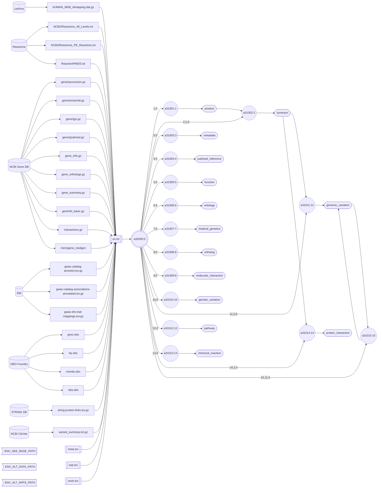

###### November 1, 2026: interlace-do cmd a32005 readme v2

# [a32005]

Application [a32005] is a strictly deterministic software agent built for zero-variation execution. Unlike probabilistic LLM-based agents, [a32005] guarantees the exact same output and behavior for any given input by relying on:

- **Fixed Rules:** Strict adherence to Standard Operating Procedures (SOPs). 
- **Explicit Logic:** Immutable execution via Bash scripts and Go programs. 
- **Predefined Paths:** Routing governed entirely by structured metadata.

The diagram below illustrates the pipeline blueprint for creating the **Gene Entity** in [interlace-ex]([interlace-ex](https://github.com/sas-quantome/interlace-ex)). Instead of manually running and monitoring [15](https://github.com/sas-quantome/interlace-ex/blob/main/cmd/README.md) separate Go applications, [a32005] automates the entire workflow with a single command.



##### Diagram Legend

- ⛁ **Cylinders:** External data providers
- ⬡ **Hexagons:** Interlace folder hierarchy
- ◯ **Circles:** Interlace Go applications
- 𓉴 **Flags:** Environment variables
- 𓋰 **Ovals:** Interlace binary files
- 𓈙 **Rectangles:** | Raw data files | or || configuration/log files ||

## Contents

1) [Help Page](#1-help-page)
2) [URI Input File and Concepts](#2-uri-input-file-and-concepts)
3) [Requirements](#3-requirements)
4) [Environment Variables](#4-environment-variables)
5) [Pipeline Execution Command Line](#5-pipeline-execution-command-line)
6) [Agent Output](#6-agent-output)
7) [Entity Output](#7-entity-output)
8) [Event Output](#8-event-output)
9) [Pipeline Jobs](#9-pipeline-jobs)

### 1. Help Page

The help page is available with the `-help` option or when no arguments are provided.

```text
Project: go-interlace
AppName: a32005
Version: 2026_10_31_10
Purpose: configures, runs, and monitors jobs and workflows in a pipeline.

Sources:

  1) PIPELINE_META
  2) PIPELINE_SOP
  3) PIPELINE_WORK

Options:

  -base-path string
        Agent, event, and entity base path (default "/Users/foglio/interlace-ex")
  -data-path string
        Data path where to read and download files (default "/Users/foglio/interlace-ex/data")
  -help
        Displays this help page
  -log string
        Logfile path to write stderr & stdout regardless of the -silent flag (default no log file)
  -loud
        Writes additional information if available
  -no-commit
        Disables committing the work
  -no-delete
        Disables deleting the artifact files
  -no-download
        Disables downloading data when necessary
  -silent
        Suppresses all standard output messages
  -uri-inp-file string
        URI list of URL, mailto, telnet, absolute-file-path#key (unique key as URI fragment), etc.
```

### 2. URI Input File and Concepts

A Uniform Resource Identifier (URI) is a unique sequence of characters that identifies an abstract or physical resource, such as a webpage, a full-path filename, an email address, a phone number, a book, a research article, a real-world object, or a concept. A URI list is necessary to ensure that input sources can be uniquely and accurately identified. The following is the URI list for creating the **Gene Entity**:

↳ [uri.txt](../../configs/input/uri.txt) ← look for the META, SOP, WORK, and other paths you must update for your local set-up

A single URI file can contain URIs for multiple applications. Interlace applications search this file to find the address of the required inputs.

The agent [a32005] is configured with 3 files declared in the URI file:

- PIPELINE_META → [meta.tsv](../../configs/input/meta.tsv) ← this is a config file so update if necessary
- PIPELINE_SOP → [sop.tsv](../../test/base/agent/configuration/sop.tsv) ← this is a final blueprint so **don't modify**
- PIPELINE_WORK → [work.tsv](../../test/base/agent/configuration/work.tsv) ← this is a final blueprint, so **don't modify**

If you need to modify an existing blueprint, then you need to design a new one, and add the new SOP and WORK entries to the `sop.tsv` and `work.tsv` files.

#### 2.1 The Meta File

The pipeline application [a32005] is not aware of data stacks or building blocks. It simply converts a plan into a sequence of safely formatted system commands. Then, it determines their execution time and location. Go Interlace custom applications provide the specific knowledge required for each task. For the plan to work, the pipeline author must supply a metadata file. The tab-delimited file must contain the following:


```text
MAX_WORKERS	<number-of-simultaneous-workers>
BASE_CONCEPT	<entity-name>
EVENT_TIME_TAG	<yyyymmddhhmmss>
WORKFLOW_SEQUENCE	<workflow-IDs>
```

The maximum number of concurrent workers, each with its own thread pool, needs to be declared. The base concept is the ontology term needed to name the entity. Data asset names, in contrast, are hardcoded by the Go Interlace applications. All the naming is processed correctly under the hood. The event timetag, however, is propagated to all workflow applications. Attention, this is the data build version. If not provided, the pipeline creates one from the actual date and time.

The workflow sequence requires at least one workflowID. The **InterlaceEx** Gene entity is created using a single workflow. When multiple workflows are chained in a single pipeline, write the sequence in the order of their dependencies. Unlike jobs, workflows are run one at a time. Running multiple pipelines in parallel for different entities is safe.

#### 2.2 The Work File

A workflow plan is defined once, and each variant must have a unique workflowID. The plan is structured as a 3x3 tab-delimited table, and a single table can store the plans for all workflows. The pipeline identifies the plan by workflowID. Let’s review the plan for building the **InterlaceEx** Gene entity:

```text
w31001	activity	Creates the Homo sapiens InterlaceEx Gene entity assets.
w31001	workflow	a32005 a31001 a31002 a31003 a31004 a31005 a31006 a31007 a31008 a31009 a31010 a31011 a31012 a31013 a31014 a31015
w31001	pipeline	1 0 2 1 0 3 0 4 0 5 0 6 0 7 0 8 0 9 0 10 0 11 2 0 12 0 13 0 14 2 0 15 11 0
```

The first column contains the workflowID. It must be unique. Use three rows per workflowID—no more, no fewer. The second column must use one of three controlled terms: activity, pipeline, or workflow. The third column describes the plan. The activity is a short phrase explaining the workflow's aim. The workflow lists the Go Interlace applications, e.g., jobs. Start with the pipeline application (e.g., [a32005]), then add the task applications, separated by spaces. The pipeline presents the DAG footprint, as discussed earlier. The DAG nodes are also separated by spaces.

```text
Example, if:

w10101     workflow     a60100 a40310 a20144 a10101

Then, the DAG nodes are:

0: a60100
1: a40310
2: a20144
3: a10101
```

#### 2.3 Numbered Naming

Break what already works, but preserve the working version. In the software world, it is possible! New applications are just promoted variations of the originals.

A single project can generate hundreds of applications, and naming them is an issue. The format used here is a non-verbose name consisting of a single lowercase letter followed by five digits. The conventional numbered names have no sequential meaning, yet are easy to remember. The naming model's aim is to maintain uniqueness and functional consistency across workflows. For example, a slight modification in workflow w60101 produces a new workflow with a different number, e.g., w60123. Same for the applications, when a different non-parametric outcome is desired, a new application is created, e.g., a personalized version.

#### 2.4 The SOP File

The standard operating procedure (SOP) table consists of five columns, tab-delimited, and values cannot be empty. Column names expected are: **WorkflowID**, **AppID**, **Code**, **Slot**, and **Filler**.

The SOP focuses on the application and is project agnostic. An application can have multiple SOPs each part of a distinct **workflowID**.

##### 2.4.1 Codes in Column 3

- **R:** Parameter required by the application
- **O:** Optional parameter
- **F:** If the boolean flag name is declared, it will be declared true
- **S:** Use for **Slurm** long option active argument, as for `slot=account` and `filler=<account:string>` DON'T USE error and output
- **P:** Use for **PBS** short option active argument, as for `slot=A` and `filler=<account:string>` DON'T USE e and o

##### 2.4.2 The Dot

Use a dot on column 3 to confirm the end of a record and when a value is not expected.

##### 2.4.3 Column 4

The **Slot** name is the application's command line parameter name.

##### 2.4.4 Column 5

This is the **Filler** value associated with the **Slot**, and it can be a dot only when the code is [O|F]

##### 2.4.5 Active Commands

When using **Slurm** and **PBS**, the following active commands are automatically included, and there is no need to declare in the SOP.

The **Slurm** active commands automatically included are:

- Stderr: --error
- Stdout: --output
- Job name: --job-name

The **PBS** active commands automatically included are:

- Stderr: -e
- Stdout: -o
- Job name: -N

### 3. Requirements

- Base path from the `-base-path` option or the default environmental-variable `ENV_AEE_BASE_PATH`
- Data path from the `-data-path` option or the default environmental-variable `ENV_ALT_DATA_PATH`
- URI list containing URLs and full-path file sources.
- The metadata, workflow, and SOP files must be declared in the URI list.

### 4. Environment Variables

The pipeline application [a32005] looks for the following default environment variables. It prioritizes the meta-configuration variables, and the command line options override them.

```text
ENV_AEE_BASE_PATH
ENV_ALT_DATA_PATH
ENV_ALT_APPS_PATH
```

### 5. Pipeline Execution Command Line

```shell
a32005 -log a32005.log -uri-inp-file uri.txt
```

```text
Inf: 2026/11/01 18:05:43.967328 application name: a32005
Inf: 2026/11/01 18:05:43.967586 application version: 2026_10_31_10
Inf: 2026/11/01 18:05:43.967607 application module: go-interlace
Inf: 2026/11/01 18:05:43.967625 application aim: configures, runs, and monitors jobs and workflows in a pipeline.
Inf: 2026/11/01 18:05:43.967638 application start time tag: 20261101180543
Inf: 2026/11/01 18:05:43.967648 listing configuration variables ...
Inf: 2026/11/01 18:05:43.967663 APP_REVISION: 10
Inf: 2026/11/01 18:05:43.967673 BASE_PATH: /Users/foglio/interlace-ex
Inf: 2026/11/01 18:05:43.967680 DATA_PATH: /Users/foglio/interlace-ex/data
Inf: 2026/11/01 18:05:43.967688 ENV_AEE_BASE_PATH: /Users/foglio/interlace-ex
Inf: 2026/11/01 18:05:43.967695 ENV_ALT_DATA_PATH: /Users/foglio/interlace-ex/data
Inf: 2026/11/01 18:05:43.967702 EVENT_TIME_TAG: 
Inf: 2026/11/01 18:05:43.967710 HOME: /Users/foglio
Inf: 2026/11/01 18:05:43.967717 LOG_OUTPUT_FILE: a32005.log
Inf: 2026/11/01 18:05:43.967724 URI_INP_FILE: uri.txt
Inf: 2026/11/01 18:05:43.967731 USER_LOGIN_NAME: foglio
Inf: 2026/11/01 18:05:43.967738 USER_NAME: Mario Foglio
Inf: 2026/11/01 18:05:43.967745 configuring pipeline ...
Inf: 2026/11/01 18:05:43.967754 checking input files ...
Inf: 2026/11/01 18:05:43.967998 configured file[PIPELINE_SOP]=/Users/foglio/interlace-ex/agent/configuration/sop.tsv
Inf: 2026/11/01 18:05:43.968012 configured file[PIPELINE_WORK]=/Users/foglio/interlace-ex/agent/configuration/work.tsv
Inf: 2026/11/01 18:05:43.968021 configured file[PIPELINE_META]=/Users/foglio/work/interlace-ex/meta.tsv
Inf: 2026/11/01 18:05:43.968059 setting up pipeline ...
Inf: 2026/11/01 18:05:43.969586 AGENT_CONF_PATH: /Users/foglio/interlace-ex/agent/configuration
Inf: 2026/11/01 18:05:43.969599 AGENT_EXEC_PATH: /Users/foglio/interlace-ex/agent/execution/202608/18000000
Inf: 2026/11/01 18:05:43.969608 BASE_CONCEPT: gene
Inf: 2026/11/01 18:05:43.969616 BASE_PATH: /Users/foglio/interlace-ex
Inf: 2026/11/01 18:05:43.969623 DATA_PATH: /Users/foglio/interlace-ex/data
Inf: 2026/11/01 18:05:43.969630 EVENT_TIME_TAG: 20260818000000
Inf: 2026/11/01 18:05:43.969637 MAX_WORKERS: 4
Inf: 2026/11/01 18:05:43.969647 URI_INP_FILE: uri.txt
Inf: 2026/11/01 18:05:43.969654 WORKFLOW_SEQUENCE: w31001
Inf: 2026/11/01 18:05:43.969661 running pipeline ...
Inf: 2026/11/01 18:05:43.969669 /Users/foglio/interlace-ex/agent/execution/202608/18000000
Inf: 2026/11/01 18:05:43.971238 standby jobs: 15
Inf: 2026/11/01 18:05:43.971457 worker Go routine=[2] setting job: j04001_w31001_a31004
Inf: 2026/11/01 18:05:43.971510 worker Go routine=[1] setting job: j01001_w31001_a31001
Inf: 2026/11/01 18:05:43.971798 worker Go routine=[3] setting job: j02001_w31001_a31002
Inf: 2026/11/01 18:05:43.971830 worker Go routine=[0] setting job: j03001_w31001_a31003
Inf: 2026/11/01 18:05:56.179265 worker Go routine=[2] running job: j04001_w31001_a31004
Inf: 2026/11/01 18:05:56.179425 worker Go routine=[2] success job: j04001_w31001_a31004
Inf: 2026/11/01 18:05:56.179464 worker Go routine=[2] setting job: j05001_w31001_a31005
Inf: 2026/11/01 18:06:07.030743 worker Go routine=[2] running job: j05001_w31001_a31005
Inf: 2026/11/01 18:06:07.030896 worker Go routine=[2] success job: j05001_w31001_a31005
Inf: 2026/11/01 18:06:07.030918 worker Go routine=[2] setting job: j06001_w31001_a31006
Inf: 2026/11/01 18:06:25.562333 worker Go routine=[0] running job: j03001_w31001_a31003
Inf: 2026/11/01 18:06:25.562458 worker Go routine=[0] success job: j03001_w31001_a31003
Inf: 2026/11/01 18:06:25.562480 worker Go routine=[0] setting job: j07001_w31001_a31007
Inf: 2026/11/01 18:06:25.935104 worker Go routine=[0] running job: j07001_w31001_a31007
Inf: 2026/11/01 18:06:25.935226 worker Go routine=[0] success job: j07001_w31001_a31007
Inf: 2026/11/01 18:06:25.935249 worker Go routine=[0] setting job: j08001_w31001_a31008
Inf: 2026/11/01 18:06:44.907806 worker Go routine=[2] running job: j06001_w31001_a31006
Inf: 2026/11/01 18:06:44.907950 worker Go routine=[2] success job: j06001_w31001_a31006
Inf: 2026/11/01 18:06:44.907973 worker Go routine=[2] setting job: j09001_w31001_a31009
Inf: 2026/11/01 18:06:54.506326 worker Go routine=[0] running job: j08001_w31001_a31008
Inf: 2026/11/01 18:06:54.509723 worker Go routine=[0] success job: j08001_w31001_a31008
Inf: 2026/11/01 18:06:54.509742 worker Go routine=[0] setting job: j10001_w31001_a31010
Inf: 2026/11/01 18:06:54.773840 worker Go routine=[2] running job: j09001_w31001_a31009
Inf: 2026/11/01 18:06:54.773964 worker Go routine=[2] success job: j09001_w31001_a31009
Inf: 2026/11/01 18:06:54.773987 worker Go routine=[2] setting job: j11001_w31001_a31011
Inf: 2026/11/01 18:08:53.197506 worker Go routine=[0] running job: j10001_w31001_a31010
Inf: 2026/11/01 18:08:53.198011 worker Go routine=[0] success job: j10001_w31001_a31010
Inf: 2026/11/01 18:08:53.198033 worker Go routine=[0] setting job: j12001_w31001_a31012
Inf: 2026/11/01 18:08:54.825459 worker Go routine=[0] running job: j12001_w31001_a31012
Inf: 2026/11/01 18:08:54.825576 worker Go routine=[0] success job: j12001_w31001_a31012
Inf: 2026/11/01 18:08:54.825599 worker Go routine=[0] setting job: j13001_w31001_a31013
Inf: 2026/11/01 18:08:56.781029 worker Go routine=[0] running job: j13001_w31001_a31013
Inf: 2026/11/01 18:08:56.781196 worker Go routine=[0] success job: j13001_w31001_a31013
Inf: 2026/11/01 18:08:56.781222 worker Go routine=[0] setting job: j14001_w31001_a31014
Inf: 2026/11/01 18:09:00.337391 worker Go routine=[1] running job: j01001_w31001_a31001
Inf: 2026/11/01 18:09:00.337556 worker Go routine=[1] success job: j01001_w31001_a31001
Inf: 2026/11/01 18:09:00.337575 worker Go routine=[1] setting job: j15001_w31001_a31015
Inf: 2026/11/01 18:09:55.084808 worker Go routine=[3] running job: j02001_w31001_a31002
Inf: 2026/11/01 18:09:55.085015 worker Go routine=[3] success job: j02001_w31001_a31002
Inf: 2026/11/01 18:10:06.573956 worker Go routine=[2] running job: j11001_w31001_a31011
Inf: 2026/11/01 18:10:06.574167 worker Go routine=[2] success job: j11001_w31001_a31011
Inf: 2026/11/01 18:10:07.787996 worker Go routine=[1] running job: j15001_w31001_a31015
Inf: 2026/11/01 18:10:07.788132 worker Go routine=[1] success job: j15001_w31001_a31015
Inf: 2026/11/01 18:11:32.850224 worker Go routine=[0] running job: j14001_w31001_a31014
Inf: 2026/11/01 18:11:32.850660 worker Go routine=[0] success job: j14001_w31001_a31014
Inf: 2026/11/01 18:11:32.850678 closed jobs: 15
Inf: 2026/11/01 18:11:32.850868 number of warnings caught: 0
Inf: 2026/11/01 18:11:32.850877 elapsed time just before closing: 5m48.882959708s
Inf: 2026/11/01 18:11:32.850882 end of process: complete
```

## 6. Agent Output

```text
interlace-ex/agent
├── configuration
│   ├── sop.tsv
│   └── work.tsv
└── execution
    └── 202608
        └── 18000000
            ├── 20260818000000_a32005.log
            ├── meta.tsv
            ├── sot.tsv
            ├── w31001_jobs.tsv
            └── work.tsv
```

## 7. Entity Output

```text
interlace-ex/entity/gene
├── chemical_reaction
│   └── 20260818000000
│       ├── catalog
│       │   ├── suk_chemical_reaction_hash_id_m.bin
│       │   └── uuk_chemical_reaction_text_s.bin
│       ├── enumeration
│       │   └── uuk_reaction_entity_cv_s.bin
│       └── property
│           ├── sdk_entrez_gene_id_u.bin
│           ├── udk_pubmed_id_u.bin
│           ├── udk_reaction_entity_cv_d.bin
│           ├── udk_reaction_hash_id_m.bin
│           └── udk_reactome_hsa_id_u.bin
├── function
│   └── 20260818000000
│       ├── catalog
│       │   ├── suk_function_hash_id_m.bin
│       │   └── uuk_function_text_s.bin
│       ├── enumeration
│       └── property
│           ├── sdk_entrez_gene_id_u.bin
│           ├── udk_pubmed_id_u.bin
│           ├── udk_rif_hash_id_m.bin
│           └── udk_taxonomy_id_u.bin
├── genetic_variation
│   └── 20260818000000
│       ├── catalog
│       │   ├── suk_genetic_variation_hash_id_m.bin
│       │   └── uuk_genetic_variation_text_s.bin
│       ├── enumeration
│       │   └── uuk_bit_flags_cv_s.bin
│       └── property
│           ├── sdk_entrez_gene_id_u.bin
│           ├── udk_bit_flags_m.bin
│           ├── udk_conical_allele_id_u.bin
│           ├── udk_omim_id_u.bin
│           ├── udk_refsnp_id_u.bin
│           ├── udk_variation_hash_id_m.bin
│           └── udk_variation_id_u.bin
├── genomic_variation
│   └── 20260818000000
│       ├── catalog
│       │   ├── suk_genomic_variation_hash_id_m.bin
│       │   └── uuk_genomic_variation_text_s.bin
│       ├── enumeration
│       │   └── uuk_bit_flags_cv_s.bin
│       └── property
│           ├── sdk_entrez_gene_id_u.bin
│           ├── udk_bit_flags_u.bin
│           ├── udk_gwas_hash_id_m.bin
│           ├── udk_ontology_id_s.bin
│           ├── udk_pubmed_id_u.bin
│           └── udk_refsnp_id_u.bin
├── medical_genetics
│   └── 20260818000000
│       ├── catalog
│       ├── enumeration
│       │   └── uuk_bit_flags_cv_s.bin
│       └── property
│           ├── sdk_entrez_gene_id_u.bin
│           ├── udk_bit_flags_u.bin
│           ├── udk_medgen_cui_s.bin
│           └── udk_omim_id_u.bin
├── metadata
│   └── 20260818000000
│       ├── catalog
│       │   ├── suk_metadata_hash_id_m.bin
│       │   └── uuk_metadata_text_s.bin
│       ├── enumeration
│       │   └── uuk_bit_flags_cv_s.bin
│       └── property
│           ├── suk_entrez_gene_id_u.bin
│           ├── udk_bit_flags_u.bin
│           ├── udk_chromosome_s.bin
│           ├── udk_gene_name_s.bin
│           ├── udk_gene_symbol_s.bin
│           ├── udk_metadata_hash_id_m.bin
│           ├── udk_name_synonyms_set_s.bin
│           ├── udk_symbol_synonyms_set_s.bin
│           ├── udk_taxonomy_id_u.bin
│           └── udk_xdb_id_set_s.bin
├── molecular_interaction
│   └── 20260818000000
│       ├── catalog
│       ├── enumeration
│       └── property
│           ├── sdk_entrez_gene_id_u.bin
│           ├── udk_interactant_entrez_gene_id_u.bin
│           ├── udk_interactant_taxonomy_id_u.bin
│           ├── udk_pubmed_id_set_s.bin
│           └── udk_taxonomy_id_u.bin
├── ontology
│   └── 20260818000000
│       ├── catalog
│       │   ├── suk_ontology_hash_id_m.bin
│       │   └── uuk_ontology_text_s.bin
│       ├── enumeration
│       │   └── uuk_bit_flags_cv_s.bin
│       └── property
│           ├── sdk_entrez_gene_id_u.bin
│           ├── udk_bit_flags_m.bin
│           ├── udk_go_hash_id_m.bin
│           ├── udk_go_id_u.bin
│           └── udk_pubmed_id_u.bin
├── ortholog
│   └── 20260818000000
│       ├── catalog
│       ├── enumeration
│       └── property
│           ├── sdk_entrez_gene_id_u.bin
│           ├── udk_ortholog_entrez_gene_id_u.bin
│           ├── udk_ortholog_taxonomy_id_u.bin
│           └── udk_taxonomy_id_u.bin
├── pathway
│   └── 20260818000000
│       ├── catalog
│       │   ├── suk_pathway_hash_id_m.bin
│       │   └── uuk_pathway_text_s.bin
│       ├── enumeration
│       └── property
│           ├── sdk_entrez_gene_id_u.bin
│           ├── udk_pathway_hash_id_m.bin
│           └── udk_reactome_hsa_id_u.bin
├── product
│   └── 20260818000000
│       ├── catalog
│       ├── enumeration
│       │   └── uuk_synonym_category_cv_s.bin
│       └── property
│           ├── sdk_entrez_gene_id_u.bin
│           ├── udk_protein_id_s.bin
│           ├── udk_synonym_category_cv_d.bin
│           └── udk_synonym_s.bin
├── protein_interaction
│   └── 20260818000000
│       ├── catalog
│       ├── enumeration
│       └── property
│           ├── sdk_entrez_gene_id_u.bin
│           ├── udk_association_ensp_id_i.bin
│           ├── udk_association_entrez_gene_id_u.bin
│           ├── udk_ensp_id_i.bin
│           └── udk_likelihood_score_n.bin
├── pubmed_reference
│   └── 20260818000000
│       ├── catalog
│       ├── enumeration
│       └── property
│           ├── sdk_entrez_gene_id_u.bin
│           └── udk_pubmed_id_u.bin
└── synonym
    └── 20260818000000
        ├── catalog
        ├── enumeration
        │   └── uuk_synonym_category_cv_s.bin
        └── property
            ├── sdk_synonym_s.bin
            ├── udk_entrez_gene_id_u.bin
            ├── udk_protein_id_s.bin
            ├── udk_synonym_category_cv_d.bin
            └── udk_synonym_version_s.bin
```

## 8. Event Output

```text
interlace-ex/event/gene
└── w31001
    └── 20260818000000
        ├── action
        │   ├── j01001_w31001_a31001.log
        │   ├── j02001_w31001_a31002.log
        │   ├── j03001_w31001_a31003.log
        │   ├── j04001_w31001_a31004.log
        │   ├── j05001_w31001_a31005.log
        │   ├── j06001_w31001_a31006.log
        │   ├── j07001_w31001_a31007.log
        │   ├── j08001_w31001_a31008.log
        │   ├── j09001_w31001_a31009.log
        │   ├── j10001_w31001_a31010.log
        │   ├── j11001_w31001_a31011.log
        │   ├── j12001_w31001_a31012.log
        │   ├── j13001_w31001_a31013.log
        │   ├── j14001_w31001_a31014.log
        │   └── j15001_w31001_a31015.log
        ├── artifact
        │   ├── chemical_reaction_431226977.tsv.gz
        │   ├── function_40265853.tsv.gz
        │   ├── genetic_variation_4040266439.tsv.gz
        │   ├── genomic_variation_3632690952.tsv.gz
        │   ├── medical_genetics_3007833124.tsv.gz
        │   ├── metadata_1295534207.tsv.gz
        │   ├── molecular_interaction_1425465952.tsv.gz
        │   ├── ontology_1974969528.tsv.gz
        │   ├── ortholog_2182144533.tsv.gz
        │   ├── pathway_846843640.tsv.gz
        │   ├── product_2433285754.tsv.gz
        │   ├── protein_interaction_1206972486.tsv.gz
        │   ├── pubmed_reference_3483497384.tsv.gz
        │   └── synonym_4003164631.tsv.gz
        └── function
            ├── j01001_w31001_a31001
            ├── j02001_w31001_a31002
            ├── j03001_w31001_a31003
            ├── j04001_w31001_a31004
            ├── j05001_w31001_a31005
            ├── j06001_w31001_a31006
            ├── j07001_w31001_a31007
            ├── j08001_w31001_a31008
            ├── j09001_w31001_a31009
            ├── j10001_w31001_a31010
            ├── j11001_w31001_a31011
            ├── j12001_w31001_a31012
            ├── j13001_w31001_a31013
            ├── j14001_w31001_a31014
            └── j15001_w31001_a31015
```

## 9. Pipeline Jobs

### j01001_w31001_a31001

```bash
#!/bin/bash
#
# This script is generated by: a32005

a31001 -silent -no-delete \
-base-path /Users/foglio/interlace-ex \
-data-path /Users/foglio/interlace-ex/data \
-base-concept gene \
-event-time-tag 20260818000000 \
-uri-inp-file uri.txt \
-workflow-id w31001 \
-log /Users/foglio/interlace-ex/event/gene/w31001/20260818000000/action/j01001_w31001_a31001.log
```

### j01001_w31001_a31001.log

```text
Inf: 2026/11/01 18:05:44.476643 application name: a31001
Inf: 2026/11/01 18:05:44.476683 application version: 2026_10_31_12
Inf: 2026/11/01 18:05:44.476694 application module: interlace-ex
Inf: 2026/11/01 18:05:44.476700 application aim: creates the Homo sapiens Gene entity Product asset from NCBI Gene DB and UniProt.
Inf: 2026/11/01 18:05:44.476705 application start time tag: 20261101180544
Inf: 2026/11/01 18:05:44.476709 listing configuration variables ...
Inf: 2026/11/01 18:05:44.476729 APP_REVISION: 12
Inf: 2026/11/01 18:05:44.476734 BASE_CONCEPT: gene
Inf: 2026/11/01 18:05:44.476738 BASE_PATH: /Users/foglio/interlace-ex
Inf: 2026/11/01 18:05:44.476742 DATA_PATH: /Users/foglio/interlace-ex/data
Inf: 2026/11/01 18:05:44.476746 ENV_AEE_BASE_PATH: /Users/foglio/interlace-ex
Inf: 2026/11/01 18:05:44.476751 ENV_ALT_DATA_PATH: /Users/foglio/interlace-ex/data
Inf: 2026/11/01 18:05:44.476755 EVENT_TIME_TAG: 20260818000000
Inf: 2026/11/01 18:05:44.476759 HOME: /Users/foglio
Inf: 2026/11/01 18:05:44.476762 LOG_OUTPUT_FILE: /Users/foglio/interlace-ex/event/gene/w31001/20260818000000/action/j01001_w31001_a31001.log
Inf: 2026/11/01 18:05:44.476766 URI_INP_FILE: uri.txt
Inf: 2026/11/01 18:05:44.476769 USER_LOGIN_NAME: foglio
Inf: 2026/11/01 18:05:44.476773 USER_NAME: Mario Foglio
Inf: 2026/11/01 18:05:44.476776 WORKFLOW_ID: w31001
Inf: 2026/11/01 18:05:44.476781 setting up the refiner ...
Inf: 2026/11/01 18:05:44.477151 file exists: /Users/foglio/interlace-ex/data/gene2ensembl.gz
Inf: 2026/11/01 18:05:44.477180 file exists: /Users/foglio/interlace-ex/data/HUMAN_9606_idmapping.dat.gz
Inf: 2026/11/01 18:05:44.477194 file exists: /Users/foglio/interlace-ex/data/gene2accession.gz
Inf: 2026/11/01 18:05:44.477229 file exists: /Users/foglio/interlace-ex/data/gene_info.gz
Inf: 2026/11/01 18:05:44.477266 creating the gene product asset ...
Inf: 2026/11/01 18:05:51.256488 total Entrez Gene Ensembl lines read: 19789503
Inf: 2026/11/01 18:05:51.256531 total Entrez Gene Ensembl table rows examined: 96207
Inf: 2026/11/01 18:05:51.256537 total Entrez Gene Ensembl tuples created: 253391
Inf: 2026/11/01 18:07:41.420169 total Entrez Gene RefSeq lines read: 285217184
Inf: 2026/11/01 18:07:41.421121 total Entrez Gene RefSeq table rows examined: 1693216
Inf: 2026/11/01 18:07:41.421129 total Entrez Gene RefSeq tuples created: 4140208
Inf: 2026/11/01 18:08:13.598870 total Entrez Gene synonyms lines read: 71719969
Inf: 2026/11/01 18:08:13.598885 total Entrez Gene synonyms table rows examined: 193812
Inf: 2026/11/01 18:08:13.598891 total Entrez Gene synonyms tuples created: 4474674
Inf: 2026/11/01 18:08:15.373239 total UniProt ID Map lines read: 5756700
Inf: 2026/11/01 18:08:15.373257 total UniProt ID Map table rows examined: 4774874
Inf: 2026/11/01 18:08:15.373263 total UniProt ID Map tuples created: 6406099
Inf: 2026/11/01 18:08:15.373302 total UniProt ID Map clusters without GeneID: 177098
Inf: 2026/11/01 18:08:15.374655 /Users/foglio/interlace-ex/event/gene/w31001/20260818000000/artifact/product_2433285754.tsv.gz size: 180210219
Inf: 2026/11/01 18:09:00.320349 number of warnings caught: 0
Inf: 2026/11/01 18:09:00.320380 elapsed time just before closing: 3m15.843813291s
Inf: 2026/11/01 18:09:00.320388 end of process: complete
```

### j02001_w31001_a31002

```bash
#!/bin/bash
#
# This script is generated by: a32005

a31002 -silent -no-delete \
-base-path /Users/foglio/interlace-ex \
-data-path /Users/foglio/interlace-ex/data \
-base-concept gene \
-event-time-tag 20260818000000 \
-workflow-id w31001 \
-log /Users/foglio/interlace-ex/event/gene/w31001/20260818000000/action/j02001_w31001_a31002.log
```

### j02001_w31001_a31002.log

```text
Inf: 2026/11/01 18:09:01.447135 application name: a31002
Inf: 2026/11/01 18:09:01.447166 application version: 2026_10_31_12
Inf: 2026/11/01 18:09:01.447177 application module: interlace-ex
Inf: 2026/11/01 18:09:01.447183 application aim: creates the Homo sapiens Gene entity Synonym asset from the NCBI Gene DB.
Inf: 2026/11/01 18:09:01.447189 application start time tag: 20261101180901
Inf: 2026/11/01 18:09:01.447193 listing configuration variables ...
Inf: 2026/11/01 18:09:01.447217 APP_REVISION: 12
Inf: 2026/11/01 18:09:01.447222 BASE_CONCEPT: gene
Inf: 2026/11/01 18:09:01.447226 BASE_PATH: /Users/foglio/interlace-ex
Inf: 2026/11/01 18:09:01.447230 DATA_PATH: /Users/foglio/interlace-ex/data
Inf: 2026/11/01 18:09:01.447234 ENV_AEE_BASE_PATH: /Users/foglio/interlace-ex
Inf: 2026/11/01 18:09:01.447237 ENV_ALT_DATA_PATH: /Users/foglio/interlace-ex/data
Inf: 2026/11/01 18:09:01.447241 EVENT_TIME_TAG: 20260818000000
Inf: 2026/11/01 18:09:01.447245 HOME: /Users/foglio
Inf: 2026/11/01 18:09:01.447251 LOG_OUTPUT_FILE: /Users/foglio/interlace-ex/event/gene/w31001/20260818000000/action/j02001_w31001_a31002.log
Inf: 2026/11/01 18:09:01.447256 USER_LOGIN_NAME: foglio
Inf: 2026/11/01 18:09:01.447260 USER_NAME: Mario Foglio
Inf: 2026/11/01 18:09:01.447263 WORKFLOW_ID: w31001
Inf: 2026/11/01 18:09:01.447267 setting up the refiner ...
Inf: 2026/11/01 18:09:01.447509 creating the gene synonym asset ...
Inf: 2026/11/01 18:09:04.050393 total Entrez Gene RIF lines read: 5919615
Inf: 2026/11/01 18:09:04.050421 total Entrez Gene RIF table rows examined: 5919615
Inf: 2026/11/01 18:09:04.050426 total Entrez Gene RIF tuples created: 5919615
Inf: 2026/11/01 18:09:04.053461 /Users/foglio/interlace-ex/event/gene/w31001/20260818000000/artifact/synonym_4003164631.tsv.gz size: 169293943
Inf: 2026/11/01 18:09:55.075294 number of warnings caught: 0
Inf: 2026/11/01 18:09:55.075343 elapsed time just before closing: 53.628599291s
Inf: 2026/11/01 18:09:55.075350 end of process: complete
```

### j03001_w31001_a31003

```bash
#!/bin/bash
#
# This script is generated by: a32005

a31003 -silent -no-delete \
-base-path /Users/foglio/interlace-ex \
-data-path /Users/foglio/interlace-ex/data \
-base-concept gene \
-event-time-tag 20260818000000 \
-uri-inp-file uri.txt \
-workflow-id w31001 \
-log /Users/foglio/interlace-ex/event/gene/w31001/20260818000000/action/j03001_w31001_a31003.log
```

### j03001_w31001_a31003.log

```text
Inf: 2026/11/01 18:05:44.338240 application name: a31003
Inf: 2026/11/01 18:05:44.338275 application version: 2026_10_31_13
Inf: 2026/11/01 18:05:44.338283 application module: interlace-ex
Inf: 2026/11/01 18:05:44.338288 application aim: creates the Homo sapiens Gene entity Metadata asset from the NCBI Gene DB.
Inf: 2026/11/01 18:05:44.338293 application start time tag: 20261101180544
Inf: 2026/11/01 18:05:44.338297 listing configuration variables ...
Inf: 2026/11/01 18:05:44.338317 APP_REVISION: 13
Inf: 2026/11/01 18:05:44.338322 BASE_CONCEPT: gene
Inf: 2026/11/01 18:05:44.338326 BASE_PATH: /Users/foglio/interlace-ex
Inf: 2026/11/01 18:05:44.338329 DATA_PATH: /Users/foglio/interlace-ex/data
Inf: 2026/11/01 18:05:44.338333 ENV_AEE_BASE_PATH: /Users/foglio/interlace-ex
Inf: 2026/11/01 18:05:44.338336 ENV_ALT_DATA_PATH: /Users/foglio/interlace-ex/data
Inf: 2026/11/01 18:05:44.338340 EVENT_TIME_TAG: 20260818000000
Inf: 2026/11/01 18:05:44.338343 HOME: /Users/foglio
Inf: 2026/11/01 18:05:44.338349 LOG_OUTPUT_FILE: /Users/foglio/interlace-ex/event/gene/w31001/20260818000000/action/j03001_w31001_a31003.log
Inf: 2026/11/01 18:05:44.338354 URI_INP_FILE: uri.txt
Inf: 2026/11/01 18:05:44.338357 USER_LOGIN_NAME: foglio
Inf: 2026/11/01 18:05:44.338361 USER_NAME: Mario Foglio
Inf: 2026/11/01 18:05:44.338364 WORKFLOW_ID: w31001
Inf: 2026/11/01 18:05:44.338367 setting up the refiner ...
Inf: 2026/11/01 18:05:44.338678 file exists: /Users/foglio/interlace-ex/data/gene_info.gz
Inf: 2026/11/01 18:05:44.338718 file exists: /Users/foglio/interlace-ex/data/gene_summary.gz
Inf: 2026/11/01 18:05:44.338730 creating the gene metadata asset ...
Inf: 2026/11/01 18:05:45.865033 total Entrez Gene RefSeq summary lines read: 3132497
Inf: 2026/11/01 18:05:45.865060 total Entrez Gene RefSeq summary table rows examined: 151658
Inf: 2026/11/01 18:05:45.865065 total Entrez Gene RefSeq summary tuples created: 151658
Inf: 2026/11/01 18:06:22.547335 total gene info lines read: 71719969
Inf: 2026/11/01 18:06:22.547386 total gene info table rows examined: 193812
Inf: 2026/11/01 18:06:22.547392 total gene info tuples created: 193812
Inf: 2026/11/01 18:06:22.682856 /Users/foglio/interlace-ex/event/gene/w31001/20260818000000/artifact/metadata_1295534207.tsv.gz size: 26781602
Inf: 2026/11/01 18:06:25.559114 number of warnings caught: 0
Inf: 2026/11/01 18:06:25.559129 elapsed time just before closing: 41.2212575s
Inf: 2026/11/01 18:06:25.559134 end of process: complete
```

### j04001_w31001_a31004

```bash
#!/bin/bash
#
# This script is generated by: a32005

a31004 -silent -no-delete \
-base-path /Users/foglio/interlace-ex \
-data-path /Users/foglio/interlace-ex/data \
-base-concept gene \
-event-time-tag 20260818000000 \
-uri-inp-file uri.txt \
-workflow-id w31001 \
-log /Users/foglio/interlace-ex/event/gene/w31001/20260818000000/action/j04001_w31001_a31004.log
```

### j04001_w31001_a31004.log

```text
Inf: 2026/11/01 18:05:44.327526 application name: a31004
Inf: 2026/11/01 18:05:44.327583 application version: 2026_10_31_12
Inf: 2026/11/01 18:05:44.327621 application module: interlace-ex
Inf: 2026/11/01 18:05:44.327626 application aim: creates the Homo sapiens Gene entity PubMed Reference asset from the NCBI Gene DB.
Inf: 2026/11/01 18:05:44.327632 application start time tag: 20261101180544
Inf: 2026/11/01 18:05:44.327636 listing configuration variables ...
Inf: 2026/11/01 18:05:44.327658 APP_REVISION: 12
Inf: 2026/11/01 18:05:44.327663 BASE_CONCEPT: gene
Inf: 2026/11/01 18:05:44.327666 BASE_PATH: /Users/foglio/interlace-ex
Inf: 2026/11/01 18:05:44.327671 DATA_PATH: /Users/foglio/interlace-ex/data
Inf: 2026/11/01 18:05:44.327675 ENV_AEE_BASE_PATH: /Users/foglio/interlace-ex
Inf: 2026/11/01 18:05:44.327679 ENV_ALT_DATA_PATH: /Users/foglio/interlace-ex/data
Inf: 2026/11/01 18:05:44.327682 EVENT_TIME_TAG: 20260818000000
Inf: 2026/11/01 18:05:44.327686 HOME: /Users/foglio
Inf: 2026/11/01 18:05:44.327690 LOG_OUTPUT_FILE: /Users/foglio/interlace-ex/event/gene/w31001/20260818000000/action/j04001_w31001_a31004.log
Inf: 2026/11/01 18:05:44.327695 URI_INP_FILE: uri.txt
Inf: 2026/11/01 18:05:44.327698 USER_LOGIN_NAME: foglio
Inf: 2026/11/01 18:05:44.327704 USER_NAME: Mario Foglio
Inf: 2026/11/01 18:05:44.327711 WORKFLOW_ID: w31001
Inf: 2026/11/01 18:05:44.327717 setting up the refiner ...
Inf: 2026/11/01 18:05:44.328249 file exists: /Users/foglio/interlace-ex/data/gene2pubmed.gz
Inf: 2026/11/01 18:05:44.328266 creating the gene PubMed reference asset ...
Inf: 2026/11/01 18:05:52.440045 total Entrez Gene PubMed lines read: 82395691
Inf: 2026/11/01 18:05:52.440086 total Entrez Gene PubMed table rows examined: 3326697
Inf: 2026/11/01 18:05:52.440092 total Entrez Gene PubMed tuples created: 3326697
Inf: 2026/11/01 18:05:52.440554 /Users/foglio/interlace-ex/event/gene/w31001/20260818000000/artifact/pubmed_reference_3483497384.tsv.gz size: 48179564
Inf: 2026/11/01 18:05:56.177047 number of warnings caught: 0
Inf: 2026/11/01 18:05:56.177093 elapsed time just before closing: 11.851473167s
Inf: 2026/11/01 18:05:56.177098 end of process: complete
```

### j05001_w31001_a31005

```bash
#!/bin/bash
#
# This script is generated by: a32005

a31005 -silent -no-delete \
-base-path /Users/foglio/interlace-ex \
-data-path /Users/foglio/interlace-ex/data \
-base-concept gene \
-event-time-tag 20260818000000 \
-uri-inp-file uri.txt \
-workflow-id w31001 \
-log /Users/foglio/interlace-ex/event/gene/w31001/20260818000000/action/j05001_w31001_a31005.log
```

### j05001_w31001_a31005.log

```text
Inf: 2026/11/01 18:05:56.438593 application name: a31005
Inf: 2026/11/01 18:05:56.438631 application version: 2026_10_31_13
Inf: 2026/11/01 18:05:56.438640 application module: interlace-ex
Inf: 2026/11/01 18:05:56.438644 application aim: creates the Homo sapiens Gene entity Function asset from NCBI Gene RIF.
Inf: 2026/11/01 18:05:56.438649 application start time tag: 20261101180556
Inf: 2026/11/01 18:05:56.438653 listing configuration variables ...
Inf: 2026/11/01 18:05:56.438671 APP_REVISION: 13
Inf: 2026/11/01 18:05:56.438675 BASE_CONCEPT: gene
Inf: 2026/11/01 18:05:56.438679 BASE_PATH: /Users/foglio/interlace-ex
Inf: 2026/11/01 18:05:56.438682 DATA_PATH: /Users/foglio/interlace-ex/data
Inf: 2026/11/01 18:05:56.438685 ENV_AEE_BASE_PATH: /Users/foglio/interlace-ex
Inf: 2026/11/01 18:05:56.438689 ENV_ALT_DATA_PATH: /Users/foglio/interlace-ex/data
Inf: 2026/11/01 18:05:56.438692 EVENT_TIME_TAG: 20260818000000
Inf: 2026/11/01 18:05:56.438695 HOME: /Users/foglio
Inf: 2026/11/01 18:05:56.438700 LOG_OUTPUT_FILE: /Users/foglio/interlace-ex/event/gene/w31001/20260818000000/action/j05001_w31001_a31005.log
Inf: 2026/11/01 18:05:56.438704 URI_INP_FILE: uri.txt
Inf: 2026/11/01 18:05:56.438707 USER_LOGIN_NAME: foglio
Inf: 2026/11/01 18:05:56.438710 USER_NAME: Mario Foglio
Inf: 2026/11/01 18:05:56.438713 WORKFLOW_ID: w31001
Inf: 2026/11/01 18:05:56.438716 setting up the refiner ...
Inf: 2026/11/01 18:05:56.439039 file exists: /Users/foglio/interlace-ex/data/generifs_basic.gz
Inf: 2026/11/01 18:05:56.439046 creating the gene function asset ...
Inf: 2026/11/01 18:06:02.307357 total Entrez Gene RIF lines read: 1695117
Inf: 2026/11/01 18:06:02.307413 total Entrez Gene RIF table rows examined: 1051428
Inf: 2026/11/01 18:06:02.307420 total Entrez Gene RIF tuples created: 1051428
Inf: 2026/11/01 18:06:04.406927 /Users/foglio/interlace-ex/event/gene/w31001/20260818000000/artifact/function_40265853.tsv.gz size: 41644681
Inf: 2026/11/01 18:06:07.026396 number of warnings caught: 0
Inf: 2026/11/01 18:06:07.026418 elapsed time just before closing: 10.58825325s
Inf: 2026/11/01 18:06:07.026423 end of process: complete
```

### j06001_w31001_a31006

```bash
#!/bin/bash
#
# This script is generated by: a32005

a31006 -silent -no-delete \
-base-path /Users/foglio/interlace-ex \
-data-path /Users/foglio/interlace-ex/data \
-base-concept gene \
-event-time-tag 20260818000000 \
-uri-inp-file uri.txt \
-workflow-id w31001 \
-log /Users/foglio/interlace-ex/event/gene/w31001/20260818000000/action/j06001_w31001_a31006.log
```

### j06001_w31001_a31006.log

```text
Inf: 2026/11/01 18:06:07.292856 application name: a31006
Inf: 2026/11/01 18:06:07.292906 application version: 2026_10_31_13
Inf: 2026/11/01 18:06:07.292915 application module: interlace-ex
Inf: 2026/11/01 18:06:07.292923 application aim: creates the Homo sapiens Gene entity Gene Ontology asset from the NCBI Gene DB.
Inf: 2026/11/01 18:06:07.292931 application start time tag: 20261101180607
Inf: 2026/11/01 18:06:07.292936 listing configuration variables ...
Inf: 2026/11/01 18:06:07.292961 APP_REVISION: 13
Inf: 2026/11/01 18:06:07.292965 BASE_CONCEPT: gene
Inf: 2026/11/01 18:06:07.292969 BASE_PATH: /Users/foglio/interlace-ex
Inf: 2026/11/01 18:06:07.292973 DATA_PATH: /Users/foglio/interlace-ex/data
Inf: 2026/11/01 18:06:07.292977 ENV_AEE_BASE_PATH: /Users/foglio/interlace-ex
Inf: 2026/11/01 18:06:07.292980 ENV_ALT_DATA_PATH: /Users/foglio/interlace-ex/data
Inf: 2026/11/01 18:06:07.292983 EVENT_TIME_TAG: 20260818000000
Inf: 2026/11/01 18:06:07.292987 HOME: /Users/foglio
Inf: 2026/11/01 18:06:07.292990 LOG_OUTPUT_FILE: /Users/foglio/interlace-ex/event/gene/w31001/20260818000000/action/j06001_w31001_a31006.log
Inf: 2026/11/01 18:06:07.292994 URI_INP_FILE: uri.txt
Inf: 2026/11/01 18:06:07.292997 USER_LOGIN_NAME: foglio
Inf: 2026/11/01 18:06:07.293000 USER_NAME: Mario Foglio
Inf: 2026/11/01 18:06:07.293003 WORKFLOW_ID: w31001
Inf: 2026/11/01 18:06:07.293007 setting up the refiner ...
Inf: 2026/11/01 18:06:07.293395 file exists: /Users/foglio/interlace-ex/data/gene2go.gz
Inf: 2026/11/01 18:06:07.293404 creating the gene ontology asset ...
Inf: 2026/11/01 18:06:43.957238 total Entrez Gene GO lines read: 124473676
Inf: 2026/11/01 18:06:43.957281 total Entrez Gene GO table rows examined: 446675
Inf: 2026/11/01 18:06:43.957287 total Entrez Gene GO tuples created: 300081
Inf: 2026/11/01 18:06:44.097018 /Users/foglio/interlace-ex/event/gene/w31001/20260818000000/artifact/ontology_1974969528.tsv.gz size: 16577392
Inf: 2026/11/01 18:06:44.905652 number of warnings caught: 0
Inf: 2026/11/01 18:06:44.905685 elapsed time just before closing: 37.613264084s
Inf: 2026/11/01 18:06:44.905689 end of process: complete
```

### j07001_w31001_a31007

```bash
#!/bin/bash
#
# This script is generated by: a32005

a31007 -silent -no-delete \
-base-path /Users/foglio/interlace-ex \
-data-path /Users/foglio/interlace-ex/data \
-base-concept gene \
-event-time-tag 20260818000000 \
-uri-inp-file uri.txt \
-workflow-id w31001 \
-log /Users/foglio/interlace-ex/event/gene/w31001/20260818000000/action/j07001_w31001_a31007.log
```

### j07001_w31001_a31007.log

```text
Inf: 2026/11/01 18:06:25.824504 application name: a31007
Inf: 2026/11/01 18:06:25.824538 application version: 2026_10_31_14
Inf: 2026/11/01 18:06:25.824546 application module: interlace-ex
Inf: 2026/11/01 18:06:25.824551 application aim: creates the Homo sapiens Gene entity Medical Genetics asset from the NCBI GenMed DB.
Inf: 2026/11/01 18:06:25.824555 application start time tag: 20261101180625
Inf: 2026/11/01 18:06:25.824559 listing configuration variables ...
Inf: 2026/11/01 18:06:25.824577 APP_REVISION: 14
Inf: 2026/11/01 18:06:25.824581 BASE_CONCEPT: gene
Inf: 2026/11/01 18:06:25.824585 BASE_PATH: /Users/foglio/interlace-ex
Inf: 2026/11/01 18:06:25.824588 DATA_PATH: /Users/foglio/interlace-ex/data
Inf: 2026/11/01 18:06:25.824592 ENV_AEE_BASE_PATH: /Users/foglio/interlace-ex
Inf: 2026/11/01 18:06:25.824595 ENV_ALT_DATA_PATH: /Users/foglio/interlace-ex/data
Inf: 2026/11/01 18:06:25.824598 EVENT_TIME_TAG: 20260818000000
Inf: 2026/11/01 18:06:25.824601 HOME: /Users/foglio
Inf: 2026/11/01 18:06:25.824604 LOG_OUTPUT_FILE: /Users/foglio/interlace-ex/event/gene/w31001/20260818000000/action/j07001_w31001_a31007.log
Inf: 2026/11/01 18:06:25.824607 URI_INP_FILE: uri.txt
Inf: 2026/11/01 18:06:25.824610 USER_LOGIN_NAME: foglio
Inf: 2026/11/01 18:06:25.824614 USER_NAME: Mario Foglio
Inf: 2026/11/01 18:06:25.824617 WORKFLOW_ID: w31001
Inf: 2026/11/01 18:06:25.824620 setting up the refiner ...
Inf: 2026/11/01 18:06:25.824945 file exists: /Users/foglio/interlace-ex/data/mim2gene_medgen
Inf: 2026/11/01 18:06:25.824952 creating the gene medical genetics asset ...
Inf: 2026/11/01 18:06:25.838757 total Entrez Gene OMIM lines read: 28751
Inf: 2026/11/01 18:06:25.838769 total Entrez Gene OMIM table rows examined: 28749
Inf: 2026/11/01 18:06:25.838773 total Entrez Gene OMIM tuples created: 25426
Inf: 2026/11/01 18:06:25.838924 /Users/foglio/interlace-ex/event/gene/w31001/20260818000000/artifact/medical_genetics_3007833124.tsv.gz size: 462761
Inf: 2026/11/01 18:06:25.933828 number of warnings caught: 0
Inf: 2026/11/01 18:06:25.933844 elapsed time just before closing: 109.826625ms
Inf: 2026/11/01 18:06:25.933849 end of process: complete
```

### j08001_w31001_a31008

```bash
#!/bin/bash
#
# This script is generated by: a32005

a31008 -silent -no-delete \
-base-path /Users/foglio/interlace-ex \
-data-path /Users/foglio/interlace-ex/data \
-base-concept gene \
-event-time-tag 20260818000000 \
-uri-inp-file uri.txt \
-workflow-id w31001 \
-log /Users/foglio/interlace-ex/event/gene/w31001/20260818000000/action/j08001_w31001_a31008.log
```

### j08001_w31001_a31008.log

```text
Inf: 2026/11/01 18:06:26.186308 application name: a31008
Inf: 2026/11/01 18:06:26.186339 application version: 2026_10_31_12
Inf: 2026/11/01 18:06:26.186347 application module: interlace-ex
Inf: 2026/11/01 18:06:26.186353 application aim: creates the Homo sapiens Gene entity Ortholog asset from the NCBI Gene DB.
Inf: 2026/11/01 18:06:26.186361 application start time tag: 20261101180626
Inf: 2026/11/01 18:06:26.186365 listing configuration variables ...
Inf: 2026/11/01 18:06:26.186383 APP_REVISION: 12
Inf: 2026/11/01 18:06:26.186387 BASE_CONCEPT: gene
Inf: 2026/11/01 18:06:26.186390 BASE_PATH: /Users/foglio/interlace-ex
Inf: 2026/11/01 18:06:26.186394 DATA_PATH: /Users/foglio/interlace-ex/data
Inf: 2026/11/01 18:06:26.186397 ENV_AEE_BASE_PATH: /Users/foglio/interlace-ex
Inf: 2026/11/01 18:06:26.186400 ENV_ALT_DATA_PATH: /Users/foglio/interlace-ex/data
Inf: 2026/11/01 18:06:26.186403 EVENT_TIME_TAG: 20260818000000
Inf: 2026/11/01 18:06:26.186406 HOME: /Users/foglio
Inf: 2026/11/01 18:06:26.186411 LOG_OUTPUT_FILE: /Users/foglio/interlace-ex/event/gene/w31001/20260818000000/action/j08001_w31001_a31008.log
Inf: 2026/11/01 18:06:26.186415 URI_INP_FILE: uri.txt
Inf: 2026/11/01 18:06:26.186418 USER_LOGIN_NAME: foglio
Inf: 2026/11/01 18:06:26.186422 USER_NAME: Mario Foglio
Inf: 2026/11/01 18:06:26.186425 WORKFLOW_ID: w31001
Inf: 2026/11/01 18:06:26.186428 setting up the refiner ...
Inf: 2026/11/01 18:06:26.186755 file exists: /Users/foglio/interlace-ex/data/gene_orthologs.gz
Inf: 2026/11/01 18:06:26.186761 creating the gene ortholog asset ...
Inf: 2026/11/01 18:06:33.544075 total Entrez Gene Orthologs lines read: 18756043
Inf: 2026/11/01 18:06:33.544125 total Entrez Gene Orthologs table rows examined: 11267602
Inf: 2026/11/01 18:06:33.544131 total Entrez Gene Orthologs tuples created: 11267602
Inf: 2026/11/01 18:06:33.544856 /Users/foglio/interlace-ex/event/gene/w31001/20260818000000/artifact/ortholog_2182144533.tsv.gz size: 304068890
Inf: 2026/11/01 18:06:54.501223 number of warnings caught: 0
Inf: 2026/11/01 18:06:54.501266 elapsed time just before closing: 28.315341291s
Inf: 2026/11/01 18:06:54.501273 end of process: complete
```

### j09001_w31001_a31009

```bash
#!/bin/bash
#
# This script is generated by: a32005

a31009 -silent -no-delete \
-base-path /Users/foglio/interlace-ex \
-data-path /Users/foglio/interlace-ex/data \
-base-concept gene \
-event-time-tag 20260818000000 \
-uri-inp-file uri.txt \
-workflow-id w31001 \
-log /Users/foglio/interlace-ex/event/gene/w31001/20260818000000/action/j09001_w31001_a31009.log
```

### j09001_w31001_a31009

```text
Inf: 2026/11/01 18:06:45.164175 application name: a31009
Inf: 2026/11/01 18:06:45.164204 application version: 2026_10_31_13
Inf: 2026/11/01 18:06:45.164213 application module: interlace-ex
Inf: 2026/11/01 18:06:45.164218 application aim: creates the Homo sapiens Gene entity Molecular Interaction asset from the NCBI Gene RIF.
Inf: 2026/11/01 18:06:45.164222 application start time tag: 20261101180645
Inf: 2026/11/01 18:06:45.164225 listing configuration variables ...
Inf: 2026/11/01 18:06:45.164244 APP_REVISION: 13
Inf: 2026/11/01 18:06:45.164248 BASE_CONCEPT: gene
Inf: 2026/11/01 18:06:45.164251 BASE_PATH: /Users/foglio/interlace-ex
Inf: 2026/11/01 18:06:45.164255 DATA_PATH: /Users/foglio/interlace-ex/data
Inf: 2026/11/01 18:06:45.164258 ENV_AEE_BASE_PATH: /Users/foglio/interlace-ex
Inf: 2026/11/01 18:06:45.164261 ENV_ALT_DATA_PATH: /Users/foglio/interlace-ex/data
Inf: 2026/11/01 18:06:45.164264 EVENT_TIME_TAG: 20260818000000
Inf: 2026/11/01 18:06:45.164268 HOME: /Users/foglio
Inf: 2026/11/01 18:06:45.164271 LOG_OUTPUT_FILE: /Users/foglio/interlace-ex/event/gene/w31001/20260818000000/action/j09001_w31001_a31009.log
Inf: 2026/11/01 18:06:45.164274 URI_INP_FILE: uri.txt
Inf: 2026/11/01 18:06:45.164278 USER_LOGIN_NAME: foglio
Inf: 2026/11/01 18:06:45.164281 USER_NAME: Mario Foglio
Inf: 2026/11/01 18:06:45.164284 WORKFLOW_ID: w31001
Inf: 2026/11/01 18:06:45.164287 setting up the refiner ...
Inf: 2026/11/01 18:06:45.164816 file exists: /Users/foglio/interlace-ex/data/interactions.gz
Inf: 2026/11/01 18:06:45.164827 creating the gene molecular interaction asset ...
Inf: 2026/11/01 18:06:47.301914 total Entrez Gene RIF interactions lines read: 4592484
Inf: 2026/11/01 18:06:47.301942 total Entrez Gene RIF interactions table rows examined: 2181478
Inf: 2026/11/01 18:06:47.301948 total Entrez Gene RIF interactions tuples created: 2178656
Inf: 2026/11/01 18:06:47.302466 /Users/foglio/interlace-ex/event/gene/w31001/20260818000000/artifact/molecular_interaction_1425465952.tsv.gz size: 70731525
Inf: 2026/11/01 18:06:54.771783 number of warnings caught: 0
Inf: 2026/11/01 18:06:54.771804 elapsed time just before closing: 9.608040583s
Inf: 2026/11/01 18:06:54.771809 end of process: complete
```

### j10001_w31001_a31010

```bash
#!/bin/bash
#
# This script is generated by: a32005

a31010 -silent -no-delete \
-base-path /Users/foglio/interlace-ex \
-data-path /Users/foglio/interlace-ex/data \
-base-concept gene \
-event-time-tag 20260818000000 \
-uri-inp-file uri.txt \
-workflow-id w31001 \
-log /Users/foglio/interlace-ex/event/gene/w31001/20260818000000/action/j10001_w31001_a31010.log
```

### j10001_w31001_a31010.log

```text
Inf: 2026/11/01 18:06:54.769134 application name: a31010
Inf: 2026/11/01 18:06:54.769170 application version: 2026_10_31_14
Inf: 2026/11/01 18:06:54.769183 application module: interlace-ex
Inf: 2026/11/01 18:06:54.769189 application aim: creates the Homo sapiens Gene entity Genetic Variation asset from the NCBI ClinVar DB.
Inf: 2026/11/01 18:06:54.769212 application start time tag: 20261101180654
Inf: 2026/11/01 18:06:54.769218 listing configuration variables ...
Inf: 2026/11/01 18:06:54.769225 APP_REVISION: 14
Inf: 2026/11/01 18:06:54.769230 BASE_CONCEPT: gene
Inf: 2026/11/01 18:06:54.769234 BASE_PATH: /Users/foglio/interlace-ex
Inf: 2026/11/01 18:06:54.769239 DATA_PATH: /Users/foglio/interlace-ex/data
Inf: 2026/11/01 18:06:54.769244 ENV_AEE_BASE_PATH: /Users/foglio/interlace-ex
Inf: 2026/11/01 18:06:54.769248 ENV_ALT_DATA_PATH: /Users/foglio/interlace-ex/data
Inf: 2026/11/01 18:06:54.769252 EVENT_TIME_TAG: 20260818000000
Inf: 2026/11/01 18:06:54.769257 HOME: /Users/foglio
Inf: 2026/11/01 18:06:54.769262 LOG_OUTPUT_FILE: /Users/foglio/interlace-ex/event/gene/w31001/20260818000000/action/j10001_w31001_a31010.log
Inf: 2026/11/01 18:06:54.769267 URI_INP_FILE: uri.txt
Inf: 2026/11/01 18:06:54.769272 USER_LOGIN_NAME: foglio
Inf: 2026/11/01 18:06:54.769279 USER_NAME: Mario Foglio
Inf: 2026/11/01 18:06:54.769284 WORKFLOW_ID: w31001
Inf: 2026/11/01 18:06:54.769289 setting up the refiner ...
Inf: 2026/11/01 18:06:54.769635 file exists: /Users/foglio/interlace-ex/data/variant_summary.txt.gz
Inf: 2026/11/01 18:06:54.769643 creating the gene genetic variation asset ...
Inf: 2026/11/01 18:08:16.502907 total ClinVar summary records without GeneID: 65501
Inf: 2026/11/01 18:08:16.502929 total ClinVar summary lines read: 9048964
Inf: 2026/11/01 18:08:16.502933 total ClinVar summary table rows examined: 9048962
Inf: 2026/11/01 18:08:16.502936 total ClinVar summary tuples created: 11942689
Inf: 2026/11/01 18:08:18.578640 /Users/foglio/interlace-ex/event/gene/w31001/20260818000000/artifact/genetic_variation_4040266439.tsv.gz size: 801196217
Inf: 2026/11/01 18:08:53.144099 number of warnings caught: 0
Inf: 2026/11/01 18:08:53.147092 elapsed time just before closing: 1m58.3781765s
Inf: 2026/11/01 18:08:53.147102 end of process: complete
```

### j11001_w31001_a31011

```bash
#!/bin/bash
#
# This script is generated by: a32005

a31011 -silent -no-delete -loud \
-base-path /Users/foglio/interlace-ex \
-data-path /Users/foglio/interlace-ex/data \
-base-concept gene \
-event-time-tag 20260818000000 \
-uri-inp-file uri.txt \
-workflow-id w31001 \
-log /Users/foglio/interlace-ex/event/gene/w31001/20260818000000/action/j11001_w31001_a31011.log
```

### j11001_w31001_a31011.log

```text
Inf: 2026/11/01 18:09:56.213786 application name: a31011
Inf: 2026/11/01 18:09:56.213819 application version: 2026_10_31_15
Inf: 2026/11/01 18:09:56.213828 application module: interlace-ex
Inf: 2026/11/01 18:09:56.213833 application aim: creates the Homo sapiens Gene entity Genomic Variation asset from the EBI GWAS Catalog.
Inf: 2026/11/01 18:09:56.213839 application start time tag: 20261101180956
Inf: 2026/11/01 18:09:56.213843 listing configuration variables ...
Inf: 2026/11/01 18:09:56.213865 APP_REVISION: 15
Inf: 2026/11/01 18:09:56.213869 BASE_CONCEPT: gene
Inf: 2026/11/01 18:09:56.213872 BASE_PATH: /Users/foglio/interlace-ex
Inf: 2026/11/01 18:09:56.213876 DATA_PATH: /Users/foglio/interlace-ex/data
Inf: 2026/11/01 18:09:56.213879 ENV_AEE_BASE_PATH: /Users/foglio/interlace-ex
Inf: 2026/11/01 18:09:56.213882 ENV_ALT_DATA_PATH: /Users/foglio/interlace-ex/data
Inf: 2026/11/01 18:09:56.213886 EVENT_TIME_TAG: 20260818000000
Inf: 2026/11/01 18:09:56.213889 HOME: /Users/foglio
Inf: 2026/11/01 18:09:56.213892 LOG_OUTPUT_FILE: /Users/foglio/interlace-ex/event/gene/w31001/20260818000000/action/j11001_w31001_a31011.log
Inf: 2026/11/01 18:09:56.213896 URI_INP_FILE: uri.txt
Inf: 2026/11/01 18:09:56.213899 USER_LOGIN_NAME: foglio
Inf: 2026/11/01 18:09:56.213902 USER_NAME: Mario Foglio
Inf: 2026/11/01 18:09:56.213906 WORKFLOW_ID: w31001
Inf: 2026/11/01 18:09:56.213909 setting up the refiner ...
Inf: 2026/11/01 18:09:56.214204 configured file[GWAS_CATALOG]=/Users/foglio/interlace-ex/data/gwas-catalog-associations-annotated.tsv.gz
Inf: 2026/11/01 18:09:56.214217 configured file[GWAS_EFO]=/Users/foglio/interlace-ex/data/gwas-efo-trait-mappings.tsv.gz
Inf: 2026/11/01 18:09:56.214304 file exists: /Users/foglio/interlace-ex/data/mondo.obo
Inf: 2026/11/01 18:09:56.214328 file exists: /Users/foglio/interlace-ex/data/oba.obo
Inf: 2026/11/01 18:09:56.214338 file exists: /Users/foglio/interlace-ex/data/gsso.obo
Inf: 2026/11/01 18:09:56.214343 file exists: /Users/foglio/interlace-ex/data/hp.obo
Inf: 2026/11/01 18:09:56.254233 creating the gene genomic variation asset ...
Inf: 2026/11/01 18:09:56.304393 total EFO Terms lines read: 110341
Inf: 2026/11/01 18:09:56.304411 total EFO Terms table rows examined: 110339
Inf: 2026/11/01 18:09:56.304417 total EFO Terms tuples created: 110339
Inf: 2026/11/01 18:09:56.323577 total HPO Terms lines read: 211112
Inf: 2026/11/01 18:09:56.323604 total HPO Terms table rows examined: 20413
Inf: 2026/11/01 18:09:56.323613 total HPO Terms tuples created: 20416
Inf: 2026/11/01 18:09:56.384655 total OBA Terms lines read: 748386
Inf: 2026/11/01 18:09:56.384676 total OBA Terms table rows examined: 83449
Inf: 2026/11/01 18:09:56.384681 total OBA Terms tuples created: 83708
Inf: 2026/11/01 18:09:56.394089 total GSSO Terms lines read: 102086
Inf: 2026/11/01 18:09:56.394108 total GSSO Terms table rows examined: 11570
Inf: 2026/11/01 18:09:56.394113 total GSSO Terms tuples created: 11462
Inf: 2026/11/01 18:09:56.482255 total MONDO Terms lines read: 928942
Inf: 2026/11/01 18:09:56.482283 total MONDO Terms table rows examined: 63267
Inf: 2026/11/01 18:09:56.482289 total MONDO Terms tuples created: 63455
Inf: 2026/11/01 18:10:01.449206 ontology ID not found: EFO:0000246
Inf: 2026/11/01 18:10:01.449224 ontology ID not found: EFO:0007882
Inf: 2026/11/01 18:10:01.449228 ontology ID not found: EFO:0008497
Inf: 2026/11/01 18:10:01.449231 ontology ID not found: EFO:0011047
Inf: 2026/11/01 18:10:01.449235 ontology ID not found: EFO:0021538
Inf: 2026/11/01 18:10:01.449238 ontology ID not found: EFO:0021539
Inf: 2026/11/01 18:10:01.449241 ontology ID not found: EFO:0021540
Inf: 2026/11/01 18:10:01.449245 ontology ID not found: EFO:0022147
Inf: 2026/11/01 18:10:01.449248 ontology ID not found: EFO:0022151
Inf: 2026/11/01 18:10:01.449251 ontology ID not found: EFO:0022152
Inf: 2026/11/01 18:10:01.449254 ontology ID not found: EFO:0022166
Inf: 2026/11/01 18:10:01.449258 ontology ID not found: EFO:0022172
Inf: 2026/11/01 18:10:01.449261 ontology ID not found: EFO:0022173
Inf: 2026/11/01 18:10:01.449264 ontology ID not found: EFO:0022188
Inf: 2026/11/01 18:10:01.449267 ontology ID not found: EFO:0022612
Inf: 2026/11/01 18:10:01.449283 ontology ID not found: EFO:0022613
Inf: 2026/11/01 18:10:01.449286 ontology ID not found: EFO:0801080
Inf: 2026/11/01 18:10:01.449289 ontology ID not found: EFO:0920016
Inf: 2026/11/01 18:10:01.449291 ontology ID not found: EFO:0920017
Inf: 2026/11/01 18:10:01.449294 ontology ID not found: EFO:0920018
Inf: 2026/11/01 18:10:01.449296 ontology ID not found: EFO:0920019
Inf: 2026/11/01 18:10:01.449299 ontology ID not found: EFO:0920020
Inf: 2026/11/01 18:10:01.449302 ontology ID not found: EFO:0920021
Inf: 2026/11/01 18:10:01.449304 ontology ID not found: EFO:0920022
Inf: 2026/11/01 18:10:01.449307 ontology ID not found: EFO:0920023
Inf: 2026/11/01 18:10:01.449310 ontology ID not found: EFO:0920024
Inf: 2026/11/01 18:10:01.449313 ontology ID not found: EFO:0920025
Inf: 2026/11/01 18:10:01.449315 ontology ID not found: EFO:0920026
Inf: 2026/11/01 18:10:01.449318 ontology ID not found: EFO:0920027
Inf: 2026/11/01 18:10:01.449320 ontology ID not found: EFO:0920028
Inf: 2026/11/01 18:10:01.449323 ontology ID not found: EFO:0920029
Inf: 2026/11/01 18:10:01.449325 ontology ID not found: EFO:0920030
Inf: 2026/11/01 18:10:01.449328 ontology ID not found: EFO:0920031
Inf: 2026/11/01 18:10:01.449330 ontology ID not found: EFO:0920032
Inf: 2026/11/01 18:10:01.449333 ontology ID not found: EFO:0920033
Inf: 2026/11/01 18:10:01.449336 ontology ID not found: EFO:0920047
Inf: 2026/11/01 18:10:01.449339 ontology ID not found: EFO:0920091
Inf: 2026/11/01 18:10:01.449341 ontology ID not found: EFO:0920092
Inf: 2026/11/01 18:10:01.449344 ontology ID not found: EFO:0920093
Inf: 2026/11/01 18:10:01.449347 ontology ID not found: EFO:1002030
Inf: 2026/11/01 18:10:01.449351 total EBI GWAS Catalog lines read: 1191574
Inf: 2026/11/01 18:10:01.449354 total EBI GWAS Catalog table rows examined: 1191572
Inf: 2026/11/01 18:10:01.449359 total EBI GWAS Catalog tuples created: 795158
Inf: 2026/11/01 18:10:01.449361 unique ontology IDs not found: 40
Inf: 2026/11/01 18:10:01.449364 tuples without ontology ID: 5031
Inf: 2026/11/01 18:10:01.619231 /Users/foglio/interlace-ex/event/gene/w31001/20260818000000/artifact/genomic_variation_3632690952.tsv.gz size: 44702469
Inf: 2026/11/01 18:10:06.569558 number of warnings caught: 0
Inf: 2026/11/01 18:10:06.569588 elapsed time just before closing: 10.356281333s
Inf: 2026/11/01 18:10:06.569592 end of process: complete
```

### j12001_w31001_a31012

```bash
#!/bin/bash
#
# This script is generated by: a32005

a31012 -silent -no-delete \
-base-path /Users/foglio/interlace-ex \
-data-path /Users/foglio/interlace-ex/data \
-base-concept gene \
-event-time-tag 20260818000000 \
-uri-inp-file uri.txt \
-workflow-id w31001 \
-log /Users/foglio/interlace-ex/event/gene/w31001/20260818000000/action/j12001_w31001_a31012.log
```

### j12001_w31001_a31012.log

```text
Inf: 2026/11/01 18:08:53.514424 application name: a31012
Inf: 2026/11/01 18:08:53.514452 application version: 2026_10_31_14
Inf: 2026/11/01 18:08:53.514459 application module: interlace-ex
Inf: 2026/11/01 18:08:53.514465 application aim: creates the Homo sapiens Gene entity Pathway asset from the Reactome DB.
Inf: 2026/11/01 18:08:53.514471 application start time tag: 20261101180853
Inf: 2026/11/01 18:08:53.514476 listing configuration variables ...
Inf: 2026/11/01 18:08:53.514498 APP_REVISION: 14
Inf: 2026/11/01 18:08:53.514503 BASE_CONCEPT: gene
Inf: 2026/11/01 18:08:53.514507 BASE_PATH: /Users/foglio/interlace-ex
Inf: 2026/11/01 18:08:53.514512 DATA_PATH: /Users/foglio/interlace-ex/data
Inf: 2026/11/01 18:08:53.514518 ENV_AEE_BASE_PATH: /Users/foglio/interlace-ex
Inf: 2026/11/01 18:08:53.514523 ENV_ALT_DATA_PATH: /Users/foglio/interlace-ex/data
Inf: 2026/11/01 18:08:53.514527 EVENT_TIME_TAG: 20260818000000
Inf: 2026/11/01 18:08:53.514531 HOME: /Users/foglio
Inf: 2026/11/01 18:08:53.514538 LOG_OUTPUT_FILE: /Users/foglio/interlace-ex/event/gene/w31001/20260818000000/action/j12001_w31001_a31012.log
Inf: 2026/11/01 18:08:53.514543 URI_INP_FILE: uri.txt
Inf: 2026/11/01 18:08:53.514547 USER_LOGIN_NAME: foglio
Inf: 2026/11/01 18:08:53.514551 USER_NAME: Mario Foglio
Inf: 2026/11/01 18:08:53.514555 WORKFLOW_ID: w31001
Inf: 2026/11/01 18:08:53.514559 setting up the refiner ...
Inf: 2026/11/01 18:08:53.515125 file exists: /Users/foglio/interlace-ex/data/NCBI2Reactome_All_Levels.txt
Inf: 2026/11/01 18:08:53.515135 creating the gene pathway asset ...
Inf: 2026/11/01 18:08:54.372234 total Reactome pathways lines read: 788195
Inf: 2026/11/01 18:08:54.372245 total Reactome pathways table rows examined: 788194
Inf: 2026/11/01 18:08:54.372250 total Reactome pathways tuples created: 159339
Inf: 2026/11/01 18:08:54.418329 /Users/foglio/interlace-ex/event/gene/w31001/20260818000000/artifact/pathway_846843640.tsv.gz size: 5289740
Inf: 2026/11/01 18:08:54.823992 number of warnings caught: 0
Inf: 2026/11/01 18:08:54.824013 elapsed time just before closing: 1.310053625s
Inf: 2026/11/01 18:08:54.824018 end of process: complete
```

### j13001_w31001_a31013

```bash
#!/bin/bash
#
# This script is generated by: a32005

a31013 -silent -no-delete \
-base-path /Users/foglio/interlace-ex \
-data-path /Users/foglio/interlace-ex/data \
-base-concept gene \
-event-time-tag 20260818000000 \
-uri-inp-file uri.txt \
-workflow-id w31001 \
-log /Users/foglio/interlace-ex/event/gene/w31001/20260818000000/action/j13001_w31001_a31013.log
```

### j13001_w31001_a31013.log

```text
Inf: 2026/11/01 18:08:55.084311 application name: a31013
Inf: 2026/11/01 18:08:55.084341 application version: 2026_10_31_14
Inf: 2026/11/01 18:08:55.084351 application module: interlace-ex
Inf: 2026/11/01 18:08:55.084357 application aim: creates the Homo sapiens Gene entity Chemical Reaction asset from the Reactome DB.
Inf: 2026/11/01 18:08:55.084362 application start time tag: 20261101180855
Inf: 2026/11/01 18:08:55.084366 listing configuration variables ...
Inf: 2026/11/01 18:08:55.084386 APP_REVISION: 14
Inf: 2026/11/01 18:08:55.084391 BASE_CONCEPT: gene
Inf: 2026/11/01 18:08:55.084395 BASE_PATH: /Users/foglio/interlace-ex
Inf: 2026/11/01 18:08:55.084400 DATA_PATH: /Users/foglio/interlace-ex/data
Inf: 2026/11/01 18:08:55.084404 ENV_AEE_BASE_PATH: /Users/foglio/interlace-ex
Inf: 2026/11/01 18:08:55.084408 ENV_ALT_DATA_PATH: /Users/foglio/interlace-ex/data
Inf: 2026/11/01 18:08:55.084412 EVENT_TIME_TAG: 20260818000000
Inf: 2026/11/01 18:08:55.084417 HOME: /Users/foglio
Inf: 2026/11/01 18:08:55.084421 LOG_OUTPUT_FILE: /Users/foglio/interlace-ex/event/gene/w31001/20260818000000/action/j13001_w31001_a31013.log
Inf: 2026/11/01 18:08:55.084426 URI_INP_FILE: uri.txt
Inf: 2026/11/01 18:08:55.084430 USER_LOGIN_NAME: foglio
Inf: 2026/11/01 18:08:55.084434 USER_NAME: Mario Foglio
Inf: 2026/11/01 18:08:55.084438 WORKFLOW_ID: w31001
Inf: 2026/11/01 18:08:55.084442 setting up the refiner ...
Inf: 2026/11/01 18:08:55.084761 file exists: /Users/foglio/interlace-ex/data/NCBI2Reactome_PE_Reactions.txt
Inf: 2026/11/01 18:08:55.084783 file exists: /Users/foglio/interlace-ex/data/ReactionPMIDS.txt
Inf: 2026/11/01 18:08:55.084792 creating the gene chemical reaction asset ...
Inf: 2026/11/01 18:08:55.089798 total Reactome PubMed reference lines read: 50196
Inf: 2026/11/01 18:08:55.089811 total Reactome PubMed reference table rows examined: 50195
Inf: 2026/11/01 18:08:55.089819 total Reactome PubMed reference tuples created: 43581
Inf: 2026/11/01 18:08:56.058945 total Reactome reactions lines read: 814425
Inf: 2026/11/01 18:08:56.058956 total Reactome reactions table rows examined: 814424
Inf: 2026/11/01 18:08:56.058961 total Reactome reactions tuples created: 184295
Inf: 2026/11/01 18:08:56.152569 /Users/foglio/interlace-ex/event/gene/w31001/20260818000000/artifact/chemical_reaction_431226977.tsv.gz size: 8239416
Inf: 2026/11/01 18:08:56.779378 number of warnings caught: 0
Inf: 2026/11/01 18:08:56.779397 elapsed time just before closing: 1.695516583s
Inf: 2026/11/01 18:08:56.779402 end of process: complete
```

### j14001_w31001_a31014

```bash
#!/bin/bash
#
# This script is generated by: a32005

a31014 -silent -no-delete \
-base-path /Users/foglio/interlace-ex \
-data-path /Users/foglio/interlace-ex/data \
-base-concept gene \
-event-time-tag 20260818000000 \
-uri-inp-file uri.txt \
-workflow-id w31001 \
-log /Users/foglio/interlace-ex/event/gene/w31001/20260818000000/action/j14001_w31001_a31014.log
```

### j14001_w31001_a31014.log

```text
Inf: 2026/11/01 18:09:56.125297 application name: a31014
Inf: 2026/11/01 18:09:56.125325 application version: 2026_10_31_16
Inf: 2026/11/01 18:09:56.125335 application module: interlace-ex
Inf: 2026/11/01 18:09:56.125340 application aim: creates the Homo sapiens Gene entity Protein Interaction asset from the STRING DB.
Inf: 2026/11/01 18:09:56.125345 application start time tag: 20261101180956
Inf: 2026/11/01 18:09:56.125348 listing configuration variables ...
Inf: 2026/11/01 18:09:56.125368 APP_REVISION: 16
Inf: 2026/11/01 18:09:56.125372 BASE_CONCEPT: gene
Inf: 2026/11/01 18:09:56.125376 BASE_PATH: /Users/foglio/interlace-ex
Inf: 2026/11/01 18:09:56.125379 DATA_PATH: /Users/foglio/interlace-ex/data
Inf: 2026/11/01 18:09:56.125382 ENV_AEE_BASE_PATH: /Users/foglio/interlace-ex
Inf: 2026/11/01 18:09:56.125385 ENV_ALT_DATA_PATH: /Users/foglio/interlace-ex/data
Inf: 2026/11/01 18:09:56.125389 EVENT_TIME_TAG: 20260818000000
Inf: 2026/11/01 18:09:56.125392 HOME: /Users/foglio
Inf: 2026/11/01 18:09:56.125395 LOG_OUTPUT_FILE: /Users/foglio/interlace-ex/event/gene/w31001/20260818000000/action/j14001_w31001_a31014.log
Inf: 2026/11/01 18:09:56.125399 URI_INP_FILE: uri.txt
Inf: 2026/11/01 18:09:56.125402 USER_LOGIN_NAME: foglio
Inf: 2026/11/01 18:09:56.125406 USER_NAME: Mario Foglio
Inf: 2026/11/01 18:09:56.125409 WORKFLOW_ID: w31001
Inf: 2026/11/01 18:09:56.125412 setting up the refiner ...
Inf: 2026/11/01 18:09:56.125683 configured file[STRING_DB]=/Users/foglio/interlace-ex/data/string-protein-links.tsv.gz
Inf: 2026/11/01 18:09:56.164004 creating the gene protein interaction asset ...
Inf: 2026/11/01 18:09:56.196822 not found: ENSP00000053469
Inf: 2026/11/01 18:09:56.201626 not found: ENSP00000074304
Inf: 2026/11/01 18:09:56.206491 not found: ENSP00000155858
... cut for brevity ...
Inf: 2026/11/01 18:10:02.208552 not found: ENSP00000501092
Inf: 2026/11/01 18:10:02.208779 not found: ENSP00000501111
Inf: 2026/11/01 18:10:02.214513 not found: ENSP00000501317
Inf: 2026/11/01 18:10:02.214531 total STRING DB rows counted: 10826056
Inf: 2026/11/01 18:10:02.214535 total STRING DB records with GeneID: 18918
Inf: 2026/11/01 18:10:02.214538 total STRING DB records with no GeneID: 731
Inf: 2026/11/01 18:10:02.214541 total STRING DB tuples created: 10574493
Inf: 2026/11/01 18:10:37.833366 not found: ENSP00000053469
Inf: 2026/11/01 18:10:37.839454 not found: ENSP00000074304
Inf: 2026/11/01 18:10:37.844777 not found: ENSP00000155858
... cut for brevity ...
Inf: 2026/11/01 18:10:45.027185 not found: ENSP00000501092
Inf: 2026/11/01 18:10:45.027396 not found: ENSP00000501111
Inf: 2026/11/01 18:10:45.034981 not found: ENSP00000501317
Inf: 2026/11/01 18:10:45.035009 total protein interaction rows counted: 10574494
Inf: 2026/11/01 18:10:45.035012 total protein interaction records with GeneID: 18918
Inf: 2026/11/01 18:10:45.035015 total protein interaction records with no GeneID: 731
Inf: 2026/11/01 18:10:45.036202 /Users/foglio/interlace-ex/event/gene/w31001/20260818000000/artifact/protein_interaction_1206972486.tsv.gz size: 301149248
Inf: 2026/11/01 18:11:32.842795 number of warnings caught: 0
Inf: 2026/11/01 18:11:32.842820 elapsed time just before closing: 1m36.717502s
Inf: 2026/11/01 18:11:32.842825 end of process: complete
```

### j15001_w31001_a31015

```bash
#!/bin/bash
#
# This script is generated by: a32005

a31015 -silent -no-delete \
-base-path /Users/foglio/interlace-ex \
-data-path /Users/foglio/interlace-ex/data \
-base-concept gene \
-event-time-tag 20260818000000 \
-uri-inp-file uri.txt \
-workflow-id w31001 \
-log /Users/foglio/interlace-ex/event/gene/w31001/20260818000000/action/j15001_w31001_a31015.log
```

### j15001_w31001_a31015.log

```text
Inf: 2026/11/01 18:10:07.663652 application name: a31015
Inf: 2026/11/01 18:10:07.663692 application version: 2026_10_31_10
Inf: 2026/11/01 18:10:07.663703 application module: interlace-ex
Inf: 2026/11/01 18:10:07.663721 application aim: inserts the GWAS Ancestry data as bit flags to the Gene entity Genomic Variation asset.
Inf: 2026/11/01 18:10:07.663734 application start time tag: 20261101181007
Inf: 2026/11/01 18:10:07.663738 listing configuration variables ...
Inf: 2026/11/01 18:10:07.663759 APP_REVISION: 10
Inf: 2026/11/01 18:10:07.663762 BASE_CONCEPT: gene
Inf: 2026/11/01 18:10:07.663766 BASE_PATH: /Users/foglio/interlace-ex
Inf: 2026/11/01 18:10:07.663769 DATA_PATH: /Users/foglio/interlace-ex/data
Inf: 2026/11/01 18:10:07.663773 ENV_AEE_BASE_PATH: /Users/foglio/interlace-ex
Inf: 2026/11/01 18:10:07.663776 ENV_ALT_DATA_PATH: /Users/foglio/interlace-ex/data
Inf: 2026/11/01 18:10:07.663780 EVENT_TIME_TAG: 20260818000000
Inf: 2026/11/01 18:10:07.663783 HOME: /Users/foglio
Inf: 2026/11/01 18:10:07.663786 LOG_OUTPUT_FILE: /Users/foglio/interlace-ex/event/gene/w31001/20260818000000/action/j15001_w31001_a31015.log
Inf: 2026/11/01 18:10:07.663790 URI_INP_FILE: uri.txt
Inf: 2026/11/01 18:10:07.663793 USER_LOGIN_NAME: foglio
Inf: 2026/11/01 18:10:07.663796 USER_NAME: Mario Foglio
Inf: 2026/11/01 18:10:07.663799 WORKFLOW_ID: w31001
Inf: 2026/11/01 18:10:07.663803 setting up the refiner ...
Inf: 2026/11/01 18:10:07.663873 configured file[GWAS_ANCESTRY]=/Users/foglio/interlace-ex/data/gwas-catalog-ancestry.tsv.gz
Inf: 2026/11/01 18:10:07.663880 integrating the gene genomic variation GWAS ancestry data ...
Inf: 2026/11/01 18:10:07.786461 total GWAS Ancestry lines read: 298271
Inf: 2026/11/01 18:10:07.786476 total GWAS Ancestry table rows examined: 298269
Inf: 2026/11/01 18:10:07.786481 total GWAS Ancestry tuples created: 795158
Inf: 2026/11/01 18:10:07.786725 number of warnings caught: 0
Inf: 2026/11/01 18:10:07.786731 elapsed time just before closing: 123.584541ms
Inf: 2026/11/01 18:10:07.786734 end of process: complete
```

[a32005]: ../../internal/app/a32005
